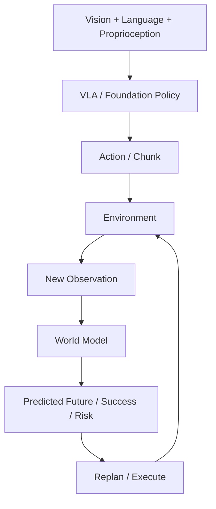

# P4 — Embodied Foundation Models: VLA & World Models

CPU-first educational and experimental playground for understanding VLA systems,
robot foundation policies, action representations, world models, and embodied decision-making.
Project-driven · experiment-backed · interview-explainable · hardware-aware.
本项目学习 foundation-model 层，不声称训练了大型 foundation model。

`mujoco-robotics-playground` 提供 P0–P3 传统机器人与 Robot Learning 基础；
本仓库独立，通过 versioned dataset / file contract 连接，不导入旧仓库模块。
不重复 MuJoCo、运动学、规划、ROS2、接触控制、BC / ACT / Diffusion 基础。



以上是最终能力链；当前只实现数据契约。

| Stage | 主线 | 状态 |
|---|---|---|
| 0 | Embodied AI Data & Action Representation | S0.1 Engineering Complete |
| 1 | Tiny Vision-Language-Action Policy | Planned |
| 2 | Modern VLA Architecture Study | Planned |
| 3 | Robot World Models | Planned |
| 4 | VLA × World Model Integration | Planned |

Current Task = **S0.1 — VLA Data Contract**
Next Task = **S0.2 — Episode / Sequence Dataset**（等待用户明确选择）

S0.1 Engineering:
- [x] Code — toy episode、NPZ + JSON、validator
- [x] Experiment — CPU round-trip / alignment / rejection checks
- [x] Docs — contract 与 learning package

S0.1 Learning:
- [ ] Run
- [ ] Modify
- [ ] Explain

Engineering Complete；Learning 尚未 Mastered。Sprint Learning Mode：Codex 完成当前任务工程包，用户 Run → Modify → Explain，然后决定是否进入下一任务。

## Run S0.1

Python 3.11+；建议未来 ML 任务使用 3.11/3.12。已有本地 `.venv` 可直接使用。
首次设置（选择支持 venv 的 Python，不向 base/system 安装）：

```bash
python -m venv .venv
.venv/bin/python -m pip install -r requirements.txt
.venv/bin/python scripts/s0_1_data_contract.py
```

默认输出 `tmp/s0_1/`，已有输出不会覆盖；再次运行请选新目录：

```bash
.venv/bin/python scripts/s0_1_data_contract.py --output tmp/my_s0_1
```

阅读 [S0.1 learning package](docs/vla/s0_1_data_contract.md)、[data contract](docs/data_contract.md)、[roadmap](docs/roadmap.md)、[handoff](docs/project_handoff.md)、[data policy](data/README.md)。

## Scope and layout

当前依赖只有 NumPy。后续需要时才添加 CPU PyTorch / Matplotlib。
32×32 / 64×64 图像、小模型、小数据、低维状态与小规模闭环是默认预算。
完整版模型在 docs 中学习论文、代码与 tensor trace，再设计 Tiny / CPU Learning Version。
当前非目标：7B VLA 训练、full OpenVLA / π0 复现或 fine-tuning、大规模 LoRA、TB 数据、
大型视频生成、humanoid foundation model、多 GPU、Isaac Sim/Lab、LLM Agent framework 堆叠。

`docs/` 学习包与交接；`data/` 文件边界与未来 adapters；`environments/manipulation/` 环境；
`vla/` Tiny VLA、动作表示、架构追踪；`world_models/` state/latent dynamics 与 planning；
`benchmarks/` 评价；`scripts/` 当前实验。空目录是骨架，不代表已实现。
