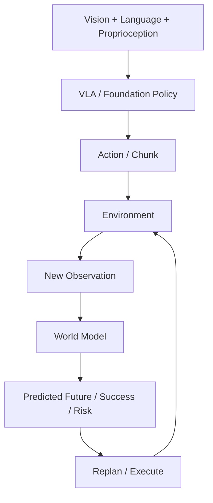

# P4 — Embodied Foundation Models: VLA & World Models

CPU-first educational and experimental playground for understanding VLA systems,
robot foundation policies, action representations, world models, and embodied decision-making.
Project-driven · experiment-backed · interview-explainable · hardware-aware.
本项目学习 foundation-model 层，不声称训练了大型 foundation model。

`mujoco-robotics-playground` 提供 P0–P3 传统机器人与 Robot Learning 基础；
本仓库独立，通过 versioned dataset / file contract 连接，不导入旧仓库模块。
不重复 MuJoCo、运动学、规划、ROS2、接触控制、BC / ACT / Diffusion 基础。



以上是最终能力链；当前完成Stage0及S1.1–S1.7工程包：数据契约、sequence dataset、RLDS/OXE概念与真实样本检查、continuous/discrete action与RGB-language chunk toy实验。已实现literal语言条件state MLP、tiny learned word embedding、tiny CNN定位和summary多模态融合对照；已实现tiny averaged-patch Transformer action chunk，但当前闭环失败；另完成独立tiny语言泛化诊断与冻结checkpoint闭环评价；现新增S3.1单步state dynamics MLP，仅合成XY验证，不代表真实机器人world model。

| Stage | 主线 | 状态 |
|---|---|---|
| 0 | Embodied AI Data & Action Representation | S0.1–S0.7 Engineering Complete + Learning Mastered |
| 1 | Tiny Vision-Language-Action Policy | S1.1–S1.7 Engineering Complete + Learning Mastered；VLA控制仍失败 |
| 2 | Modern VLA Architecture Study | S2.1–S2.7 Engineering Complete + Learning Mastered |
| 3 | Robot World Models | S3.1 Engineering Complete；Learning待用户核验 |
| 4 | VLA × World Model Integration | Planned |

Current Task = **S3.1 — State Dynamics**
Next Task = **S3.2 — Multi-step Rollout**（仅计划）

S0.1 Engineering:
- [x] Code — toy episode、NPZ + JSON、validator
- [x] Experiment — CPU round-trip / alignment / rejection checks
- [x] Docs — contract 与 learning package

S0.1 Learning:
- [x] Run
- [x] Modify
- [x] Explain

Engineering Complete + Learning Mastered（2026-10-13 用户确认实验、预测及五项 Explain）。Sprint Learning Mode：Codex 完成当前任务工程包，用户 Run → Modify → Explain，然后决定是否进入下一任务。

## S3.1 status and Run

Engineering:

- [x] Code — 226参数NumPy residual MLP、显式梯度/Adam、train-only统计
- [x] Experiment — 完整episode held-out、两个基线、2000/20步、checkpoint重载与单步latency
- [x] Docs — [S3.1学习包](docs/vla/s3_1_state_dynamics.md)

Learning:

- [ ] Run
- [ ] Modify
- [ ] Explain

CPU .venv Python3.12.3 / NumPy2.5.4，无安装或下载。先读Problem→Mathematics，再运行：

```bash
OPENBLAS_NUM_THREADS=1 .venv/bin/python scripts/s3_1_state_dynamics.py --output tmp/my_s3_1
# 先预测训练步数的影响：
OPENBLAS_NUM_THREADS=1 .venv/bin/python scripts/s3_1_state_dynamics.py --epochs 20 --output tmp/my_s3_1_short
```

40条合成XY episode；train600 / validation200转移。动作是commanded world displacement[m]，
实际位移由位置相关gain/串扰决定。held-out单步RMSE：不动17.287mm、理想加法6.849mm、
MLP2000步0.138mm、20步3.096mm。查看contract.json、report.json与validation_predictions.npz。
仅同分布单步证据，无多步稳定、真实机器人或闭环success声明。
Engineering Complete；学习三项需用户明确报告，助手执行不计掌握。S3.2仅计划。

## S2.7 status and Run

Engineering:

- [x] Code — 显式AR / flow expert / small diffusion head假设成本计算
- [x] Experiment — E1/4预算不变量、K10/20单路径变化及非法输入检查
- [x] Docs — [S2.7学习包](docs/vla/s2_7_vla_architecture_comparison.md)：五策略版本、模态、融合、动作、训练、适配与评价统一对照

Learning:

- [x] Run
- [x] Modify
- [x] Explain

repo .venv Python3.12.3，纯标准库，无安装/模型/dataset下载。所有ms为人为假设，非真实模型测速。
先读学习包对照表和成本公式，第二条先预测E对latency与预算的不同影响：

```bash
.venv/bin/python scripts/s2_7_architecture_budget.py --output tmp/my_s2_7
.venv/bin/python scripts/s2_7_architecture_budget.py --execute 4 --output tmp/my_s2_7_e4
```

查看report.json / budget.md：四条假设latency保持185/85/85/55ms，E1→4预算100→400ms。
scalar chunk AR为H4假设，原版OpenVLA仍H1。计算结果不代表真实模型排名或闭环成功。
Engineering Complete + Learning Mastered（2026-10-19 用户确认实验、预测及五项Explain）。Stage2全部工程与学习完成；S3.1仅计划。

## S2.6 status and Run

Engineering:

- [x] Code — state digitize、hybrid隔离mask与adaptive RMS教学探针
- [x] Experiment — 1mm/20mm状态扰动、两层泄漏反例、零初始化与非零modulation
- [x] Docs — [S2.6学习包](docs/vla/s2_6_pi05_study.md)、[来源manifest](docs/vla/s2_6_pi05_sources.json)

Learning:

- [x] Run
- [x] Modify
- [x] Explain

CPU NumPy，实测Python3.12.3 / NumPy2.5.4，无安装或模型/dataset下载。
先读学习包Problem→Architecture；第二条先预测delta变化：

```bash
.venv/bin/python scripts/s2_6_pi05_conditions.py --output tmp/my_s2_6
.venv/bin/python scripts/s2_6_pi05_conditions.py --delta .02 --output tmp/my_s2_6_delta20
```

检查report.json / trace.npz：changed bins [128,128]→[130,128]，正确mask隔离差0，错误mask泄漏67.5。
区分论文异构训练/层级推理、开源pi05 state/time条件与无训练本地probe；不证明机器人泛化。
Engineering Complete + Learning Mastered（2026-10-19 用户确认实验、预测及五项Explain）。S2.7仅计划。

## S2.5 status and Run

Engineering:

- [x] Code — 不同宽度expert的共同attention、prefix cache与flow Euler数学实验
- [x] Experiment — full/cache等价、state/action信息边界、K10/20及oracle/偏置/解析ODE
- [x] Docs — [S2.5学习包](docs/vla/s2_5_pi0_architecture_trace.md)、[来源manifest](docs/vla/s2_5_pi0_sources.json)

Learning:

- [x] Run
- [x] Modify
- [x] Explain

CPU NumPy，Python3.14.7 / NumPy2.5.4，无新依赖、模型或dataset下载；不训练π0。
先读paper/code flow时间方向差别；第二条先预测K与物理时间的区别：

```bash
.venv/bin/python scripts/s2_5_pi0_flow_trace.py --output tmp/my_s2_5
.venv/bin/python scripts/s2_5_pi0_flow_trace.py --steps 20 --output tmp/my_s2_5_k20
```

trace.npz记录mask/cache与独立手写场积分。代码noise t1→action t0，Δt_flow为负；state在原版suffix。
K增加不改H/A/robot dt；解析ODE数值误差下降，偏置场误差不消失，不证明learned控制能力。
Engineering Complete + Learning Mastered（2026-10-18 用户确认实验、预测及五项Explain）；S2.6仅计划。

## S2.4 status and Run

Engineering:

- [x] Code — 显式NumPy时间DCT、量化、train-only整数pair BPE与逆变换
- [x] Experiment — smooth/rough heldout、scalar bins对照、scale10/20、六类拒绝与重载
- [x] Docs — [S2.4学习包](docs/vla/s2_4_fast_action_representation.md)、[固定来源manifest](docs/vla/s2_4_fast_sources.json)

Learning:

- [x] Run
- [x] Modify
- [x] Explain

CPU NumPy，Python3.14.7 / NumPy2.5.4；无安装、真实dataset或模型/发布字典下载。
本地整数BPE是教学版，不是官方byte-level FAST+；没有VLA策略训练或控制。
第二条先预测scale对系数、字典、token数与误差界的影响：

```bash
.venv/bin/python scripts/s2_4_fast_tokenization.py --output tmp/my_s2_4
.venv/bin/python scripts/s2_4_fast_tokenization.py --scale 20 --output tmp/my_s2_4_s20
```

看report/tokenizer.json/trace.npz：smooth tokens2→6而RMSE不变；rough两次32tokens，保留失败case。
BPE对量化整数无损，不代表物理动作无损或robot success。
Engineering Complete + Learning Mastered（2026-10-18 用户确认实验、预测及五项Explain）。
S2.5仅计划，不自动进入。

## S2.3 status and Run

Engineering:

- [x] Code — 双分支proxy融合/BOS插入/causal标签shift、原版codec代数与统计选择
- [x] Experiment — compact/wide、端点/非法ID、隔离官方codec等价、NPZ重载
- [x] Docs — [S2.3学习包](docs/vla/s2_3_openvla_architecture_trace.md)、[来源manifest](docs/vla/s2_3_openvla_sources.json)

Learning:

- [x] Run
- [x] Modify
- [x] Explain

CPU NumPy，Python3.14.7 / NumPy2.5.4；无安装、真实dataset或weights下载，不运行7B模型。
先读学习包的原版/固定实现/教学代理边界，第二条先预测统计变化：

```bash
.venv/bin/python scripts/s2_3_openvla_trace.py --output tmp/my_s2_3
.venv/bin/python scripts/s2_3_openvla_trace.py --unnorm-key wide --output tmp/my_s2_3_wide
```

原版默认image+text，无直接proprio输入；unnorm_key选择统计及动作维数，不是state token。
本地IDs/normalized与trace数组不变，selected物理XY命令变2倍；没有训练或生成动作能力声明。
Engineering Complete + Learning Mastered（2026-10-18 用户确认实验、预测及五项Explain）；S2.4仅计划。

## S2.2 status and Run

Engineering:

- [x] Code — NumPy block mask/readout、missing payload隔离、head shape与扩散正向代数
- [x] Experiment — present/missing、未来/只读反事实、NaN边界、八类checks与NPZ重载
- [x] Docs — [S2.2学习包](docs/vla/s2_2_octo_study.md)，原版论文与固定Octo源码trace

Learning:

- [x] Run
- [x] Modify
- [x] Explain

CPU NumPy，Python3.14.7 / NumPy2.5.4；无安装、dataset或weights下载，无训练策略。
先读学习包；第二条先预测selected模式、mask/readout和不变量：

```bash
.venv/bin/python scripts/s2_2_octo_trace.py --output tmp/my_s2_2
.venv/bin/python scripts/s2_2_octo_trace.py --wrist missing --output tmp/my_s2_2_missing
```

trace.npz包含两条件mask/attention/embeddings和独立扩散fixture；flag只选择report.selected。
7槽shape不变，valid7→5、allowed edges28→14；head shape与oracle噪声恢复不证明适配/生成能力。
Engineering Complete + Learning Mastered（2026-10-18 用户确认实验、预测及五项Explain）；S2.3仅计划。

## S2.1 status and Run

Engineering:

- [x] Code — 复用train-only joint codec，对照channel IDs/数字字段与词表限制
- [x] Experiment — B256/B16、半bin界、6类拒绝、NPZ round-trip
- [x] Docs — [S2.1学习包](docs/vla/s2_1_rt_overview.md)，原版论文与固定RT-1源码对照

Learning:

- [x] Run
- [x] Modify
- [x] Explain

CPU NumPy，Python3.14.7 / NumPy2.5.4；无安装、dataset或weights下载。不训练RT模型。
先读学习包Problem→Architecture，再运行；第二条先预测bins变化：

```bash
.venv/bin/python scripts/s2_1_rt_overview.py --output tmp/my_s2_1
.venv/bin/python scripts/s2_1_rt_overview.py --bins 16 --output tmp/my_s2_1_b16
```

查看report.json/codec.npz：格式转换不证明语义迁移，合法token不证明robot success。
Engineering Complete + Learning Mastered（2026-10-18 用户确认实验、预测及五项Explain）；S2.2仅计划。

## S1.7 status and Run

Engineering:

- [x] Code — 冻结checkpoint/hash/协议、visited-state动作误差、分阶段latency、raw与拒绝记录
- [x] Experiment — 四条件各16attempts，learned/oracle/zero，同源E1/E3，完整失败与source回归审计
- [x] Docs — [S1.7学习包](docs/vla/s1_7_closed_loop_vla_rollout.md)

Learning:

- [x] Run
- [x] Modify
- [x] Explain

CPU NumPy，无训练/安装/下载；Python3.14.7 / NumPy2.5.4。需要已有S1.5 checkpoint，默认tmp/s1_5_final；
可用`--checkpoint tmp/my_s1_5`指定自己已完成的目录，缺失不会自动重训。

```bash
.venv/bin/python scripts/s1_7_closed_loop_evaluation.py --output tmp/my_s1_7
.venv/bin/python scripts/s1_7_closed_loop_evaluation.py --execute 3 --output tmp/my_s1_7_e3
```

第二条先预测hash/offline/attempts不变量及prefix/feedback/visited error变化。
Learned nominal/disturbed/shifted_start均0/16，unsupported为拒绝0/16；oracle四组16/16（特权目标参照）。
Offline executed MSE≈.000564m²，nominal visited MSE≈.00453m²，状态与动作槽不同，不能当同一loss直接相减。
查看source_evidence.json、protocol.json、summary.csv与完整report/raw episodes；Stage1工程包完成，控制能力仍未达标。
Engineering Complete + Learning Mastered（2026-10-18 用户确认实验、预测及五项 Explain）。
Stage1工程与学习包全部完成，VLA控制仍失败；当前任务状态见上方S2.1。

## S1.6 status and Run

Engineering:

- [x] Code — 42参数text goal selector、train-only词表、整句查表对照与独立phrase split
- [x] Experiment — 已知词重组/OOV词类/颜色别名/语序碰撞、分类与oracle控制器桥接分开评价
- [x] Docs — [S1.6学习包](docs/vla/s1_6_language_generalization.md)

Learning:

- [x] Run
- [x] Modify
- [x] Explain

CPU NumPy，无安装/下载；Python3.14.7 / NumPy2.5.4。单独训练语言classifier，不修改S1.5失败模型。
先读学习包的oracle bridge边界，第二条先预测OOV策略变化：

```bash
.venv/bin/python scripts/s1_6_language_generalization.py --output tmp/my_s1_6
.venv/bin/python scripts/s1_6_language_generalization.py --unk-policy map --output tmp/my_s1_6_map
```

已知词新组合4/4；默认未知词拒绝；map下未知verb/noun4/4、未知颜色2/4、语序1/2。
这可由已知颜色捷径与表示碰撞解释，不是通用语言理解。oracle位置+固定控制器桥接不代表learned VLA成功，S1.5仍0/16。
查看probe_manifest.json、tokenizer、report分类/失败stage与text_diagnostics.npz；Engineering Complete + Learning Mastered（2026-10-18 用户确认实验、预测及五项 Explain）；S1.7仅计划。

## S1.5 status and Run

Engineering:

- [x] Code — 16image patches + 3learned word + proprio token → 2454参数Transformer → H3实际delta
- [x] Experiment — raw/group/windows/masks、全参数梯度、零动作与oracle对照、E1/E3完整失败rollout
- [x] Docs — [S1.5学习包](docs/vla/s1_5_tiny_transformer_vla.md)

Learning:

- [x] Run
- [x] Modify
- [x] Explain

CPU NumPy，无安装/下载；Python3.14.7 / NumPy2.5.4。固定平均patch和2D网格，训练image/text/state投影与Transformer。
**工程链路完成，模型未学会控制**：seed7 nominal/disturbed均0/16，oracle均16/16，验证loss仅略优于零动作基线。
先读学习包，再运行；第二条先预测H固定、E变化：

```bash
.venv/bin/python scripts/s1_5_tiny_transformer_vla.py --output tmp/my_s1_5
.venv/bin/python scripts/s1_5_tiny_transformer_vla.py --execute 3 --output tmp/my_s1_5_e3
```

E1→3保持data/weights/offline loss不变，calls8→3、反馈.1→.3s，error/trace变化但本次仍0/16。
查看report.json、raw episodes、train/validation_chunks.npz和attention_probe.npz；完整失败是学习材料。
Engineering Complete（闭环失败）+ Learning Mastered（2026-10-18 用户确认实验、预测及五项 Explain）；S1.6仅计划。

## S1.4 status and Run

Engineering:

- [x] Code — 冻结CNN红蓝位置summary + literal条件 + 当前XY，concat与单block pre-LN Transformer
- [x] Experiment — 全参数梯度核验、scene held-out、三模态消融、扰动及两种参考控制器
- [x] Docs — [S1.4学习包](docs/vla/s1_4_multimodal_fusion.md)

Learning:

- [x] Run
- [x] Modify
- [x] Explain

CPU NumPy，无安装/下载；Python3.14.7 / NumPy2.5.4。视觉含固定R/B channel-swap先验，语言固定two-class one-hot。
先读学习包的输入契约与proposal/executed区别，再运行；第二条先预测实际外扰的影响：

```bash
.venv/bin/python scripts/s1_4_multimodal_fusion.py --output tmp/my_s1_4
.venv/bin/python scripts/s1_4_multimodal_fusion.py --kick-x .12 --output tmp/my_s1_4_kick
```

最终float32、seed7：concat610参数/Transformer618参数，full toy成功44/48与8/48，三种模态置零均0/48。
同样结果不代表架构优劣；oracle与冻结视觉+手写颜色选择均48/48，失败/error/trace完整保存。
第4次转移后的+.12m实际world x扰动不改权重或offline loss，本次full成功数不变；看trace核对反馈。
查看report.json、*_fusion.npz、attention_probe.npz和scenes.png。Engineering Complete + Learning Mastered（2026-10-17 用户确认实验、预测及五项 Explain）；S1.5仅计划。

## S1.3 status and Run

Engineering:

- [x] Code — 116参数NumPy CNN、15×15×4空间features、heatmap与显式pixel/world映射
- [x] Experiment — 未见目标中心定位、GAP/颜色probe、oracle与visible/occluded/blank完整闭环
- [x] Docs — [S1.3学习包](docs/vla/s1_3_tiny_visual_encoder.md)

Learning:

- [x] Run
- [x] Modify
- [x] Explain

CPU NumPy，无安装/下载；Python3.14.7 / NumPy2.5.4。PNG使用标准库，不依赖当前缺失的Pillow。
先读学习包，再运行；第二条先预测主条件切换的不变量和失败：

```bash
.venv/bin/python scripts/s1_3_visual_encoder.py --output tmp/my_s1_3
.venv/bin/python scripts/s1_3_visual_encoder.py --observation occluded --output tmp/my_s1_3_occluded
```

每次都保存三条件对照，flag只选主报告条件，不改变训练。validation24个未见中心，visible平均定位误差.000309m，
toy闭环24/24；occluded/blank均0/24。查看preview.png（三列RGB/相对热图/遮红）、features与report。
只证明固定颜色格点renderer的CNN定位+固定控制器；不是learned VLA或真实视觉精度。Engineering Complete + Learning Mastered（2026-10-17 用户确认实验、预测及五项 Explain）；S1.4仅计划。

## S1.2 status and Run

Engineering:

- [x] Code — train-only tokenizer、4维learned embedding、masked mean、310参数state policy
- [x] Experiment — embedding反向核验、PAD/UNK/词序诊断、held-out闭环与完整OOV失败
- [x] Docs — [S1.2学习包](docs/vla/s1_2_tiny_language_representation.md)

Learning:

- [x] Run
- [x] Modify
- [x] Explain

CPU NumPy，无安装/下载；repo .venv Python3.14.7 / NumPy2.5.4。
先读学习包Problem→Mathematics，第二条先预测reject→map的影响：

```bash
.venv/bin/python scripts/s1_2_language_representation.py --output tmp/my_s1_2
.venv/bin/python scripts/s1_2_language_representation.py --unk-policy map --output tmp/my_s1_2_map
```

两模式权重和known结果一致：validation raw MSE≈1.607e−6m²、toy success12/12。
OOV两模式均0/24：默认全部tokenization拒绝，map则全部在10步终点失败。
查看tokenizer.json、report diagnostics及train/validation_tokens.npz；PAD不计入mean，零UNK仍计入。
仅固定两指令toy证据，不是自然语言泛化。Engineering Complete + Learning Mastered（2026-10-17 用户确认实验、预测及五项 Explain）；S1.3仅计划。

## S1.1 status and Run

Engineering:

- [x] Code — 226参数NumPy MLP、手写反向/Adam、literal one-hot与无语言基线
- [x] Experiment — reset-group held-out、梯度核验、物理MSE、完整闭环/失败/延迟
- [x] Docs — [S1.1学习包](docs/vla/s1_1_language_conditioned_state_policy.md)

Learning:

- [x] Run
- [x] Modify
- [x] Explain

CPU，无新依赖或下载；实测repo .venv Python3.14.7 / NumPy2.5.4。
先读学习包Problem→Mathematics，再运行；第二条先预测训练步数的影响：

```bash
.venv/bin/python scripts/s1_1_language_state_policy.py --output tmp/my_s1_1
.venv/bin/python scripts/s1_1_language_state_policy.py --epochs 20 --output tmp/my_s1_1_short
```

默认含语言/无语言validation raw MSE≈1.349e−6/4.669e−4 m²，toy闭环12/12与6/12；
20步为3/12与1/12。只证明固定literal两目标的理想点任务，不是视觉语言泛化。
Engineering Complete + Learning Mastered（2026-10-17 用户确认实验、预测及五项 Explain）。
当前S1.1已掌握；S1.2仅计划，等待用户选择。

## S0.7 status and Run

Engineering:

- [x] Code — causal state + anchor RGB + language → rule chunks、S0.2 mask/index audit、execution prefix
- [x] Experiment — paired language、future/result isolation、12 rejection cases、H/E与扰动闭环toy比较
- [x] Docs — [S0.7 learning package](docs/vla/s0_7_action_chunk_representation.md)、context preview与完整失败记录

Learning:

- [x] Run
- [x] Modify
- [x] Explain

Engineering Complete + Learning Mastered（2026-10-14 用户确认实验、预测及五项 Explain）。已有NumPy/Pillow，无安装或下载。
6 synthetic point episodes，32×32 RGB、world delta[m]、10Hz；手写规则，不是learned VLA。
output必须为新目录；先预测H4固定、E1→4的变化，再运行第二条：

```bash
.venv/bin/python scripts/s0_7_action_chunk.py --output tmp/my_s0_7
.venv/bin/python scripts/s0_7_action_chunk.py --execute 4 --output tmp/my_s0_7_e4
```

查看context_preview.png、report.json及train/validation_chunks.npz；train16/validation8 anchors、42/20 valid tokens。
离线masked MSE均0，nominal toy均2/2；固定扰动E1为1/2、E4为0/2，完整失败保留。
H是未来输出长度，E是执行前缀；mask不传入planner。Stage0 Engineering Complete + Learning Mastered，等待用户选择S1.1。

## S0.6 status and Run

Engineering:

- [x] Code — train-range scalar bins / channel IDs / center decode / explicit saturation
- [x] Experiment — B8→16、boundary/half-bin oracle、16 rejection cases、physical error与toy replay
- [x] Docs — [S0.6 learning package](docs/vla/s0_6_discrete_action_tokenization.md)、codec与raw语义边界

Learning:

- [x] Run
- [x] Modify
- [x] Explain

Engineering Complete + Learning Mastered（2026-10-14 用户确认实验、预测及五项 Explain）。已有NumPy，无安装或下载。
复用S0.5已知joint_absolute toy；range只fit12条原始train actions；decode有损，held-out saturation显式报告。
output必须为新目录；第二条先预测B8→16再运行：

```bash
.venv/bin/python scripts/s0_6_action_tokenization.py --output tmp/my_s0_6
.venv/bin/python scripts/s0_6_action_tokenization.py --bins 16 --output tmp/my_s0_6_b16
```

查看tokenizer.json、tokens.npz与report.json。词表16→32，每episode仍8IDs；half-bin界减半，held-out仍5/8饱和。
toy replay以原reference为目标，不能把低重建误差叫真实robot success；未训练模型或复现大型tokenizer。
完成Run/Modify/五项Explain后等待选择S0.7。

## S0.5 status and Run

Engineering:

- [x] Code — joint absolute / two delta anchors / Cartesian views、train-only normalizers、S0.2 chunks
- [x] Experiment — correct decode/replay、gain .5→1、frame/embodiment/leakage、11 rejection cases、H1/H6
- [x] Docs — [S0.5 learning package](docs/vla/s0_5_continuous_action_representation.md)、physical/raw与derived语义

Learning:

- [x] Run
- [x] Modify
- [x] Explain

Engineering Complete + Learning Mastered（2026-10-14 用户确认实验、预测及五项 Explain）。只使用已有NumPy，无下载或安装。
四条手写servo toy episodes（train3 / validation1），不是Bridge转换或learned policy。
output必须为新目录；先预测gain变化，再运行第二条：

```bash
.venv/bin/python scripts/s0_5_action_representation.py --output tmp/my_s0_5
.venv/bin/python scripts/s0_5_action_representation.py --gain 1 --output tmp/my_s0_5_gain1
```

查看report.json、raw episodes、representations.npz、normalizers.json和train_chunks.npz。
gain=.5时reference≠下一测量，两种delta须分别解码；normalization只fit原始train actions，padding不参与。
Cartesian views仅为XY目标，无IK/controller执行转换。完成Run/Modify/五项Explain后等待选择S0.6。

## S0.4 status and Run

Engineering:

- [x] Code — pinned bounded download、Parquet/schema audit、CPU video decode、HTML/PNG/report
- [x] Experiment — real episode0、28 rows/frames、clock/PTS、8 rejection cases、preview stride invariance
- [x] Docs — [S0.4 learning package](docs/vla/s0_4_real_robot_dataset_inspection.md)、manifest与契约差异

Learning:

- [x] Run
- [x] Modify
- [x] Explain

Engineering Complete + Learning Mastered（2026-10-14 用户确认实验、预测及五项 Explain）。
首次下载四文件共1,923,948bytes（约1.93MB）：社区BridgeData V2 LeRobot转存的一条episode、
单相机视频和schema/task索引；不是原始RLDS。NumPy/PyArrow/av/Pillow，CPU；不下载全集或模型。
本机隔离环境现为Python3.12.3；输出目录必须不存在：

```bash
.venv/bin/python scripts/s0_4_inspect_robot_sample.py --download --output tmp/my_s0_4
.venv/bin/python scripts/s0_4_inspect_robot_sample.py --preview-stride 14 --output tmp/my_s0_4_stride14
```

打开`tmp/my_s0_4/inspection.html`或PNG/report.json；第二条运行前预测5→3预览帧及raw/time/shape是否改变。
现有source只核验不覆盖；无`--download`时离线。缺终点/边界/success与控制语义证据，拒绝训练契约导出。
完成Run/Modify/五项Explain后等待选择S0.5。

## S0.3 status and Run

Engineering:

- [x] Code — explicit synthetic loaded-RLDS adapter / local contract validation
- [x] Experiment — last action invalid、terminal/truncated、independent success、10 rejection cases
- [x] Docs — [S0.3 learning package](docs/vla/s0_3_rlds_oxe_concepts.md)、two official catalog schema notes

Learning:

- [x] Run
- [x] Modify
- [x] Explain

Engineering Complete + Learning Mastered（2026-10-14 用户确认实验、预测及五项 Explain）。
只使用已有NumPy；没有TensorFlow/TFDS/RLDS安装或真实数据下载。输出目录必须不存在：

```bash
.venv/bin/python scripts/s0_3_rlds_concepts.py --output tmp/my_s0_3
.venv/bin/python scripts/s0_3_rlds_concepts.py --ending truncated --output tmp/my_s0_3_truncated
```

Run后看source四steps与本地三actions；Modify前预测boundary/success/shape变化；Explain回答学习包五问。
本例是合成概念验证，未声称完整OXE转换或真实机器人能力。完成后等待选择S0.4。

## S0.2 status and Run

Engineering:

- [x] Code — file-backed episodes、group split、causal windows、padding/masks
- [x] Experiment — source alignment、masked loss、boundary/leakage counterexamples
- [x] Docs — [S0.2 learning package](docs/vla/s0_2_sequence_dataset.md)

Learning:

- [x] Run
- [x] Modify
- [x] Explain

Engineering Complete + Learning Mastered（2026-10-14 用户确认实验、预测及五项 Explain）。
只需要已有 NumPy，不增加依赖。仓库根目录执行，输出目录须不存在：

```bash
.venv/bin/python scripts/s0_2_sequence_dataset.py --output tmp/my_s0_2
.venv/bin/python scripts/s0_2_sequence_dataset.py --horizon 2 --output tmp/my_s0_2_h2
```

第一条为 Run；第二条在预测 horizon 变化后做 Modify。阅读学习包回答五项 Explain。
完成后等待用户选择下一任务。

## Run S0.1

Python 3.11+；建议未来 ML 任务使用 3.11/3.12。已有本地 `.venv` 可直接使用。
首次设置（选择支持 venv 的 Python，不向 base/system 安装）：

```bash
python -m venv .venv
.venv/bin/python -m pip install -r requirements.txt
.venv/bin/python scripts/s0_1_data_contract.py
```

默认输出 `tmp/s0_1/`，已有输出不会覆盖；再次运行请选新目录：

```bash
.venv/bin/python scripts/s0_1_data_contract.py --output tmp/my_s0_1
```

阅读 [S0.1 learning package](docs/vla/s0_1_data_contract.md)、[data contract](docs/data_contract.md)、[roadmap](docs/roadmap.md)、[handoff](docs/project_handoff.md)、[data policy](data/README.md)。

## Scope and layout

当前依赖为NumPy与S0.4读取/预览所需PyArrow、av、Pillow。后续需要时才添加CPU PyTorch / Matplotlib。
32×32 / 64×64 图像、小模型、小数据、低维状态与小规模闭环是默认预算。
完整版模型在 docs 中学习论文、代码与 tensor trace，再设计 Tiny / CPU Learning Version。
当前非目标：7B VLA 训练、full OpenVLA / π0 复现或 fine-tuning、大规模 LoRA、TB 数据、
大型视频生成、humanoid foundation model、多 GPU、Isaac Sim/Lab、LLM Agent framework 堆叠。

`docs/` 学习包与交接；`data/` 文件边界与未来 adapters；`environments/manipulation/` 环境；
`vla/` Tiny VLA、动作表示、架构追踪；`world_models/` state/latent dynamics 与 planning；
`benchmarks/` 评价；`scripts/` 当前实验。空目录是骨架，不代表已实现。
