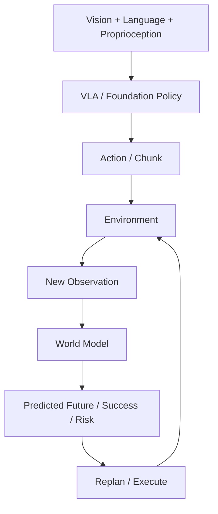

# P4 — Embodied Foundation Models: VLA & World Models

CPU-first educational and experimental playground for understanding VLA systems,
robot foundation policies, action representations, world models, and embodied decision-making.
Project-driven · experiment-backed · interview-explainable · hardware-aware.
本项目学习 foundation-model 层，不声称训练了大型 foundation model。

`mujoco-robotics-playground` 提供 P0–P3 传统机器人与 Robot Learning 基础；
本仓库独立，通过 versioned dataset / file contract 连接，不导入旧仓库模块。
不重复 MuJoCo、运动学、规划、ROS2、接触控制、BC / ACT / Diffusion 基础。



以上是最终能力链；当前完成Stage0工程包：数据契约、sequence dataset、RLDS/OXE概念与真实样本检查、continuous/discrete action与RGB-language chunk toy实验。未实现learned VLA或world model。

| Stage | 主线 | 状态 |
|---|---|---|
| 0 | Embodied AI Data & Action Representation | S0.1–S0.6 Mastered；S0.7 Engineering Complete |
| 1 | Tiny Vision-Language-Action Policy | Planned |
| 2 | Modern VLA Architecture Study | Planned |
| 3 | Robot World Models | Planned |
| 4 | VLA × World Model Integration | Planned |

Current Task = **S0.7 — Action Chunk Representation**
Next Task = **S1.1 — Language-conditioned State Policy**（等待用户明确选择）

S0.1 Engineering:
- [x] Code — toy episode、NPZ + JSON、validator
- [x] Experiment — CPU round-trip / alignment / rejection checks
- [x] Docs — contract 与 learning package

S0.1 Learning:
- [x] Run
- [x] Modify
- [x] Explain

Engineering Complete + Learning Mastered（2026-10-13 用户确认实验、预测及五项 Explain）。Sprint Learning Mode：Codex 完成当前任务工程包，用户 Run → Modify → Explain，然后决定是否进入下一任务。

## S0.7 status and Run

Engineering:

- [x] Code — causal state + anchor RGB + language → rule chunks、S0.2 mask/index audit、execution prefix
- [x] Experiment — paired language、future/result isolation、12 rejection cases、H/E与扰动闭环toy比较
- [x] Docs — [S0.7 learning package](docs/vla/s0_7_action_chunk_representation.md)、context preview与完整失败记录

Learning:

- [ ] Run
- [ ] Modify
- [ ] Explain

Engineering Complete（2026-10-14）；Learning待用户确认。已有NumPy/Pillow，无安装或下载。
6 synthetic point episodes，32×32 RGB、world delta[m]、10Hz；手写规则，不是learned VLA。
output必须为新目录；先预测H4固定、E1→4的变化，再运行第二条：

```bash
.venv/bin/python scripts/s0_7_action_chunk.py --output tmp/my_s0_7
.venv/bin/python scripts/s0_7_action_chunk.py --execute 4 --output tmp/my_s0_7_e4
```

查看context_preview.png、report.json及train/validation_chunks.npz；train16/validation8 anchors、42/20 valid tokens。
离线masked MSE均0，nominal toy均2/2；固定扰动E1为1/2、E4为0/2，完整失败保留。
H是未来输出长度，E是执行前缀；mask不传入planner。Stage0工程完成，学习确认后等待选择S1.1。

## S0.6 status and Run

Engineering:

- [x] Code — train-range scalar bins / channel IDs / center decode / explicit saturation
- [x] Experiment — B8→16、boundary/half-bin oracle、16 rejection cases、physical error与toy replay
- [x] Docs — [S0.6 learning package](docs/vla/s0_6_discrete_action_tokenization.md)、codec与raw语义边界

Learning:

- [x] Run
- [x] Modify
- [x] Explain

Engineering Complete + Learning Mastered（2026-10-14 用户确认实验、预测及五项 Explain）。已有NumPy，无安装或下载。
复用S0.5已知joint_absolute toy；range只fit12条原始train actions；decode有损，held-out saturation显式报告。
output必须为新目录；第二条先预测B8→16再运行：

```bash
.venv/bin/python scripts/s0_6_action_tokenization.py --output tmp/my_s0_6
.venv/bin/python scripts/s0_6_action_tokenization.py --bins 16 --output tmp/my_s0_6_b16
```

查看tokenizer.json、tokens.npz与report.json。词表16→32，每episode仍8IDs；half-bin界减半，held-out仍5/8饱和。
toy replay以原reference为目标，不能把低重建误差叫真实robot success；未训练模型或复现大型tokenizer。
完成Run/Modify/五项Explain后等待选择S0.7。

## S0.5 status and Run

Engineering:

- [x] Code — joint absolute / two delta anchors / Cartesian views、train-only normalizers、S0.2 chunks
- [x] Experiment — correct decode/replay、gain .5→1、frame/embodiment/leakage、11 rejection cases、H1/H6
- [x] Docs — [S0.5 learning package](docs/vla/s0_5_continuous_action_representation.md)、physical/raw与derived语义

Learning:

- [x] Run
- [x] Modify
- [x] Explain

Engineering Complete + Learning Mastered（2026-10-14 用户确认实验、预测及五项 Explain）。只使用已有NumPy，无下载或安装。
四条手写servo toy episodes（train3 / validation1），不是Bridge转换或learned policy。
output必须为新目录；先预测gain变化，再运行第二条：

```bash
.venv/bin/python scripts/s0_5_action_representation.py --output tmp/my_s0_5
.venv/bin/python scripts/s0_5_action_representation.py --gain 1 --output tmp/my_s0_5_gain1
```

查看report.json、raw episodes、representations.npz、normalizers.json和train_chunks.npz。
gain=.5时reference≠下一测量，两种delta须分别解码；normalization只fit原始train actions，padding不参与。
Cartesian views仅为XY目标，无IK/controller执行转换。完成Run/Modify/五项Explain后等待选择S0.6。

## S0.4 status and Run

Engineering:

- [x] Code — pinned bounded download、Parquet/schema audit、CPU video decode、HTML/PNG/report
- [x] Experiment — real episode0、28 rows/frames、clock/PTS、8 rejection cases、preview stride invariance
- [x] Docs — [S0.4 learning package](docs/vla/s0_4_real_robot_dataset_inspection.md)、manifest与契约差异

Learning:

- [x] Run
- [x] Modify
- [x] Explain

Engineering Complete + Learning Mastered（2026-10-14 用户确认实验、预测及五项 Explain）。
首次下载四文件共1,923,948bytes（约1.93MB）：社区BridgeData V2 LeRobot转存的一条episode、
单相机视频和schema/task索引；不是原始RLDS。NumPy/PyArrow/av/Pillow，CPU；不下载全集或模型。
本机隔离环境现为Python3.12.3；输出目录必须不存在：

```bash
.venv/bin/python scripts/s0_4_inspect_robot_sample.py --download --output tmp/my_s0_4
.venv/bin/python scripts/s0_4_inspect_robot_sample.py --preview-stride 14 --output tmp/my_s0_4_stride14
```

打开`tmp/my_s0_4/inspection.html`或PNG/report.json；第二条运行前预测5→3预览帧及raw/time/shape是否改变。
现有source只核验不覆盖；无`--download`时离线。缺终点/边界/success与控制语义证据，拒绝训练契约导出。
完成Run/Modify/五项Explain后等待选择S0.5。

## S0.3 status and Run

Engineering:

- [x] Code — explicit synthetic loaded-RLDS adapter / local contract validation
- [x] Experiment — last action invalid、terminal/truncated、independent success、10 rejection cases
- [x] Docs — [S0.3 learning package](docs/vla/s0_3_rlds_oxe_concepts.md)、two official catalog schema notes

Learning:

- [x] Run
- [x] Modify
- [x] Explain

Engineering Complete + Learning Mastered（2026-10-14 用户确认实验、预测及五项 Explain）。
只使用已有NumPy；没有TensorFlow/TFDS/RLDS安装或真实数据下载。输出目录必须不存在：

```bash
.venv/bin/python scripts/s0_3_rlds_concepts.py --output tmp/my_s0_3
.venv/bin/python scripts/s0_3_rlds_concepts.py --ending truncated --output tmp/my_s0_3_truncated
```

Run后看source四steps与本地三actions；Modify前预测boundary/success/shape变化；Explain回答学习包五问。
本例是合成概念验证，未声称完整OXE转换或真实机器人能力。完成后等待选择S0.4。

## S0.2 status and Run

Engineering:

- [x] Code — file-backed episodes、group split、causal windows、padding/masks
- [x] Experiment — source alignment、masked loss、boundary/leakage counterexamples
- [x] Docs — [S0.2 learning package](docs/vla/s0_2_sequence_dataset.md)

Learning:

- [x] Run
- [x] Modify
- [x] Explain

Engineering Complete + Learning Mastered（2026-10-14 用户确认实验、预测及五项 Explain）。
只需要已有 NumPy，不增加依赖。仓库根目录执行，输出目录须不存在：

```bash
.venv/bin/python scripts/s0_2_sequence_dataset.py --output tmp/my_s0_2
.venv/bin/python scripts/s0_2_sequence_dataset.py --horizon 2 --output tmp/my_s0_2_h2
```

第一条为 Run；第二条在预测 horizon 变化后做 Modify。阅读学习包回答五项 Explain。
完成后等待用户选择下一任务。

## Run S0.1

Python 3.11+；建议未来 ML 任务使用 3.11/3.12。已有本地 `.venv` 可直接使用。
首次设置（选择支持 venv 的 Python，不向 base/system 安装）：

```bash
python -m venv .venv
.venv/bin/python -m pip install -r requirements.txt
.venv/bin/python scripts/s0_1_data_contract.py
```

默认输出 `tmp/s0_1/`，已有输出不会覆盖；再次运行请选新目录：

```bash
.venv/bin/python scripts/s0_1_data_contract.py --output tmp/my_s0_1
```

阅读 [S0.1 learning package](docs/vla/s0_1_data_contract.md)、[data contract](docs/data_contract.md)、[roadmap](docs/roadmap.md)、[handoff](docs/project_handoff.md)、[data policy](data/README.md)。

## Scope and layout

当前依赖为NumPy与S0.4读取/预览所需PyArrow、av、Pillow。后续需要时才添加CPU PyTorch / Matplotlib。
32×32 / 64×64 图像、小模型、小数据、低维状态与小规模闭环是默认预算。
完整版模型在 docs 中学习论文、代码与 tensor trace，再设计 Tiny / CPU Learning Version。
当前非目标：7B VLA 训练、full OpenVLA / π0 复现或 fine-tuning、大规模 LoRA、TB 数据、
大型视频生成、humanoid foundation model、多 GPU、Isaac Sim/Lab、LLM Agent framework 堆叠。

`docs/` 学习包与交接；`data/` 文件边界与未来 adapters；`environments/manipulation/` 环境；
`vla/` Tiny VLA、动作表示、架构追踪；`world_models/` state/latent dynamics 与 planning；
`benchmarks/` 评价；`scripts/` 当前实验。空目录是骨架，不代表已实现。
