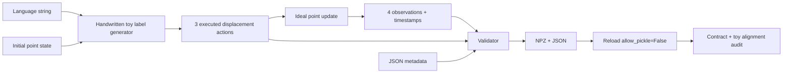

# S0.1 — VLA Data Contract

## Why

VLA 学习 `(observation_t, language) → action_t`。如果不知道 action 是目标位置还是位移，
不知道图像是执行前还是执行后，模型即使 loss 很小也可能学到错误问题。
本任务建立可检查的文件边界，为旧机器人经验与新 foundation-policy 研究提供共同语言。
Problem：用三个转移让数据语义可见；不训练网络，不构造 sequence dataset。

## Intuition

把 episode 看成录像的四帧和帧间的三条控制命令：
先看第一帧，执行一次“向右移动 1cm”，看到第二帧；重复三次。
语言是整个 episode 的目标说明，观测是当时实际测量，动作是帧间已执行命令。
终点还要拍一帧，但不能凭空增加终点动作。

## Input / Output Contract

详细 [versioned contract](../data_contract.md)。

| Item | shape / dtype | meaning / time |
|---|---|---|
| proprioception | (4,2) float32 | world x,y [m] at t=0…3；无速度/力/图像 |
| language_instruction | JSON string | constant `move right` or `move left`；未 tokenized |
| policy-example input | (2,) float32 + string | proprioception[t] 和 episode language，t=0…2 |
| action | (3,2) float32 | world delta x,y [m] during transition t→t+1 |
| timestamp | (4,) float64 | relative s，0/.1/.2/.3 |
| terminated / truncated | (3,) bool | 执行后边界；本 toy 最后 terminated=true |

Episode：一次连续 rollout，reset 在 episode 外；trajectory：其中有序状态/动作/时间序列。
Embodiment：这里是 world XY ideal point；真实机器人还需要 joint order、传感布局、controller 等。
Metadata 除上述项还包含 schema_version、episode_id、task_name、success、control_dt、
action_representation、modalities、provenance、success_definition。
成功标签用于结果，不进入当时观测；next_state 不作为预测 action_t 的输入。

## Core Concepts

- T 是转移数；T+1 是观测数。terminal observation_T 无对应 action_T。
- Language 是条件；本例由手写 generator 根据左右指令生成标签，没有模型或语言 encoder。
- Proprioception 是当时测量；action 是实际执行命令。真实 measured state 不必等于 reference。
- Schema 检查字段/shape/time，不自动证明传感器因果、单位或语义真的正确。
- success、自然结束、时间截断是不同概念；失败 episode 仍是有效数据。

## Mathematics

\[
o_t=p_t\in\mathbb{R}^2,\quad a_t=\Delta p_t\in\mathbb{R}^2,
\quad p_{t+1}=p_t+a_t,\quad \tau_t=t\Delta t.
\]

p_t：world 位置，shape (2,)，单位 m，时刻 t 的确定性测量。
o_t：本 toy 观测，shape (2,)，与 p_t 相同；不是未来真值。
a_t：world 位移，shape (2,)，单位 m，转移 t→t+1 的确定性命令。
τ_t：scalar，相对时钟 s；Δt：scalar control interval，0.1 s。
t∈{0,1,2} 是动作索引，terminal p_3 在 τ_3=0.3s。

语言 ℓ 是 episode-constant string；手写标签规则
`a_t = [s × 0.01, 0]`，s=+1（right）或 −1（left），无概率分布/训练。
Toy success：s × p_{3,x} ≥ 0.03m（浮点容差 1e−7m）。
以上加法是 ideal point 的假设，不能搬到有惯性/servo/contact 的机器人。

## Architecture / Data Flow



未来 VLA 是 observation→encoder、language→embedding、fusion→model→action head。
本任务刻意停在它的输入输出边界，没有 encoder、fusion 或 learned action head。

## Math / Architecture → Code

[scripts/s0_1_data_contract.py](../../scripts/s0_1_data_contract.py)：
`toy_episode` 用 `np.tile` 构造 (3,2) 标签，`np.cumsum` 和初始零位置构造 (4,2) 状态；
`validate` 对应 schema、dtype、T/T+1、clock、boundary、physical metadata 检查；
`main` 调用 `np.savez_compressed` 保存数组、JSON 保存文本，然后独立 reload。
`np.load(..., allow_pickle=False)` 不启用对象反序列化。
`assert_allclose(p[1:], p[:-1]+a)` 对应 toy transition equation；这个检查独立于通用 validator。
`rejection_checks` 构造错误文件内容，确认错误不会静默进入下游学习。
shape 是动态读取的，不在通用 validator 中写死 T=3/P=2。

## Minimal Experiment

在仓库根目录，用 README 的 `.venv`：

```bash
.venv/bin/python scripts/s0_1_data_contract.py --output tmp/my_s0_1
.venv/bin/python scripts/s0_1_data_contract.py --direction left --output tmp/my_s0_1_left
```

输出目录必须不存在。每次一个 `.npz` + `.json`，无公开数据下载。
验证：数值/文本 round-trip、时间对齐、toy 转移、same initial state/different language 标签，
并拒绝 missing terminal、bad clock/dtype、early boundary、NaN、unknown schema、normalized raw、missing unit。
可直接打开 JSON 看 metadata；用 `np.load` 查每个数组。

## Expected Result

右向终点约 [0.03,0]m，左向约 [−0.03,0]m；观测 (4,2)、动作 (3,2)。
8 类 invalid 数据均拒绝；NPZ 与原始数组逐值相同。

## Actual Result

2026-10-13，在仓库独立 `.venv`，Python 3.14.7 / NumPy 2.5.4，CPU：
默认右向与 `--direction left --output tmp/s0_1_left` 均 PASS。
终点 x 分别 ±0.029999999329447746m；每次 8/8 rejection checks。
`pip check`：No broken requirements found。
可选 next_state/image/force/tactile 的合法结构与 next_state 错配拒绝也通过独立验证。
输出为 ignored 本地 artifact；不是提交的数据集。
未来 CPU Torch 任务需要再检查 Python/依赖兼容，不将本次 Python 3.14 结果推广到后续 ML。

## Explanation

结果证明当前实现能保存并读回一个显式 episode，保留 terminal observation，
捕获指定的结构/时序错误。对同起点，手写左右标签不同。
不能证明 learned language grounding、机器人成功率、动态真实性、泛化、VLA 能力或 schema 覆盖所有现实传感器。
没有训练/推理，因此不报告模型 loss/latency 或机器人 benchmark。

## Failure Cases

| Failure | Consequence / current handling |
|---|---|
| temporal mismatch | future image/force 偷看 action 后结果；长度/时钟只检出部分错误，需 exporter 审计 |
| episode boundary | 少 terminal 或拼接 reset 会伪造转移；本 validator 拒绝长度/早结束错误 |
| data leakage | success/next_state 混入 policy 输入或 timestep split 泄漏；下一任务才实现 split |
| action normalization | normalized delta 被当 m；raw normalized=false，统计留 train-only artifact |
| action / embodiment mismatch | absolute reference 被当 delta，或 joint order/frame不同；检查 metadata，不能猜语义 |
| language ambiguity | “right”可能 camera/body/world；本 toy 明确 world +x，真实文本需标注规范 |
| distribution shift / multimodality | 手写 deterministic toy 无法覆盖真实可行路径分布；不声称泛化 |
| compounding error / rollout drift | 本 toy exact update 不含 learned error；world model 阶段才测多步误差 |
| uncertainty | validator PASS 不代表低物理风险或 calibrated probability |
| inference latency | 本任务无模型；后续 closed-loop 要计实际推理/规划成本 |

## Relation to Robotics

本契约在 sensors/state estimation 和 policy/control interface 之间。
它不替代 FK/IK、feedback controller 或 safety scoring，只让数据跨仓库时语义可审计。
P3 的 absolute reference 经 servo 执行；本 toy 是 ideal delta，两者不可混用。

## Interview Capsule

30 秒：VLA 数据不仅是张量，还需要时序和动作语义。T 次动作有 T+1 个观测，
用当时 o_t 和 episode language 预测 a_t，保留终点。NPZ 存数值，JSON 记录单位、frame、
embodiment 和 version；原始数据不归一化。

2 分钟：我先固定文件边界而不是绑定旧 repo 模块。用三步左右移动构造一个可解释例子，
明确 float32 state/action 和 float64 clock，a_t 在两次观测之间执行。
每个 episode 保留终点，terminated/truncated 在最后一次转移上，success 单独记录。
Validator 检查 shape、clock、dtype、metadata 与非法归一化，round-trip 之后还检查 toy dynamics。
真实机器人 reference 不等于 measured next state，导出器必须解释 anchor/servo/joint order。
后续 split 以 episode/reset group 为单位，normalizer 只用 train。
这个实验验证数据接口，尚未训练 VLA，也没有证明语言语义或机器人控制能力。

## Likely Follow-up Questions

1. 为什么三次动作必须有四次观测？terminal 观测用于什么？
2. absolute reference 和 measured-state delta 如何区分？为何不都叫 ctrl？
3. 为什么 timestamp 是 float64，而模型向量通常 float32？
4. 为什么不能把 success 或 next_state 拼入 o_t 训练 action_t？
5. 为什么 shape 相同也不能直接合并不同 embodiment？

## Must Remember

- T transitions → T+1 observations；o_t 在 a_t 之前。
- 明确 action 的 anchor、frame、unit、execution。
- Text/metadata 不放 object NPZ；读取禁用 pickle。
- 保留 raw physical units，train-only normalization 与 episode split。
- Contract PASS ≠ learned policy success ≠ Learning Mastered。

## My Verification

- [ ] Run：新目录运行默认命令，打开 JSON 与 NPZ，确认 4 observations / 3 actions。
- [ ] Modify：先预测 `--direction left` 的第一条动作、终点和 success，再运行新目录核对。
- [ ] Explain：用自己的话回答上面五问，特别画出 o_0→a_0→o_1→a_1→o_2→a_2→o_3。

Current Task = S0.1；Next Task = S0.2。STOP，等待用户完成学习动作与选择。
