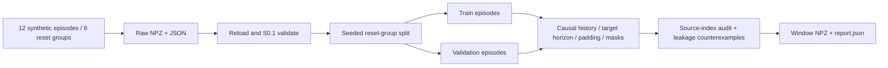

# S0.2 — Episode / Sequence Dataset

## Why

Problem：episode 是完整轨迹，模型通常需要固定长度的输入 history 和输出 horizon。
直接把所有 timestep 拼起来切窗口，会在 reset 附近制造不存在的状态转移；
随机拆重叠窗口又会把同一轨迹放到训练和验证中。本任务把 S0.1 文件契约变为可审计序列。
不训练 VLA；不扩展到 RLDS，不重新讲 ACT 基础。

## Intuition

以当前 action 时刻 t 为锚点，向左收集包含当前观测的最近 L 帧，向右取从 a_t 开始的 H 条动作。
过去不够就在左侧补零，未来不够就在右侧补零。mask 告诉模型哪些位置是真实数据。
零只是填充值；真实位置或真实动作也可以是零，不能靠数值判断有效性。
先给完整 episode 分配 train/validation，再分别切窗口。
同一个 reset 的左右指令轨迹共享 group_id，整组留在同一侧。

## Input / Output Contract

原始输入为 [S0.1 NPZ + JSON](../data_contract.md)，T actions / T+1 observations，
world XY ideal point，位置与位移单位 m，control_dt=0.1s，语言为整个 episode 的 string。
本任务只支持 proprioception + language；遇到 image/force/tactile 等可选数组明确拒绝，留给后续扩展。

| Window field | batch shape / dtype | modality / semantic / time |
|---|---|---|
| observation | (N,L,P) float32 | causal state history，最新位置是 o_t，左侧 padding=0 [m] |
| observation_mask | (N,L) bool | True=真实 observation；不能直接假定是某框架 attention mask 的极性 |
| action | (N,H,A) float32 | label a_t…a_{t+H−1}，右侧 padding=0 [m] |
| action_mask | (N,H) bool | True=真实 action label，用于 loss |
| observation_index | (N,L) int64 | episode-local timestep；padding=-1 |
| action_index | (N,H) int64 | episode-local action index；padding=-1 |
| anchor | (N,) int64 | t，范围 0…T−1；无 terminal anchor T |
| episode_id / group_id | (N,) NumPy Unicode | source identity / reset group，非 object dtype |
| language_instruction | (N,) NumPy Unicode | constant instruction per source episode，尚未 tokenized |

N=该 split 中所有 episode 的 T 之和；每个真实动作恰好产生一个 anchor。
P=A=2 是当前 toy；L=history、H=horizon 是正整数。索引/mask 无物理单位。
边界旗标、success 和 o_T 留在 raw 文件，不进入 policy input。
Window NPZ 是派生视图，不替代 versioned raw episode；其参数、split IDs、seed 在 report.json 中记录。

## Core Concepts

- timestep：一个观测或转移索引；sequence：以 t 为 anchor 的有序窗口。
- history：L 个输入槽，包含当前观测；horizon：H 个未来动作标签槽，从当前动作开始。
- padding：保证固定 shape 的占位；mask：真实/占位的显式区分。
- episode split：同一轨迹所有窗口在同一侧；group split：相关 episode 也在同一侧。
- validation：后续选模型用的 held-out 数据；本任务无模型，也无 test 集或部署成功率。
- raw units：不将 normalized 数值写回源文件；统计只看 train 的真实转移起点。

## Mathematics

对 episode e，T_e 是已执行动作数。o_t∈R^P 是时刻 t 的确定性实测状态；
a_t∈R^A 是 t→t+1 的确定性已执行位移命令，本例都使用 m、world frame。
L/H 为无单位正整数；t∈[0,T_e−1]；j/k 是窗口槽索引。

\[
X_{t,j}=\begin{cases}o_{t-L+1+j}&t-L+1+j\ge0\\0&\text{otherwise}\end{cases},
\quad j=0,\ldots,L-1
\]

X_t shape (L,P)，history mask u_{t,j}=1 当源观测索引非负，否则 0。
最大输入索引始终是 t，不包含 o_{t+1} 或 terminal o_T。

\[
Y_{t,k}=\begin{cases}a_{t+k}&t+k<T_e\\0&\text{otherwise}\end{cases},
\quad k=0,\ldots,H-1
\]

Y_t shape (H,A)，target mask m_{t,k}=1 当 t+k<T_e，否则 0。
模型将来应从 (X_t, language) 预测 Y_t；未来动作作为训练标签，不作为 policy 输入。

\[
\mathcal L=\frac{\sum_{n,k}m_{n,k}\sum_{d=1}^A(\hat Y_{n,k,d}-Y_{n,k,d})^2}
{A\sum_{n,k}m_{n,k}}.
\]

N 为 batch anchor 数；hat Y 是未来模型预测，shape (N,H,A)，这里用手造数值检验 loss。
Loss 是每个真实动作 scalar 的均方误差，单位 m²；不是概率、success rate 或归一化 loss。
本实现把 valid entries 索引出来再计算，避免 padded NaN×0 仍为 NaN；全空 mask 报错。
这个聚合方式按 action-token 数量加权，重叠标签重复计数，未做 per-episode 等权。

## Architecture / Data Flow



T=3、L=3、H=4 的示意：

| anchor | history | history mask | target | action mask |
|---|---|---|---|---|
| 0 | PAD,PAD,o0 | 0,0,1 | a0,a1,a2,PAD | 1,1,1,0 |
| 1 | PAD,o0,o1 | 0,1,1 | a1,a2,PAD,PAD | 1,1,0,0 |
| 2 | o0,o1,o2 | 1,1,1 | a2,PAD,PAD,PAD | 1,0,0,0 |

终点 o3 保存于 raw episode，但不成为 policy history 的最新观测，因为没有 a3 标签。
下一 episode 的 o0/a0 不得用于补齐本 episode。

## Math / Architecture → Code

[脚本](../../scripts/s0_2_sequence_dataset.py)：
- `generate_episodes`：6 reset groups，T=1…6；每组左右两个 episodes，共42动作。不同起点便于发现错误跨界。
- `load_episodes`：`allow_pickle=False` 读取同 stem 的文件；调用 S0.1 validator，拒绝 duplicate ID 和不配对文件。
- `split_episodes`：seed shuffle group IDs，2组 validation / 4组 train；不是每次随机拆窗口。
- `make_windows`：`start=max(0,t-L+1)`，history 左填、action 右填；用索引≥0生成 mask。
  检查 embodiment、dt、action representation、channel fields 一致，不因 shape 一样就混合语义。
- `audit_windows`：逐 anchor/slot 用原 episode 索引作为独立 oracle，检查值、mask 和 index。
- `masked_mse`：valid entries 选择后求均值；真实零仍然计入。
- `experiment`：正确 split、故意坏 row split、terminal 修改不改变输入、跨界污染拒绝、padding loss 和 val sentinel 检查。

这里的普通字典/NumPy 数组已足够；没有 Torch Dataset/DataLoader 或额外 wrapper。
调用时先通过 loader 验证源文件再切窗口。重叠 history 是正常训练设计，但不能跨 split。

## Minimal Experiment

在仓库根目录，已有 `.venv`，无需安装新依赖：

```bash
.venv/bin/python scripts/s0_2_sequence_dataset.py --output tmp/my_s0_2
.venv/bin/python scripts/s0_2_sequence_dataset.py --horizon 2 --output tmp/my_s0_2_h2
```

输出目录必须不存在：episodes/ 包含12个 raw NPZ/JSON pair；train_windows.npz、
validation_windows.npz 和 report.json 是派生产物，全部 ignored。
看窗口的方法：

```bash
.venv/bin/python - <<'PY'
import numpy as np
with np.load('tmp/my_s0_2/train_windows.npz', allow_pickle=False) as w:
    for key in w.files:
        print(key, w[key].shape, w[key].dtype, w[key][0])
PY
```

可选边界运行：`--history 1 --horizon 1 --seed 3 --output tmp/my_s0_2_min`。

## Expected Result

12 episodes / 6 groups / 42 anchors。seed=2 时 train reset0/1/2/4、validation reset3/5。
L=3,H=4：train observation(22,3,2)、action(22,4,2)，validation(20,3,2)/(20,4,2)。
改 H=2 不改变 episode split、N 或 history，只减少 target 槽及其有效重复标签数量。
Group overlap 与 episode overlap 都为0；坏的按奇偶 anchor split 有10共享 episodes。
Mask loss≈1，故意将 padded prediction=1000 后 unmasked loss 非常大。

## Actual Result

2026-10-14，CPU，仓库 `.venv` Python3.14.7 / NumPy2.5.4：

| Configuration | train N / val N | valid action tokens train / val | Result |
|---|---|---|---|
| L3 H4 seed2 | 22 / 20 | 48 / 56 | PASS |
| L3 H2 seed2 | 22 / 20 | 36 / 36 | PASS |
| L1 H1 seed3 | 24 / 18 | 24 / 18 | PASS |

Default valid history tokens train/val=44/48。固定 T1/L4/H4 probe：
masked MSE=1.0000000093132257，unmasked=750000.2500000023 m²；padded NaN 不影响 masked 值，全空 mask 拒绝。
实际坏 row split 有10共享 episodes；正确 split 共享 episode/group=0。
Validation x 加100m后，train mean x 保持0.2545454502105713m；
错误 all-data mean 改变47.619049072265625m。这里只诊断统计泄漏，未实现完整 normalizer。
所有窗口与源索引匹配，跨界污染被拒绝，改变 terminal observation 不改变 policy history。
NPZ（包括 Unicode 语言）读取不需要 pickle，保存后逐数组一致。
`pip check` 无冲突；本地 Markdown 链接检查和 `git diff --check` 通过。

## Explanation

结果证明在这些 variable-length toy episodes 上，history 因果、horizon 不跨 episode、padding 可识别，
split 保持 reset group 隔离；mask loss 和数据泄漏反例符合预期。
验证数据视图的正确性，不证明 policy 学习效果、语言泛化、真实 robot success、world-model 预测或部署延迟。
T1 probe 的 padding loss 数值固定，不随 CLI H 改变；CLI 参数作用于真实生成的 train/validation windows。
train-only mean 没有使用重复窗口或 padding，以免重复标签加权或补零改变统计。

## Failure Cases

| Failure | Effect / handling |
|---|---|
| concatenate then slice | reset 两侧被拼成假轨迹；按 episode 切并逐索引审计 |
| future input | terminal或o_{t+1}泄漏；history最大索引t；修改terminal不影响输入 |
| row/window split | 邻近重叠轨迹泄漏；先 group split 再 window |
| related episodes split | episode IDs 不同但同 reset；group_id 整组划分，group 来源真实性仍靠生产者 |
| zero means missing | 真实零动作被丢弃；独立 bool mask，索引 padding=-1 |
| wrong mask polarity | 某 attention API True 表示忽略；接模型时显式转换，不机械复用 |
| loss includes padding | 模型倾向输出零或指标被大 padding误差主导；valid-action scalar mean |
| all-data normalization | held-out distribution进入训练；train transition-start统计，raw不修改 |
| embodiment mismatch | 相同shape不同物理含义；检查字段/动作/controller声明，真实校准仍需审计 |
| language ambiguity/multimodality | deterministic左右toy不覆盖复杂语言或多路径；本任务无语义模型 |
| distribution shift / uncertainty | split不泄漏不等于覆盖OOD或校准；后续评价另做 |
| compounding error / world-model drift / latency | 离线窗口不说明闭环行为；本任务不报告模型推理/规划结果 |

## Relation to Robotics

序列视图位于原始轨迹与策略训练之间。history 支持部分可观测任务的过去上下文，
horizon 为 chunk 标签提供格式；这里未实现 chunk policy 或执行规则。
控制器、传感器、时间契约仍由 raw metadata 决定，不因 padding 而改变机器人语义。

## Interview Capsule

30秒：我先按 episode/reset group 分训练验证，再以每个真实动作时刻生成窗口。
history 包含当前观测，左padding；target从当前动作开始，右padding。
独立 mask 保留真实零值，loss 只平均有效动作维度；terminal观测保留但不做无标签anchor。

2分钟：原始轨迹有 T+1 观测、T 动作，直接拼接会让reset成为假转移。
我用12个长短不一的toy episodes验证从文件读回到sequence的全过程，
配对左右轨迹按reset group绑定，避免相关episode跨train/val。
每个anchor保存episode ID、源索引和mask，用独立逐索引oracle审计。
L3/H4默认有22/20窗口，修改H不改split或窗口数，只改标签长度。
还实际构造了按timestep拆分的泄漏和padding loss反例，验证val变化不会影响train统计。
这些结果支持数据管线正确性，不能替代机器人闭环success评价；没有训练模型。

## Likely Follow-up Questions

1. 为什么 history 包含 o_t，却不能包含 o_{t+1}？terminal o_T 为什么不成为 anchor？
2. L=3/H=4 时 T=1 的 episode，其输入/输出 mask 分别是什么？
3. 为什么 padding=0 时仍需要 mask？loss 分母为什么是 A×有效token数？
4. 按 episode split 后，什么情况下仍然需要 reset-group split？
5. 把 H 从4改到2，哪些 shape/数量会变，哪些不变？为什么不用所有窗口拟合归一化？

## Must Remember

- Split episodes/groups BEFORE windowing；ID不同不一定独立。
- History ends at o_t；target begins at a_t；terminal无额外action。
- Left history padding，right target padding，True表示真实数据。
- Mask决定有效性，零值不能决定；valid loss不含padding。
- Offline dataset checks ≠ closed-loop success ≠ Learning Mastered。

## My Verification

- [x] Run：默认运行，查看 report.json 与第一条 window 的 mask/index。
- [x] Modify：先预测 H4→H2 对 N、history、target shape、valid token总数的影响，然后新目录运行核对。
- [x] Explain：独立回答五问，画一个短episode的边界窗口。

Current Task = S0.2；Next Task = S0.3 — RLDS / Open X-Embodiment Concepts。
Engineering Complete + Learning Mastered（2026-10-14 用户确认实验、预测及五项 Explain）。
解释覆盖因果 history、T1 边界 mask/index、有效动作标量均值、reset-group 隔离及 H4→H2 数量变化。
STOP，等待用户选择下一任务。
