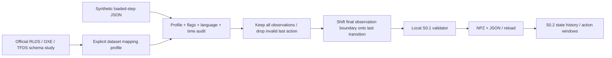

# S0.3 — RLDS / Open X-Embodiment Concepts

## Why

Problem：我们的 NPZ+JSON 如何对接 generalist robot datasets，而不把整个仓库绑定到数据框架？
本任务研究标准 episode/step 语义、真实 schema metadata 与 adapter 边界；不下载真实轨迹、不训练模型。
Open X-Embodiment（OXE）汇集采用 RLDS episode 格式的机器人数据集，官方同时提供 dataset metadata 与读取示例。
共同格式降低结构解析成本；具体动作含义仍必须逐数据集核对。[OXE README](https://github.com/google-deepmind/open_x_embodiment/blob/9eeb68b989efbcf474e8fb9019e01d02b962a604/README.md)

## Intuition

RLDS 提供“轨迹文件夹里有按时间排序的 step 卡片”的共同结构。
相同卡片栏目不意味着相同机器人单位或控制器；adapter 必须同时翻译结构和明确语义。
本轮用一个自造四step样本练习翻译，最后一张只有有效观测，不能把占位action当第四次动作。
我们保留内部 NPZ+JSON，让未来真正的 RLDS reader 停留在仓库边界。

## Input / Output Contract

RLDS 是 Reinforcement Learning Datasets 的数据/工具生态；官方读取形态是 dataset of episodes，
episode 内有 steps dataset 和自定义 metadata。`is_first/is_last` 是基础标志，其他step字段按数据集定义。
`invalid` 可标识不完整轨迹；同一数据集的step字段需一致。[RLDS format](https://github.com/google-research/rlds/blob/b35dac3a6b73396b0cb8773095999c4b5d70947c/README.md#dataset-format)

本轮输入为 `synthetic_loaded_rlds_xy/1.0` JSON fixture，Python list 模拟已加载的 steps；
不是 TensorFlow `tf.data.Dataset`，不是 TFRecord，也不是从 OXE 下载的 episode。
`profile/contract_metadata/timestamp/invalid` 在本 fixture 中显式必需；不是 RLDS 通用必需字段。
JSON 本身没有 float32 tensor dtype；转换后明确采用本仓库 float32/float64。

| Fixture field | shape / Python type | semantic / modality / time |
|---|---|---|
| steps | length 4 list | 有序 o0…o3 的记录 |
| observation.state | (2,) numeric list | world XY measured position [m] at i |
| observation.natural_language_instruction | string | episode constant `move right` |
| action | (2,) numeric list in real steps | world delta [m] from o_i to o_{i+1} |
| is_first / is_last / is_terminal | scalar bool | initial / final record / terminal observation |
| timestamp | scalar float | explicit relative s; 0/.1/.2/.3，RLDS不保证提供这个字段 |
| reward / discount | scalar float | fixture的非目标字段；本adapter不保留，丢弃在metadata中声明 |
| contract_metadata | dict | toy embodiment/action/controller/units/dt/success/provenance显式 sidecar |

最后step的 action=[999,999] 是故意构造的无效占位，不是动作，也不是有效机器人命令。
输出 [embodied_episode/1.0](../data_contract.md)：timestamp(4,)float64，
proprioception(4,2)float32，action(3,2)float32，terminated/truncated(3,)bool。
语言为JSON string；终止标志从最终观测step映射到最后转移行；success独立保留。

## Core Concepts

1. RLDS结构约定与TFDS读取/存储工具不同：TFDS提供feature描述与loader，RLDS描述episode/step的组织和时间含义。
2. 已加载RLDS的action作用于同step observation。原始EnvLogger/dm_env记录可能把先前动作放在结果观测旁，不能二次错位。
   [官方 generated vs loaded 对照](https://github.com/google-research/rlds/blob/b35dac3a6b73396b0cb8773095999c4b5d70947c/README.md#synthetic-datasets)
3. `is_last=True`时，action/reward/discount无效；`is_terminal=True`表示当前观测是终止状态。
   完整episode最后step非terminal对应truncation，终止不等于成功。[RLDS build_step](https://github.com/google-research/rlds/blob/b35dac3a6b73396b0cb8773095999c4b5d70947c/rlds/rlds_types.py)
4. 本adapter是严格的dataset-specific synthetic profile，不是万能RLDS/OXE reader；需要额外source schema审计才能接真实数据。
5. 本仓库v1要求有意义的终点观测、已知success、固定dt、恒定语言与显式动作语义；真实source不满足时拒绝或设计契约扩展，不编造。

### Real metadata schema study (no trajectories)

以下是官方TFDS目录的人工整理，记录于 [oxe_schema_notes.json](../../data/adapters/oxe_schema_notes.json)，
不是下载的 dataset_info.json 或已执行的builder输出。

| Dataset/catalog version | state/image | language | action | adapter question |
|---|---|---|---|---|
| fractal20220817_data 0.1.0 | base_pose_tool_reached(7,)float32；image(256,320,3)uint8 | observation内 natural_language_instruction | dict；world_vector(3,)float32 | 目录称world_vector为base-relative位移；不能按字段名猜world frame |
| bridge 0.1.0 | state(7,)float32；image_0(256,256,3)uint8等 | step顶层 language_instruction | (7,)float32 | 需要source解释各维度/单位/控制器；has_language与has_image_*说明可用性 |

来源：[Fractal catalog](https://www.tensorflow.org/datasets/catalog/fractal20220817_data)，
[Bridge catalog](https://www.tensorflow.org/datasets/catalog/bridge)。
目录最后更新分别2024-09-03 / 2024-05-16，2026-10-14查阅；不是所有OXE数据集的固定schema。
两例已说明language路径、action容器和观测并不统一；这不能证明实际episode遵守全部canonical时序。
本轮没有审核两者的producer或跑真实builder；dt/单位细节/terminal有效性/source grouping仍待确认。

## Mathematics

令 S_i 是加载后第i个step dict，o_i 是其中观测、a_i是其中outgoing action。
四step对应T=3次转移，而不是四次动作：

\[
S_0=(o_0,a_0),\ S_1=(o_1,a_1),\ S_2=(o_2,a_2),\ S_3=(o_3,\text{invalid action}).
\]

本toy中o_i∈R²，world位置[m]，确定性时刻测量；a_i∈R²，world位移[m]，
转移i→i+1的确定性命令；i=0…2有效，o_3为最后观测。timestamp τ_i=i×0.1s，非RLDS普遍假设。

\[
O[i]=S_i.observation.state,\quad A[t]=S_t.action\ (t<T),
\]
\[
terminated[T-1]=S_T.is\_terminal,\quad
truncated[T-1]=\neg S_T.is\_terminal.
\]

O shape(T+1,2)，A shape(T,2)，boundary arrays shape(T,)；其它转移boundary为False。
以上映射仅用于完整、canonical且终点有效的本profile，需先验证is_first/is_last/invalid。
success是scalar bool，由source metadata明确给定，与上述boundary公式无函数依赖。
现实source若没有success annotation，不能用reward==1或terminal标志无依据补出bool。

## Architecture / Data Flow



未来完整版：真实TFDS reader→逐dataset语义审计/adapter→内部episode文件。
当前Tiny CPU Learning Version仅NumPy+JSON；不用TensorFlow/RLDS包，不下载模型或dataset shards。
框架支持不等于语义统一；本实验没有模型encoder/fusion/action head。

## Math / Architecture → Code

[data/adapters/rlds_toy.py](../../data/adapters/rlds_toy.py) 的 `convert_episode`：
检查profile/XY单位/frame/controller、同步dt、首末标志、语言一致；
保留`steps`全部state，动作只取`steps[:-1]`，最终is_terminal映射至boundary[-1]。
`validate`复用S0.1文件契约；metadata记录reward/discount未保存，禁止静默声称无损转换。
已加载RLDS的action不用shift到下一step；shift的是source final observation的终止标志到内部final transition。

[scripts/s0_3_rlds_concepts.py](../../scripts/s0_3_rlds_concepts.py) 生成4039bytes默认JSON fixture，
重新读取后转换，与S0.1数组作独立alignment oracle；改末action为NaN仍不产生标签。
验证terminal/truncated两种边界，以及success True/False独立；坏输入逐例拒绝。
保存NPZ+JSON并reload，最后交给S0.2 `make_windows/audit_windows`，L3/H4得到3个anchors。
Adapter内部未读旧仓库，没有TFDS import，没有网络访问。

## Minimal Experiment

仓库根目录，输出须为新目录；无需安装依赖：

```bash
.venv/bin/python scripts/s0_3_rlds_concepts.py --output tmp/my_s0_3
.venv/bin/python scripts/s0_3_rlds_concepts.py --ending truncated --output tmp/my_s0_3_truncated
```

产物：synthetic_loaded_rlds.json、episode.npz、episode.json、report.json，全部ignored。
比较source.steps[-1].is_terminal与输出terminated[-1]/truncated[-1]。
读取 [schema notes](../../data/adapters/oxe_schema_notes.json)，定位两个真实目录的language/action差异。
网络只用于官方文档/代码/schema metadata查询；没有下载真实robot samples、权重或GB/TB数据。

## Expected Result

4source steps→4observations/3actions；[999,999]不进入输出动作。
默认terminated=[F,F,T]，truncated=[F,F,F]；改ending后两者反转，success仍True。
T3/L3/H4序列产生3anchors与6个有效action tokens（3+2+1）。
坏flag、时钟、language、profile、未知单位、缺success、NaN真实动作与invalid轨迹均拒绝。

## Actual Result

2026-10-14，CPU，仓库`.venv` Python3.14.7、NumPy2.5.4（actual module path在本venv内）。
默认terminal与`--ending truncated`两次均PASS：shape(4,2)/(3,2)，末动作占位未进入label，
terminal-action NaN修改不改变输出；每次10/10 invalid cases拒绝。
success独立保留，包括额外False检查；NPZ+JSON往返完全一致；S0.2窗口3anchors/6valid action tokens。
内部数值payload94bytes；默认合成source JSON4039bytes。未下载真实dataset。
`pip check`、本地链接及git diff --check通过；未新增依赖。

## Explanation

验证了canonical RLDS概念映射的shape、时序、边界，以及内部dataset继续工作的能力。
不能证明真实TFDS decode、TFRecord读取、任何OXE dataset的完整转换、真实success标签质量或机器人泛化。
source含metadata的显式toy语义，本adapter未从图像/字段名“推理”动作含义。
即使flag形状正确，producer伪造终点或错放action仍可能通过结构检查；需真实数据/producer audit。

## Failure Cases

| Failure | Effect / response |
|---|---|
| same step vs arrival action | 双重shift造成错误监督；查producer与loaded语义，不按名字猜 |
| last action treated valid | 零或非零placeholder均不是label；由is_last语义丢弃，而非按数值 |
| is_last==success | 记录结束不说明成功；success必须来自明确标注 |
| missing final observation | 不补零/重复造terminal，拒绝本例缺last；真实伪造flags仍需审计 |
| undefined terminal observation | 本契约要求有效o_T，source不能提供就隔离/扩展schema |
| missing is_terminal | RLDS可选不等于本profile可选；无法可靠区分边界时拒绝 |
| language changes/empty | 本v1仅constant language，不静默取第一条覆盖余下指令 |
| shape/action/frame mismatch | world_vector字段名未必world frame；source-specific mapping不可省略 |
| unknown dt/units/calibration | 不自动填toy的0.1s、m/world；真实adapter需producer evidence |
| leakage/normalization | 保留episode/group identity，split-before-window，raw不归一化 |
| distribution shift/embodiment | format统一不代表controller/robot统一，也不说明OOD成功 |
| multimodality/uncertainty/drift/latency | 本例未涉及learned futures或多路径；无模型推理、校准风险或闭环证据 |

## Relation to Robotics

RLDS/adapter位于录制器和学习pipeline之间；translation保证sensor、language、controller labels有可追踪的对齐。
它不替代机器人反馈控制，不把异构embodiment自动变成统一动作空间。
S0.4才计划检查真实robot sample；S0.3止于官方schema study和synthetic mapping。

## Interview Capsule

30秒：RLDS统一episode/step结构，OXE采用这个组织形式，但具体字段和动作语义仍异构。
最后step有最终观测而无有效action，我将四step映射成四观测/三动作，
并将最终is_terminal映射到最后转移的terminated/truncated，success独立。

2分钟：我先读官方RLDS schema和两份TFDS catalog，发现language路径、action结构和frame说明都可能不同。
本仓库仍用NPZ+JSON，边界adapter需要explicit profile，不能从shape猜语义。
CPU实验用4KB左右的合成loaded-RLDS fixture，末action故意设为999，确保它不进入标签；
终止和截断两种情况都保留相同success。十类坏输入被拒绝，转换后沿用S0.1 validator与S0.2窗口检查。
这验证canonical概念映射，尚未安装TFDS或读取真实轨迹，不能声称支持完整OXE。

## Likely Follow-up Questions

1. RLDS、TFDS、Open X-Embodiment各负责什么？统一格式是否等于统一动作语义？
2. 为什么4个RLDS steps只产生3个actions？最后action非零还能不能作为label？
3. is_last、is_terminal、terminated/truncated和success如何区分与映射？
4. 已加载RLDS与原始EnvLogger/dm_env记录的action时间位置有什么区别？
5. 为什么不能把Fractal/Bridge直接交给本toy adapter？真实映射还缺什么证据？

## Must Remember

- RLDS共同结构，不保证所有robot的字段/单位/controller统一。
- Loaded step action作用于同step observation；别把原始记录时序照搬两次。
- Last step action无效；terminal observation与success不同。
- Adapter需要source-specific semantics；缺dt/单位/终点/success不要编造。
- Synthetic schema experiment不等于真实robot sample inspection。

## My Verification

- [x] Run：运行默认fixture conversion，比较source四steps与输出三actions。
- [x] Modify：先预测terminal→truncated的boundary arrays、success、shape、window数量，再运行核对。
- [x] Explain：独立回答上面五问，画出最后source step如何对应最后转移boundary。

2026-10-14 用户确认实验和预测均已完成，并提交五项 Explain：区分RLDS/TFDS/OXE职责，
说明末step动作无效、boundary与success独立、loaded RLDS不再次shift action，
以及真实Fractal/Bridge接入所需的schema与producer语义证据。学习状态依据用户报告确认；未重新运行实验。

Current Task = S0.3；Next Task = S0.4 — Real Robot Dataset Inspection。
Engineering Complete + Learning Mastered（2026-10-14 用户确认）。STOP，不自动进入S0.4。
