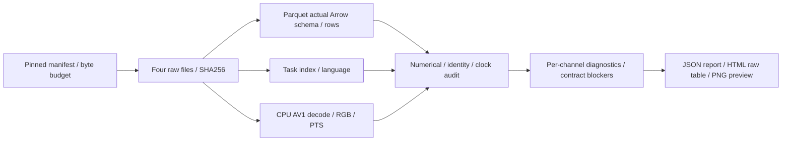

# S0.4 — Real Robot Dataset Inspection

## Why

Problem：S0.3的canonical toy映射能通过检查，但真实机器人文件是否提供同样的语义证据？
本任务读取一条公开BridgeData V2社区转存episode，查看state/action、语言与相机图像，
对比内部契约，区分已验证的结构与尚未验证的动作含义。不训练模型、不实现通用adapter。

## Intuition

文件能打开，像录像能播放，并不代表可以直接作为训练episode。
把检查分为三层：实际bytes/schema → 数值/时间/图像对应 → producer语义/契约适配。
前两层可以本地实验；第三层证据缺失就记录unknown，不用猜测填齐必需字段。

## Input / Output Contract

Source：[jesbu1/bridge_v2_lerobot固定revision](https://huggingface.co/datasets/jesbu1/bridge_v2_lerobot/tree/3899a5d24770fa593ad09f6f6e22cd417a227431)。
这是社区LeRobot v2.0转存，metadata声明WidowX与5fps；不是原始Bridge RLDS/TFDS。
源card有信息空缺，转换脚本revision和原始episode映射未知。固定mirror revision不等于确认producer。
源card声明apache-2.0；这不替代原始数据许可及转存链路审查，不将样本重新分发进git。

[manifest](../../data/adapters/bridge_sample_manifest.json)固定四个文件、大小、SHA256：

| File | bytes | purpose |
|---|---:|---|
| meta/info.json | 4,692 | schema、字段名、fps、video编码说明 |
| meta/tasks.jsonl | 1,637,992 | task_index→语言；公开单文件文本索引，只用task 0 |
| episode_000000.parquet | 6,384 | 单条episode全部数值记录 |
| image_0/episode_000000.mp4 | 274,880 | 单相机完整视频 |
| Total | 1,923,948 | 约1.93MB十进制；不下载全集/权重 |

CLI默认离线；首次缺文件时显式`--download`。只支持这个固定样本，总budget<3MB；
每个response最多读取expected bytes+1，校验后才保存，已有raw文件只核验不覆盖。
本轮为验证下载路径另取相同四文件一遍，总样本传输3,847,896bytes，不增加episode或相机。

| Actual field | shape / dtype | modality / time / semantics |
|---|---|---|
| observation.state | (28,7) float32 | x/y/z/roll/pitch/yaw/gripper，名称来自mirror；单位/frame未知 |
| action | (28,7) float32 | 同名七通道；absolute/delta/anchor/controller/单位未在mirror声明 |
| timestamp | (28,) float32 | 存储相对秒；0…5.4，约0.2s间隔，不是已证实的硬件采集时钟 |
| frame_index | (28,) int64 | 0…27，有序 |
| episode_index / index / task_index | (28,) int64 | 本例episode0/global index0…27/task0 |
| camera_present | (28,4) bool | 全部[True,True,True,False]；只下载image_0，不能说已读取三相机 |
| video image_0 | decode(28,256,256,3) uint8 RGB | AV1→CPU RGB24；相机外参/内参/采集延迟未知 |
| language | JSON string | task0=`put small spoon from basket to tray`；28行均引用它 |

输出ignored `tmp/<run>/report.json`、`contact_sheet.png`、`inspection.html`。
报告schema=`robot_sample_inspection_report/1.0`，不是`embodied_episode/1.0`；不生成训练NPZ或补造success/boundary。
HTML含全部28行原始数值与报告，PNG是带行号/时刻的图像预览；预览不等于raw image重采样。

## Core Concepts

1. Snapshot可复现：revision固定内容范围，SHA256固定实际字节；只证明内容相同，不证明物理语义正确。
2. 实际Arrow dtype独立检查，不只相信metadata；转换成NumPy时保留float32，不归一化raw。
3. LeRobot表N行state/N行action不自动具有RLDS末step无效动作约定；本例不能擅自drop最后action。
4. PTS是视频presentation时间；匹配表clock仍不证明sensor acquisition同步或因果。
5. 行号结束、夹爪值、图像看似完成都不能替代独立success标注和终止类型。
6. 单episode无法估计数据集失败比例、泛化或可靠train/validation分割；原始reset group也未知。

官方上下文：[Bridge原始数据处理代码](https://github.com/rail-berkeley/bridge_data_v2/blob/bc60a35b701a12021c8c95e9d8601274d3acd928/data_processing/bridgedata_raw_to_numpy.py)
显式保存observations/next_observations，并按采集日期处理camera latency；
[官方loader](https://github.com/rail-berkeley/bridge_data_v2/blob/bc60a35b701a12021c8c95e9d8601274d3acd928/jaxrl_m/data/bridge_dataset.py)
还提供action relabeling路径。它们说明不同处理路径会影响标签，不能据此证明本mirror采用了哪条路径。
本轮只读代码，未执行producer，也没有读取原始pkl；不使用不可信pickle。

## Mathematics

令N=28，s_i∈R⁷、a_i∈R⁷，i=0…27。通道单位未知，不能把所有维度的数值加成物理误差。
记录clock符合τ_i≈i/5秒；存储为float32，因此允许1e−6秒容差。
视频presentation时刻v_i与τ_i逐帧比较；v_i≈τ_i不是采集因果证明。

内部契约要求T个有效outgoing动作与T+1个观测，并有明确boundary、success和动作语义。
本文件N/N不能确定是T=N且缺s_N，还是T=N−1且a_{N−1}无效，或其他producer约定。
末action=[0,0,0,0,0,0,1]；非零夹爪值和零位姿值都不能判定标签有效性。

仅做数值diagnostic：

\[
d_i=s_{i+1,0:6}-s_{i,0:6},\quad
e_{k,j}=\operatorname{mean}_{i\text{ valid}}|a_{i+k,j}-d_{i,j}|,
\quad k\in\{-1,0,1\},\ j=0\ldots5.
\]

报告每个通道的MAE，不混合平移和旋转，不含gripper。不同offset可用pair数不同；
Euler差不一定是正确旋转delta，servo命令也不必等于measured displacement。
因此这只是排查线索，不能选最小值就shift/relabel或宣布语义验证。

预览stride K：选择{0,K,2K,…<N}并补入N−1。
K7→[0,7,14,21,27]；K14→[0,14,27]。只改变展示选择，不修改clock/fps、raw行数或action。

## Architecture / Data Flow



没有encoder/fusion/policy或normalizer。文件停在inspection层，没有接入S0.2训练窗口。

## Math / Architecture → Code

[script](../../scripts/s0_4_inspect_robot_sample.py)：`prepare_source`做bounded download与hash；
`audit_arrow`检查真实类型；`audit_rows`检查有限值、shape、episode/frame/index/clock、camera/task；
`decode_video`经PyAV CPU解码并逐帧核对RGB与PTS；`alignment_probe`输出逐通道diagnostic；
`write_preview`以Pillow保存contact sheet，并输出包含全量raw数值的HTML。
`rejection_checks`修改内存副本，8类坏输入应拒绝；原文件保持不变。
显式`local_contract.export_allowed=false`及六项blockers，不提供绕过语义检查的export选项。

## Minimal Experiment

先读下载budget与限制；在仓库根目录使用隔离`.venv`，依赖见requirements.txt。
已有依赖不需重复安装；新环境用Python3.11/3.12创建venv，再在venv内安装requirements。
本机Python3.12缺ensurepip，使用已有pip的`--python .venv/bin/python3`指定安装目标，未改base/system。

```bash
# 首次取得固定四文件；已有文件只核验，不再下载。
.venv/bin/python scripts/s0_4_inspect_robot_sample.py --download --output tmp/my_s0_4
# Modify前预测显示帧数及raw/time/shape是否变化；此命令离线。
.venv/bin/python scripts/s0_4_inspect_robot_sample.py --preview-stride 14 --output tmp/my_s0_4_stride14
```

输出目录必须不存在。浏览器打开`tmp/my_s0_4/inspection.html`，或直接打开PNG/report.json。
默认source=`tmp/s0_4_source`；可用`--source`指定同样的四份已验证原文件。
检查all rows、last action、每通道min/max、camera availability与contract blockers。

## Expected Result

读取真实episode0及task0，获得28行(7,)state/action和28帧RGB。
camera0有效，视频PTS匹配记录clock；SHA256通过；K7显示5帧、K14显示3帧。
八类坏输入拒绝；缺语义证据的raw不被导出为内部训练episode。

## Actual Result

2026-10-14，CPU，Python3.12.3，NumPy2.5.4 / PyArrow24.0.0 / av17.1.0 / Pillow12.3.0；
解释器`.venv/bin/python`，全部module paths在`.venv/lib/python3.12/site-packages/`。
四文件1,923,948bytes；初次读取及CLI单独下载验证使用两份相同snapshot。
wheel新下载NumPy16.7MB、PyArrow48.9MB、av35.4MB，Pillow6.9MB使用缓存；
另bootstrap pip26.2.1约1.8MB到venv。没有TensorFlow/TFDS/Torch/LeRobot、模型权重或全集下载。

默认与K14实验均PASS：28rows、state/action(28,7)float32，video(28,256,256,3)uint8 RGB；
CPU decoder=`libdav1d`，video5fps；clock最大偏差1.9073486345888568e−7秒。
task text=`put small spoon from basket to tray`；camera mask全[True,True,True,False]。
预览5→3帧，raw/source/arrays/video/language/alignment诊断/contract blockers一致；8/8坏输入拒绝。
已查看PNG，确认真实厨房操作场景及行号/时刻可读；视觉检查不判定独立任务success。
`pip check`通过。CLI hash/schema/clock/video检查的PASS不等于producer语义验证。

## Explanation

本轮从S0.3人工catalog学习进入真实字节/数值/图像检查，证据范围是一条社区转存episode与一个相机。
观察到N/N、缺boundary/success、语义未声明，因此选择inspection而非强行转换。
未验证原始RLDS/TFDS解码、转存实现、全部OXE兼容性、camera causality或真实控制成功率。
没有模型，offline loss、inference latency和closed-loop success不适用；本轮不报告这些能力。

## Failure Cases

| Failure | consequence / handling |
|---|---|
| changed bytes / partial download | size/hash拒绝，不静默使用main新版本 |
| null/NaN/wrong width/type | schema/数值拒绝，不补零修复 |
| mixed episode / shuffled rows / clock | identity/index/clock拒绝，不跨reset拼接 |
| camera unavailable / video count or PTS mismatch | 拒绝当前inspection路径；缺相机不等于黑图 |
| sensor latency / frame calibration | PTS一致不能解决；等待producer与标定证据 |
| final action semantics missing | 不丢末action，不补末obs，不设boundary |
| success missing | 保持unknown，不从图像、reward或文件结束推断 |
| units/frame/controller/rotation unknown | 只报raw每通道数值；不执行命令或toy加法 |
| language / future information leakage | 文本由task_id解析；success不进入policy；当前无训练pipeline |
| reset group / split / normalization | 原始group未知且单episode，不训练、不fit统计、不随机拆timestep |
| distribution shift / multimodality / drift / uncertainty | 单示范不能量化泛化、多路径或模型风险；无learned模型 |
| latency / closed-loop failure stages | 只有离线检查，没有部署或成功率证据 |

## Relation to Robotics

真实状态、命令、camera与语言在文件层相遇；模型输入还需控制与采集语义审计。
七维state/action不是toy XY profile；格式和相同字段名不能替代embodiment/controller契约。
S0.5将学习动作表示，本任务到真实inspection为止。

## Interview Capsule

30秒：我以固定revision和SHA256检查一条真实Bridge社区转存，读28行七维state/action和一个RGB相机。
结构与视频PTS匹配，但N/N表缺明确终点、boundary、success和动作语义，因此没有生成内部训练episode。

2分钟：下载budget约1.93MB，用CPU PyArrow/PyAV而非安装全套机器人学习框架。
实际dtype与metadata分开检查；raw保持原样，生成每通道统计、全行表、contact sheet与契约差异。
预览stride7→14只改变5→3显示帧；八类坏输入拒绝。时间匹配不等于sensor causality，
数值action与state差的offset diagnostic也不能代替producer证据。我明确记录mirror转换链路未知，
没有把一条轨迹的外观当成功标签，也没有宣称支持完整OXE或机器人泛化。

## Likely Follow-up Questions

1. 本次实际读取了什么？为什么社区LeRobot转存不等于原始RLDS语义验证？
2. 28行state和28行action为什么不能直接变成内部T/T+1 episode？末action能否擅自丢弃？
3. video PTS与timestamp一致能证明什么，不能证明什么？
4. 为什么action与state差的MAE不能直接决定shift、单位或controller？success能否由视频推断？
5. preview stride7→14改变了哪些产物？raw、fps、dt、统计与训练动作是否变化？

## Must Remember

- Pinned bytes ≠ verified producer semantics。
- N/N真实表不能套用toy末action规则。
- PTS一致不是sensor causality；字段名不是unit/frame。
- 缺success/boundary/终点/控制语义就记录unknown，不补造。
- Preview stride改变展示，不重采样原始数据。

## My Verification

- [x] Run：运行新输出目录，打开HTML/PNG/report，定位28rows、task0、last action与blockers。
- [x] Modify：先预测stride7→14的显示行号/数量及raw、clock、shape、diagnostic，再运行核对。
- [x] Explain：独立回答上面五问，区分bytes/structure、time匹配与producer语义证据。

2026-10-14 用户明确确认实验和预测均已完成，并提交五项 Explain：固定转存文件检查不等于原始RLDS验证，
N/N无法确定末动作有效性或终点，PTS匹配不证明采集同步，MAE仅是offset诊断且视频不替代success，
stride7→14只改变预览5→3帧，raw/clock/统计/诊断/blockers保持不变，未生成训练动作标签。
Learning Mastered依据用户报告确认；本轮未重新运行实验。

Current Task = S0.4；Next Task = S0.5 — Continuous Action Representation。
Engineering Complete + Learning Mastered（2026-10-14 用户确认）。STOP，不自动进入S0.5。
