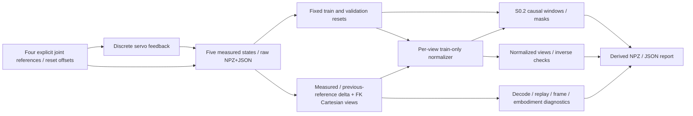

# S0.5 — Continuous Action Representation

## Why

Problem：shape相同的action，可能是绝对目标、相对测量的delta、相对上一命令的delta，
也可能是Cartesian目标或normalized token。若训练和执行解释不同，会把正确数字变成错误命令。
本任务以一个显式servo trace比较表示，不训练模型、不重新解释S0.4未知语义的Bridge样本。

## Intuition

给servo的目标r_t不是机器人当时实际位置q_t，也不保证下一次测量q_(t+1)到达目标。
同一目标可以写成r_t，或r_t−q_t，或r_t−r_(t−1)；正确解码可以恢复同一reference。
不同anchor不能互换；归一化与chunk也不会自动消除这种差别。

## Input / Output Contract

CPU NumPy-only，四条独立synthetic reset episodes：servo_0/1/2为train，servo_3为validation。
split在normalization/window之前显式固定；不是随机timestep拆分或真实数据划分验证。
基础reference序列(rad)：[[.2,.3],[.4,.5],[.3,.6],[.5,.2]]，q_0=[.1,.4]rad。
四episode同时平移q_0与references，offset为[0,0]、[.1,0]、[−.1,.05]、[.8,−.1]rad。
关节顺序[q1,q2]，范围toy (−π,π)；fixed base=world，平面连杆长度[.3,.2]m。
本任务不是重学完整FK/IK，仅用小显式FK暴露单位/frame/embodiment差异。

Raw沿用[embodied_episode/1.0](../data_contract.md)，四个有效absolute joint commands、五个测量。
每条都有独立NPZ+JSON，保持物理单位、normalized=false；默认control_dt=.1s、servo gain=.5。
四命令budget结束始终truncated，terminated全False；success独立由最后tracking error阈值判断。
语言仅为手写constant string `track the four joint references`，没有语言理解或模型能力证据。

| Array/view | shape / dtype | unit / frame / anchor / time |
|---|---|---|
| raw proprioception / measured_joint | (5,2) float32 | [q1,q2]rad，ordered joint axes，观测i=0…4 |
| raw action / joint_absolute | (4,2) float32 | r_t [rad]，joint coordinate zero，转移t→t+1的目标 |
| joint_delta_measured | (4,2) float32 | r_t−q_t [rad]，anchor当时测量 |
| joint_delta_previous_reference | (4,2) float32 | r_t−r_(t−1) [rad]，显式初始化r_-1=q_0 |
| measured_xy | (5,2) float32 | FK(q_i) [m]，world，派生位置而非图像或独立传感器 |
| cartesian_absolute | (4,2) float32 | FK(r_t) [m]，world origin；只给XY目标，无姿态 |
| cartesian_delta_measured | (4,2) float32 | FK(r_t)−FK(q_t) [m]，anchor当前测量的末端位置 |
| local_frame_cartesian_delta | (4,2) float32 | R^T Δp [m]，固定相对world旋转+90°的local frame；不是随机器人运动的tool frame |
| measured_joint_displacement | (4,2) float32 | q_(t+1)−q_t [rad]，执行后结果，不能当action输入 |
| command_delta_rate | (4,2) float32 | (r_t−q_t)/dt [rad/s]，命令误差除以区间；不是实测关节速度 |
| *_normalized | (4,2) float32 | per-view z-score，无量纲；必须用匹配sidecar反归一化 |
| timestamp | (5,) float64 | 相对秒0…0.4，同步synthetic clock |
| terminated / truncated | (4,) bool | 末truncated=True，success单独存JSON |
| train chunk action / action_normalized | (12,H,2) float32 | raw rad / z-score；每个anchor对应有序未来命令，zero padding |
| action_mask / action_index | (12,H) bool / int64 | True=真实，invalid index=−1；不跨episode |

Artifacts：ignored `tmp/<run>/episodes/`、`representations.npz`、`train_chunks.npz`、
`normalizers.json`、`report.json`；NPZ读取allow_pickle=False。
Derived report schema=`continuous_action_experiment/1.0`；normalizer=`action_zscore/1.0`。
Derived表示不是raw契约升级；Cartesian views不直接导出为可执行机器人命令。

## Core Concepts

1. Absolute reference与measured state分开；delta必须写明当前测量或previous reference anchor。
2. Delta command不是实际位移；除dt可得到平均命令误差rate，不能因此声明velocity controller。
3. Joint与Cartesian的单位、维数、frame、运动学与controller不同，FK(delta q)不是Cartesian displacement。
4. Cartesian位置目标通常不能唯一决定joint reference；本toy只验证FK目标，不提供IK、姿态或Cartesian控制执行器。
5. Normalization须按表示单独拟合；相同shape和z-score不统一动作意义、embodiment或控制器。
6. Chunk表示未来序列；future measured-anchor delta依赖future measured state，不能全部加在chunk起点q_t上。
7. train统计使用原始动作各一次，不使用padding或重叠chunk中的重复动作；zero variance处理必须显式记录。

## Mathematics

所有关节量确定性、shape(2,)rad；reference r_t在τ_t采集q_t之后执行于[τ_t,τ_(t+1))：

\[
q_{t+1}=q_t+\alpha(r_t-q_t),\quad 0<\alpha\le1,\quad\Delta t=0.1\mathrm{s}.
\]

这只是离散servo toy，不是含惯性、限速、接触或硬件时延的物理模型。

\[
d_t^m=r_t-q_t,\qquad d_t^r=r_t-r_{t-1},\quad r_{-1}=q_0.
\]
\[
r_t=q_t+d_t^m=r_{t-1}+d_t^r=q_0+\sum_{i=0}^{t}d_i^r,
\qquad q_{t+1}-q_t=\alpha d_t^m.
\]

α=.5：q_1=[.15,.35]，d_1^m=[.25,.15]，d_1^r=[.2,.2]rad；两者都能恢复r_1=[.4,.5]rad。
α=1在本toy中使q_t=r_(t−1)，两种delta相等，command delta=measured displacement（float32容差）。

平面XY FK，只表示位置：

\[
f(q)=\begin{bmatrix}l_1\cos q_1+l_2\cos(q_1+q_2)\\l_1\sin q_1+l_2\sin(q_1+q_2)\end{bmatrix},
\quad p_t=f(q_t),\quad p_t^{ref}=f(r_t),\quad\Delta p_t=p_t^{ref}-p_t.
\]

Same joint target在不同link lengths下产生不同p_ref；delta向量换frame用R或R^T，absolute位置换frame还需原点平移。
此处R=[[0,−1],[1,0]]，Δp_world=RΔp_local；只演示固定局部frame，不省略真实tool姿态变化。

训练动作集合每条原始行各一次，M=12，逐通道计算float64统计：

\[
\mu_j=M^{-1}\sum a_{i,j},\quad
\sigma_j=\sqrt{M^{-1}\sum(a_{i,j}-\mu_j)^2},\quad
s_j=\begin{cases}1\text{ source unit}&\sigma_j=0\\\sigma_j&\text{otherwise}\end{cases},
\quad z=(a-\mu)/s,\quad a=zs+\mu.
\]

ddof=0；constant channel保留真实std=0与constant flag，scale显式用1原单位。
无clipping：z不保证落在[−1,1]。每个view独立stats与signature（单位/frame/channel order/anchor/embodiment/controller/dt）。
保存模型视图为float32，所以反变换误差按float32容差检查，不声称逐bit可逆。

Chunk C_t[k]=r_(t+k)，有效条件t+k<T；mask先判断，只有有效槽归一化。
未来measured delta解码需q_(t+k)，而不是反复用q_t；previous-reference delta可从已知r_(t−1)累加得到reference序列。
离线重放存好的delta可以匹配toy trace，不证明受扰动时也会匹配。

## Architecture / Data Flow



没有encoder/fusion/action head或learned model。物理reference永远以raw rad存储，
normalizer与chunk是独立派生文件；S0.4 source及旧仓库均不读取或修改。

## Math / Architecture → Code

[script](../../scripts/s0_5_action_representation.py)：`servo`实现显式闭环测量更新；
`episode`写S0.1兼容的joint_absolute raw；`views`计算五种表示、p与previous anchor。
`fit_stats`只接受标明train的episode，逐view核对signature；`transform`校验target signature、shape、finite和positive scale。
`round_trip`写/读raw并调用S0.1 validator。`make_windows/audit_windows`直接复用S0.2，不重复设计窗口框架。
`main`进行replay、错误解释、link/frame、validation污染、constant channel和11类rejection诊断。
report记录每个derived数组的shape/dtype/单位/frame/temporal语义与每个episode最终tracking error/success。

## Minimal Experiment

无需安装或下载；仓库根目录使用已有隔离venv，output必须为新目录：

```bash
.venv/bin/python scripts/s0_5_action_representation.py --output tmp/my_s0_5
# 先预测gain .5→1对states/delta/reference/stats/chunk/boundary/success的影响，再运行。
.venv/bin/python scripts/s0_5_action_representation.py --gain 1 --output tmp/my_s0_5_gain1
```

打开report、第一条raw episode与normalizers；用np.load(...,allow_pickle=False)看representations和train_chunks。
可选H1/H6只改变派生chunk，不改变raw/normalizer，chunk完整学习仍留给S0.7；本任务不进入S0.6 tokenization。

## Expected Result

四raw episodes均4commands/5measurements；正确delta解码/servo replay匹配原trace。
α=.5时两anchor delta不同，命令不是实际位移，toy tracking失败但budget仍truncated。
α=1时状态到达reference，两delta一致且toy tracking成功；raw reference、split、joint_absolute train stats与chunk数量不变。
train-only z-score round-trip通过，validation改动不改变train fit，padding保持masked zero，错signature拒绝。

## Actual Result

2026-10-14，CPU，`.venv/bin/python` Python3.12.3、NumPy2.5.4，
actual module path=`.venv/lib/python3.12/site-packages/numpy/__init__.py`；未新增依赖/下载。
α=.5 / α=1 / H1 / H6四次均通过raw/view/chunk往返、delta解码/重放、normalization及11/11拒绝检查。
独立手算trace与train/all-data mean oracle通过；pip check、本地Markdown链接与git diff --check通过。

| Diagnostic | default α=.5 | α=1 |
|---|---|---|
| base episode final q [rad] | [.39375,.35625] | [.5,.2]（float32误差） |
| r_last−q_last [rad] | [.10625,−.15625] | max abs约1.49e−8 |
| 两种delta最大差 [rad] | .125 | 0 |
| command delta vs measured displacement最大差 [rad] | .15625003 | 0 |
| toy success (max final error≤.02rad) | 四episode均False | 四episode均True |
| boundary | final truncated | final truncated |

默认把measured delta当absolute执行，末状态相对正确trace误差约[−.2375,−.43125]rad。
全序列delta反复加q_0（stale anchor）reference最大逐通道误差约[.1875,.1125]rad；这是四步诊断，不随H改变。
换links为[.2,.3]m：相同r的XY最大分量差约.04878067m；local delta误作world最大分量差约.20428187m。

joint_absolute train mean≈[.35,.41666668]rad；错误all-data mean≈[.55,.3875]rad；
validation q1 reference再加.2rad使错误all-data mean变≈[.60,.3875]，train stats保持不变。
held-out absolute z最大≈6.86199（未clip）；五view round-trip最大误差≈7.45e−9原单位。
constant-channel独立training fixture的q2 reference=.25rad，std=0、scale=1rad、z=0；未改原始文件。
H3: train chunk(12,3,2)，27 valid tokens；H1: (12,1,2)，12tokens；H6: (12,6,2)，30tokens。
三次H实验各有12anchors，train normalizers完全相同，padding不参与fit或inverse。

## Explanation

验证的是已知toy控制语义的不同表示与明确解码，不是任何机器人action自动统一。
离线等价重放只有在本toy及相同初值/anchor/servo下成立，不证明learned policy或受扰动控制鲁棒性。
toy success是手写reference序列的跟踪阈值，不是真实机器人任务成功率；没有模型loss或inference latency。
FK提供位置目标，没证明从Cartesian视图可唯一还原关节参考，也没有安装/运行IK controller。
S0.4仍缺单位/frame/controller/终点/success，不能把本toy的metadata搬过去填空。

## Failure Cases

| Failure | consequence / handling |
|---|---|
| delta as absolute / wrong anchor | 生成不同reference；错误重放量化差异，正常路径显式解码 |
| command equals measured displacement | α<1跟踪滞后反例；执行后差值不作为policy输入 |
| delta vs velocity / dt mismatch | rad与rad/s及interval意义不同，不能仅换字段名 |
| joint/cartesian/frame/rotation | 不计算FK(delta)代替displacement；固定local旋转需显式映射，未处理SE(3)姿态 |
| same shape, different embodiment/order/units/controller | S0.2 semantics signature拒绝混合；links例展示几何差异 |
| normalized raw / wrong stats / zero scale / NaN | S0.1或transform拒绝；normalized文件不伪装raw |
| validation/padding/window-repeat normalization | fit仅train原始行，fit_rows12；污染probe展示错误均值 |
| constant channel / clipping | 记录std0/scale1；不自动clip，z-score不保证有界 |
| future measured-anchor chunk | 不用一个q_t解码所有delta，不混入future measured state作policy输入 |
| boundary / group leakage | 四reset先split；S0.2 index audit保证窗口不越episode；success不依赖truncated |
| language / multimodality / distribution shift | 手写序列与constant instruction无learned grounding，不能声明toy泛化 |
| compounding error / uncertainty / latency | 未训练预测器，delta trace扰动鲁棒性/风险校准/部署延迟未知 |
| inertia / contact / saturation / wrapped angles | toy不包含；不能据此证明硬件tracking与控制安全性 |

## Relation to Robotics

Action representation处于policy输出与controller之间，必须保留reference、measurement、frame和time约定。
它可以改善接口审计，但不是自动通用控制层。P3熟悉的servo/reference概念在这里用于VLA标签与decode契约。

## Interview Capsule

30秒：我用四步toy servo比较absolute reference与两种delta，证明anchor决定动作意义。
gain=.5时command不等于measured displacement；正确解码重放一致。每种view独立train-only归一化，chunk只对真实槽处理。

2分钟：raw是joint_absolute rad、T+1测量，Cartesian views是已知FK下的XY目标，不冒充唯一IK命令。
我检查frame/link-length/order/controller错配，normalizer写明unit/frame/anchor与train IDs；
validation污染、constant channel和padding都有显式诊断。gain1使本toy两delta相同，但不推广到真实servo。
11类坏输入拒绝，float32反归一化误差可量化。没有训练policy，不将toy tracking success叫真实robot success，
也没有借这套已知toy语义转换S0.4未知producer的Bridge样本。

## Likely Follow-up Questions

1. Absolute reference、measured-anchor delta、previous-reference delta如何解码？gain=.5时为什么后两者不同？
2. 为什么command delta不等于measured displacement或velocity？同一reference的joint和Cartesian表示还依赖什么？
3. Z-score在哪些数据上fit？为什么不能用validation、padding或重叠chunk？constant channel与inverse如何处理？
4. 为什么相同shape或normalized数值不能统一embodiment/frame/controller？measured-anchor chunk为何不能始终加q_t？
5. gain .5→1改变哪些state/delta/success？absolute references、joint_absolute stats、chunk counts和boundary为何保持不变？

## Must Remember

- Reference≠measurement；delta必须写anchor。
- Command delta≠实际位移；dt与controller决定rate的含义。
- FK/reference、frame、units和embodiment不可从shape猜。
- 每种表示独立train-only stats，raw保留物理单位；z-score不保证有界。
- Chunk有时序与anchor；toy replay不是learned robot success。

## My Verification

- [x] Run：运行新目录，查看raw与五view、normalizers、chunk masks和错误解释报告。
- [x] Modify：先预测gain .5→1对state/delta/success/reference/stats/chunk/boundary的影响，再运行核对。
- [x] Explain：独立回答上面五问，手算t=1两种delta并还原reference。

2026-10-14 用户确认实验和预测均已完成，并提交五项 Explain：三种joint表示解码及t1手算，
command delta与measured displacement/rate的区别，joint/Cartesian的运动学与控制语义，
逐表示train-only z-score、constant channel与inverse，shape/normalization不能统一embodiment及chunk anchor，
以及gain .5→1的变化与不变量。Learning Mastered依据用户报告确认；本轮未重新运行实验。

Current Task = S0.5；Next Task = S0.6 — Discrete Action Tokenization。
Engineering Complete + Learning Mastered（2026-10-14 用户确认）。STOP，不自动进入S0.6。
