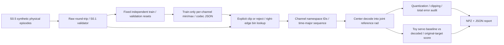

# S0.6 — Discrete Action Tokenization

## Why

Problem：连续机器人命令如何变成离散IDs？decode丢掉多少物理信息，遇训练范围外动作怎么办？
本任务建立小而显式的scalar uniform tokenizer，验证bins→IDs→decode，不训练token预测器。
不是大型tokenizer复现，也不把S0.4未知语义的真实样本拿来猜动作范围。

## Intuition

把每个关节的训练动作范围切成B个格子，每个格子用中心代表整个区间。
细格子降低范围内的最坏误差，但超出范围的值依然会被夹到边缘，不能靠更多格子恢复。
ID不是角度；必须带正确codec、channel顺序和控制语义，decode为rad reference之后才能交给controller。

## Input / Output Contract

直接复用[S0.5 generator](../../scripts/s0_5_action_representation.py)：四个独立synthetic resets，
train servo_0/1/2，validation servo_3；各T4/T+1=5，raw joint_absolute(4,2)float32 rad，q1/q2。
dt=.1s，原始servo gain=.5；raw末budget truncated、success独立。所有raw重新写读并验证，原S0.5文件不改。
只fit 12条原始训练action，不使用validation、padding或重叠窗口；本轮没有z-score或chunk tokenizer。

| Artifact / tensor | shape / dtype | modality / units / frame / temporal |
|---|---|---|
| episodes/<id>/episode.npz + JSON | S0.1 raw contract | 原始物理reference、T+1测量/clock/boundary/success |
| <id>_ids in tokens.npz | (4,2) int64 | 离散无量纲ID；仍按outgoing转移t→t+1与q1/q2顺序 |
| <id>_serialized_ids | (8,) int64 | time-major：[q1_t,q2_t,q1_(t+1),q2_(t+1),…] |
| <id>_decoded | (4,2) float32 | 有损中心reference[rad]，joint zero anchor，ordered joint axes |
| <id>_saturated | (4,2) bool | 每标量是否strictly outside训练range；不是任务success |
| tokenizer.json | scalar_action_bins/1.0 JSON | B、每通道low/high、signature、fit IDs/rows、边界与序列顺序 |
| report.json | action_tokenization_experiment/1.0 JSON | per-channel误差、boundary oracle、range leakage与toy replays |

所有输出ignored `tmp/<run>/`。NPZ读取allow_pickle=False；tokenizer/report往返核对。
每通道B个IDs：q1=0…B−1，q2=B…2B−1；词表大小2B。ID0是合法q1值，不是padding。
无PAD/BOS/EOS、无文本vocabulary映射，也没有learned embedding或模型logits。
序列长度始终8/episode；int64 IDs数值payload64bytes，原float32 action32bytes，当前存储不是压缩。

signature固定representation/anchor/unit/frame/fields/embodiment/links/controller/dt。
必须保留**本次精确tokenizer.json**（含B/ranges/rules），同ID换codec可能解码为不同物理动作。
CLI使用clip并返回saturation；`encode(...,overflow='reject')`遇超range拒绝。raw永不覆盖，clip不是静默修复。
constant range(high==low)在本v1拒绝，需显式codec扩展；不能借用S0.5 z-score scale1规则假装有非零bins范围。

## Core Concepts

1. Scalar binning每维一个token，不是整向量一个token；两个B-bin通道最多B²种组合，但词表2B、每动作2IDs。
2. Center decode是有损量化；encode(decode(ids))可以稳定，不代表decode(encode(action))完全相同。
3. Boundary规则必须明确：内部edge恰好相等进入右格，low/high端点均算范围内，high进入最后格。
4. Saturation误差与quantization误差分开；范围外没有相对原值的half-bin保证。
5. Train-only ranges可避免validation leakage；不能偷看held-out值扩大范围然后宣称无saturation。
6. 离散ID和相同shape仍不统一unit/frame/anchor/robot/controller；codec不能解释未知producer。
7. 低offline reconstruction error不自动保证controller成功；评价目标仍应是原物理目标，不能改成decoded目标。

## Mathematics

令a_(t,j)为joint_absolute reference[rad]，j=0/1，T=4；训练每通道L_j/H_j，B∈[2,65536]整数：

\[
\Delta_j=(H_j-L_j)/B,\quad e_{j,k}=L_j+k\Delta_j,\quad k=0\ldots B.
\]

finite input，显式clip：c=min(max(a,L),H)。saturation=(a<L)或(a>H)，端点不是saturation。
内部区间[e_k,e_(k+1))，最后格包含H；内部edge归右格。

\[
b_{t,j}=\min(B-1,\lfloor(c_{t,j}-L_j)/\Delta_j\rfloor),\quad
id_{t,j}=jB+b_{t,j},\quad
\hat a_{t,j}=L_j+(b_{t,j}+1/2)\Delta_j.
\]

数学floor等价于在explicit edges上查找；实现使用float64 linspace与searchsorted(side='right')，
避免floor附近的舍入歧义；测试nextafter(edge,±∞)及exact edge。输出float32加1e−7rad数值容差。

\[
|\hat a-c|\le\Delta_j/2,\qquad
|\hat a-a|\le|a-c|+\Delta_j/2.
\]

只有范围内a=c才能把半格界作为总误差界。decode(low/high)也是首末**中心**，不保留端点原值。
B翻倍、range不变时Δ/2减半；任意单点实际误差未必单调，不能把sample MAE降低当普遍定理。

手算oracle：L=[0,0]rad、H=[1,1]rad、B4，a=[[0,.25],[.5,1]]：
bin=[[0,1],[2,3]]，IDs=[[0,5],[2,7]]，decode=[[.125,.375],[.625,.875]]rad。

Toy replay使用显式feedback update q_next=q+α(reference−q)，α=.5与1分别比较原reference和decoded reference。
success判定始终max|q_final−**original r_last**|≤.02rad；四命令budget仍truncated。
report分开baseline/quantized、train/validation、full denominator与final tracking failure stage。
α1是反事实toy controller probe，不改raw source的α.5 metadata或测量。

## Architecture / Data Flow



没有模型。未来预测IDs需要embedding/classification/合法token约束，仍须decode及controller契约；
本轮只验证手写codec与已知toy动作，S0.7 chunk及后续模型任务不自动进入。

## Math / Architecture → Code

[script](../../scripts/s0_6_action_tokenization.py)：`fit_tokenizer`只接受train并记录signature；
`grid`核验codec/range/rules；`encode`分开clip与saturation，用searchsorted找到bin、加channel offset；
`decode`拒绝float IDs、负ID或错channel namespace，并输出中心float32 rad。
`boundary_probe`检查exact endpoints/内部edge/nextafter/范围外；`reconstruction_error`逐通道检查界与误差分解；
`replay`仅在toy中对原始reference评分；`main`检查manual oracle、validation污染、16类坏输入与文件round-trip。

## Minimal Experiment

已有隔离NumPy环境，无安装/下载；output必须不存在：

```bash
.venv/bin/python scripts/s0_6_action_tokenization.py --output tmp/my_s0_6
# 先预测B8→16的词表、序列长度、范围、误差界、saturation与toy结果，再运行核对。
.venv/bin/python scripts/s0_6_action_tokenization.py --bins 16 --output tmp/my_s0_6_b16
```

查看tokenizer.json的fit IDs/low/high，report的boundary_probe、各episode误差与replays。
用np.load(...,allow_pickle=False)检查IDs、serialized序列、decoded rad和saturation；对照raw第一个reference。

## Expected Result

B8→16：词表16→32，范围与raw/split不变，每episode仍(4,2)IDs/(8,)sequence；范围内误差界减半。
train无saturation，held-out超range仍saturate；clip/reject、half-bin界、boundary与namespace规则均可检查。
ID round-trip稳定但physical round-trip有损；baseline与decoded replay分开，不把decode后到达新目标当原任务成功。

## Actual Result

2026-10-14，CPU，`.venv/bin/python` Python3.12.3 / NumPy2.5.4，actual module在`.venv/lib/python3.12/site-packages/`。
没有新增依赖/安装/下载；B8与B16均PASS raw/token/codec文件往返、ID stability、boundary/半格界、16/16拒绝。
独立手算IDs、范围和误差界核对通过；pip check、本地Markdown链接、git diff --check通过。

训练range≈q1[.1,.6]rad / q2[.2,.65]rad；fit12原始actions，train IDs servo_0/1/2。
错误all-data high≈[1.3,.65]；validation q1再+.2rad变≈[1.5,.65]，正常train high保持≈[.6,.65]。

| Diagnostic | B8 | B16 |
|---|---|---|
| vocabulary / IDs per episode | 16 / 8 | 32 / 8 |
| per-channel half-bin bound [rad] | [.03125,.028125] | [.015625,.0140625] |
| servo_0 MAE [rad] | [.0125,.01875002] | [.00624999,.00703125] |
| train saturated / scalars | 0 / 24 | 0 / 24 |
| validation saturated / scalars | 5 / 8 | 5 / 8 |
| validation max total error [rad] | [.73124993,.128125] | [.71562493,.11406250] |
| gain1 train baseline success | 3 / 3 | 3 / 3 |
| gain1 train decoded success | 0 / 3 | 3 / 3 |
| gain1 validation baseline / decoded | 1/1 / 0/1 | 1/1 / 0/1 |
| gain.5 baseline / decoded (all4) | 0/4 / 0/4 | 0/4 / 0/4 |

held-out最大clipping误差≈[.69999993,.10000000]rad，与B无关；减少量化误差不能恢复被clip的值。
失败stage为final joint tracking threshold；保存所有四episode，不隐藏held-out失败。
原始四步预算仍truncated，raw success与counterfactual replay score不相互覆盖。

## Explanation

验证了一个明确的有损scalar codec、训练范围外退化和toy控制结果；没有训练或评估任何token预测模型。
测试replay有已知toy feedback，但不包含真实机器人动力学/接触/latency，没有真实robot success或泛化证据。
更大B可以降低量化界，却增大词表；当前每个标量仍一个int64 token，序列长度及存储没有减少。
成功变化与本样本/阈值/controller有关，不能推广为“更多bins一定提高robot success”。

## Failure Cases

| Failure | effect / handling |
|---|---|
| edge ambiguity / high endpoint | exact/right/nextafter oracle；high放最后bin而非ID B |
| out-of-range hidden clipping | 返回saturation并分开clip误差；reject模式测试 |
| changed range / codec version / B | 必须用本tokenizer sidecar；同IDs不保证同物理值 |
| same shape, different anchor/unit/frame/order/controller/dt | signature拒绝；tokenization不推断embodiment语义 |
| illegal namespace / float or negative ID | decode拒绝；ID0不是padding，未实现masked chunk codec |
| NaN / bad width / constant range | 拒绝；不补零或假造range |
| validation leakage / padding / repeated chunks | fit仅12原始train行；污染probe展示错误high |
| offline error vs task success | 原目标评分，保存全分母与失败stage，不以decoded目标替换原目标 |
| temporal mismatch / episode reset | 各episode独立time-major IDs，不拼接跨reset监督 |
| normalization / angles / gripper | 本v1仅raw two-joint absolute rad；不实现wrap-angle或binary gripper规则 |
| distribution shift / multimodality | held-out saturation不证明真实OOD覆盖；未学多路径或语言grounding |
| compounding error / uncertainty / latency | toy feedback重放不是learned drift/校准/部署延迟评价 |

## Relation to Robotics

离散化是在物理动作与模型符号之间的接口，不是controller。Codec必须可追踪到raw单位、reference语义与时间。
训练range限制会在部署时变成饱和命令；应该明确检测，不把“合法token”当作“合适的机器人动作”。

## Interview Capsule

30秒：我把train joint references按通道切成等宽bins，内部edge归右，decode中心；范围内误差界半格。
ID带channel namespace，codec固定单位/anchor/controller。Held-out 5/8饱和，翻倍bins仍不能恢复超range值。

2分钟：我保存raw物理文件，codec只fit12条train动作，报告量化/clipping/总误差与文件往返。
两关节每步两个IDs，B8→16词表16→32但sequence仍8，不声称压缩或大型tokenizer复现。
16类坏输入拒绝，边界用nextafter与手算oracle验证。Toy gain1相对原始目标评分，train decoded success0/3→3/3，
validation仍0/1；gain.5四条都失败。低离线误差不是控制成功，toy结果不是真实robot generalization。

## Likely Follow-up Questions

1. 本tokenizer的range、bin、channel-specific ID与center decode如何定义？内部edge与low/high如何处理？
2. 为什么physical round-trip有损而ID round-trip可稳定？半bin误差界什么时候适用？
3. 为什么range只能fit原始train actions？held-out超range时clip与reject各意味着什么，增加B能否解决？
4. B8→16改变词表、序列长度、界和实际误差哪些量？ID0和非法channel ID怎么区分？
5. 为什么replay必须用原物理目标评分？本次toy baseline/decoded train/validation结果能证明与不能证明什么？

## Must Remember

- ID不是rad；必须带准确codec与物理语义。
- 内部edge归右，端点范围内，但decode为中心。
- 半格界只约束in-range总误差；saturation单独记录。
- train-only ranges；更多bins不扩展范围，也不自动缩短序列。
- Reconstruction error≠control success；toy replay≠真实机器人泛化。

## My Verification

- [ ] Run：新目录运行，检查raw/codec/IDs/decoded/saturation和toy replay report。
- [ ] Modify：先预测B8→16的范围、词表、序列长度、误差界、saturation与toy成功变化，再运行核对。
- [ ] Explain：独立回答五问，手算B4 oracle并解释half-bin界与range外误差。

Current Task = S0.6；Next Task = S0.7 — Action Chunk Representation。
Engineering Complete；Learning待用户确认。STOP，不自动进入S0.7。
