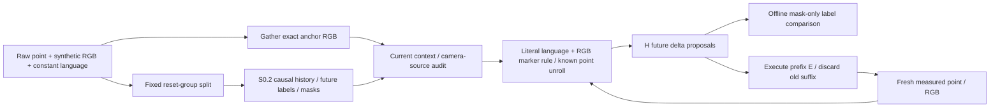

# S0.7 — Action Chunk Representation

## Why

Problem：模型给出的未来H个动作如何与当前RGB、语言、状态历史对齐？预测H步是否必须执行H步？
本任务复用S0.2窗口与S0.1 raw契约，增加显式synthetic RGB/language条件，验证末端mask、因果输入和execution prefix。
不训练VLA，也不实现Stage1模型或Stage3 learned world model；手写规则只用于让表示和执行差异可检查。

## Intuition

一次看当前场景，按指令选红点或蓝点，提出未来H次world XY displacement。
每次只执行前E次，再取新观测；尚未执行的旧计划丢弃，重新生成chunk。
H决定输出shape；E决定多久重新观察与决策。示范末端缺未来labels要mask，不能用零值推断是否有效。

## Input / Output Contract

CPU NumPy计算；已有Pillow仅生成PNG预览，无新依赖/下载。
6 synthetic episodes，3独立scene/reset groups；每组红/蓝指令各一条，相同初始状态与图像。
group0/1为train（T2/T6各两条，共16actions），group2为validation（T4两条，共8actions）。
先按reset固定split，再window；相关红蓝pair不能拆开。无normalization拟合或模型训练。

Synthetic point：p=[x,y]world m，controller为每区间直接施加delta；dt=.1s，每通道最大|delta|=.06m。
红目标[.24,0]m，蓝目标[−.24,0]m；三组初始p分别[0,−.12]、[0,.12]、[.06,−.12]m。
raw符合embodied_episode/1.0，T个actions/T+1个states、images、clock；budget耗尽truncated，success独立。
六条raw成功标注为False/False/True/True/True/False；保留失败示范，不把correct label当task success。

| Raw / derived field | shape / dtype | modality / units / frame / temporal |
|---|---|---|
| raw proprioception | (T+1,2) float32 | measured world XY[m] at i=0…T |
| raw image | (T+1,32,32,3) uint8 | synthetic RGB HWC，0–255，当前状态与静态目标markers |
| raw action | (T,2) float32 | world XY displacement[m]，由当前测量决定，转移t→t+1 |
| raw timestamp | (T+1,) float64 | 相对秒，i×.1 |
| terminated/truncated | (T,) bool | 末budget truncated=True；success不由boundary推断 |
| observation in chunk NPZ | (N,L,2) float32 | causal state history ending at anchor t；left zero padding |
| observation_mask/index | (N,L) bool/int64 | True=real，padding index=−1 |
| image/image_index | (N,32,32,3) uint8 / (N,) int64 | **仅anchor RGB**，image_index=t；不取未来/terminal图像 |
| language_instruction | (N,) Unicode string | literal `move to red` / `move to blue`，episode constant |
| action / predicted | (N,H,2) float32 | offline future labels / handwritten proposals，world m；labels有right padding |
| action_mask/index | (N,H) bool/int64 | True iff t+k<T，padding index=−1 |
| anchor / episode_id / group_id | (N,) index/string | 每个有效动作一个anchor，不以terminal o_T作输入anchor |

Camera：u=16+x/.02，v=16−y/.02；32×32，nearest pixel，.02m/pixel，world y向上对应image v向下。
背景[10,10,10]，agent黄、goal红/蓝各一像素；先画agent再画goal，重叠时goal仍可见。
精确marker检索是假设，不是真实camera/learned vision；caption在preview外侧，不进入policy图像。
目标位于u28/u4,v16；goal静态可见，是合法任务条件，不是未来结果标签。

Planner只接收history、history_mask、anchor image、language、H。
**action_mask/未来action/未来state/未来RGB/episode success均不传入planner**。
当前手写规则只使用history最后一个真实state；L表示输入契约，不声称已学temporal encoder。
无tokenizer、normalized输入、embedding/fusion或neural action head。

Artifacts：ignored `tmp/<run>/episodes/`、train_chunks.npz、validation_chunks.npz、
context_preview.png、report.json（action_chunk_context_experiment/1.0）；读取NPZ allow_pickle=False。
Raw契约不升级，S0.2 state-only reader未放宽；S0.7专用context函数显式附加并审核anchor RGB。

## Core Concepts

1. Chunk是按时间排序的(H,A)未来命令，batch(N,H,A)，不是一个二维action重复H次。
2. 历史只到t，目标从a_t开始；o_T保留在raw，但不产生训练anchor或action_T。
3. Mask由source index与episode边界定义；真实zero action仍必须参与loss，padding不参与。
4. H prediction horizon、E execution prefix、dt control interval是三个不同量；1≤E≤H。
5. 推理时planner没有示范末端action_mask；固定rollout budget明确限制实际执行数，不把mask当“能知未来何时结束”。
6. Chunk后续delta由计划内simulated state计算；扰动后这些状态可能不再是真实状态，旧后缀会stale。
7. Exact offline label equality不保证扰动后成功；本例甚至失败示范也能有零label loss。

## Mathematics

本toy输入c_t=(p_(max(0,t−L+1):t), I_t, ℓ)，状态[m]、图像uint8、语言string都属于时刻t已知条件。
pixel目标映射g(ℓ,I_t)∈R²[m]；规则精确匹配文字与RGBmarker，不涉及概率或学习。

\[
\tilde p_{t,0}=p_t,\qquad
\hat a_{t,k}=\operatorname{clip}(g-\tilde p_{t,k},-.06,.06),\qquad
\tilde p_{t,k+1}=\tilde p_{t,k}+\hat a_{t,k},\quad k=0\ldots H-1.
\]

这是known ideal-point unroll，不读取future measured state，不代表learned world-model prediction。

\[
Y_t[k]=\begin{cases}a_{t+k}&t+k<T\\0&\text{padding}\end{cases},\quad
M_t[k]=[t+k<T].
\]
\[
\mathcal L=\frac{\sum_{n,k,j}M_{n,k}(\hat A_{n,k,j}-Y_{n,k,j})^2}
{A\sum_{n,k}M_{n,k}},\quad A=2.
\]

Masked MSE单位m²、每valid scalar平均；训练分母84、validation40（默认H4）。
实现先索引real slots再算差，padding预测改NaN仍不影响loss；全空mask拒绝。

手算T2、L2、H4、anchor1：history indices[0,1]；action indices[1,−1,−1,−1]、mask[T,F,F,F]。
group0 red此时p=[.06,−.06]，计划[[.06,.06],[.06,0],[.06,0],[0,0]]m；
只第一条有source label，其余planner proposals不能因“没有示范label”就被改成实际执行动作。
T6、anchor5的source action=[0,0]依然valid，其后的padding也是0但mask=False。

每个H≥1的anchor数量N=Σepisodes T，不随H改变；valid tokens=Σ_t min(H,T−t)。
默认train42/validation20；H2为28/14；H1为16/8。

执行时prefix长度=min(E,H,remaining explicit budget)，每次执行后才更新真实point。
在四步rollout中，E1每.1s决策，E4每.4s决策（本toy假设零调度延迟）；H均4不变。
第2次转移后固定外部扰动+ .12m到world x，改变真实p但旧chunk未自动修正。
score=max|p_final−selected original goal|≤1e−6m；四步budget truncated与success独立。

## Architecture / Data Flow



未来learned VLA需要encoder/fusion/action head；这里明确只提供输入/输出契约与rule baseline。
不把简单prefix比较扩展为Stage4 planner或训练Stage1 policy，下一任务仍须用户选择。

## Math / Architecture → Code

[script](../../scripts/s0_7_action_chunk.py)：`render`按公开pixel-world规则造RGB；
`demonstration`用selected physical goal生成raw、S0.1 validator验证；`round_trip`复用已有文件边界。
`context_windows`复用S0.2 make_windows，再附加anchor image；`audit_context`审核state/action index、RGB index/value、language与camera声明。
`target_from_context/plan`仅解析当前marker和literal instruction，unroll H；`predictions`逐窗口调用。
`rollout`执行prefix、插入相同物理扰动、刷新上下文，保存全部trace/commands/decision ticks/success/failure stage。
record的rule-planner latency是本机单次plan调用耗时，不包含render/controller，不是neural inference或部署benchmark。
未来/result intervention仅修改内存反事实副本，检查anchor0输入和预测不变；不是合法物理轨迹导出，raw原件不改。

## Minimal Experiment

仓库根目录、已有NumPy/Pillow环境，output必须不存在：

```bash
.venv/bin/python scripts/s0_7_action_chunk.py --output tmp/my_s0_7
# 先预测H不变、E1→4对dataset、calls、扰动响应与success的影响。
.venv/bin/python scripts/s0_7_action_chunk.py --execute 4 --output tmp/my_s0_7_e4
```

打开context_preview.png、report.json，检查split/chunk masks/indices、raw合法zero和rollout decision ticks。
可选`--horizon 2`保持E1，检查H变化对target shape/count的影响；不是默认Modify要求。

## Expected Result

默认train16anchors/validation8，H4 targets(16,4,2)/(8,4,2)，valid tokens42/20。
paired RGB/state相同而指令不同导致不同rule chunks；输入没有future/result leakage；masked loss为0，NaN padding不影响。
E1→4不改变raw、dataset或offline loss；四步rollout调用4→1，无扰动均2/2，扰动后旧chunk可能stale。

## Actual Result

2026-10-14，CPU，`.venv/bin/python` Python3.12.3，NumPy2.5.4 / Pillow12.3.0，actual module均在venv内。
无新依赖、安装或数据/模型下载；Pillow只做本地PNG preview，已查看三组paired场景与caption。
H4/E1、H4/E4、H2/E1、L1/H1/E1四次均PASS raw/chunk round-trip、source-index/context audit、
RGB/state同输入不同指令、future/result intervention、masked loss及12/12拒绝检查。
本地Markdown链接、pip check与git diff --check通过；独立手算indices/count/trace和E变化不变量检查通过。

| Result | H4/E1 | H4/E4 |
|---|---|---|
| raw / split / dataset | 相同 | 相同 |
| train / validation anchors | 16 / 8 | 16 / 8 |
| valid action tokens | 42 / 20 | 42 / 20 |
| masked MSE[m²] | 0 / 0 | 0 / 0 |
| rule calls per four-step rollout | 4 | 1 |
| nominal success | 2/2 | 2/2 |
| +.12m x扰动 success | 1/2 | 0/2 |
| disturbed red final error[m] | 0 | ≈.12 |
| disturbed blue final error[m] | ≈.12 | ≈.12 |

扰动发生在第2次转移后：red正好到goal，E1重新观察后输出zero，E4继续旧delta而overshoot；
blue被向相反方向推回，剩余两步每步最多.06m，E1也无法在预算内到goal。所有失败stage=final goal error after command budget。
这是固定toy扰动/限步反例，不证明短prefix总能成功，也不证明long chunk总会失败。
单次rule latency在report中逐rollout保存median/max与实际样本数，值随本机调度变化，不冻结成性能结论。

Raw 6episode共24有效动作，5行合法zero-vector，success3/6且全部truncated；failure episodes保留。
H2 valid tokens28/14；H1 valid tokens16/8。H变化保持split/anchor/context/raw不变，L1去除history padding。
默认末anchor indices train[5,−1,−1,−1] / validation[3,−1,−1,−1]，mask均[T,F,F,F]。
E只影响inference prefix，不改变离线target H或mask；S0.6 tokenization没有在本轮扩展为chunk codec。

## Explanation

验证了当前context到未来动作的shape、time alignment、mask，以及固定扰动下prefix刷新频率的效果。
offline0证明手写生成规则与标签一致，不是训练得到的language grounding/visual perception或泛化。
图像解析依赖精确颜色与已知calibration，动力学为理想点，不包含real camera、latency、servo/contact/inertia。
固定两条rollout每条件的完整分母是toy evidence，不是真实robot success、VLA模型表现或统计稳健benchmark。

## Failure Cases

| Failure | consequence / handling |
|---|---|
| future RGB/state/success input | image index/value审计及anchor0 intervention；future result不传planner |
| terminal anchor / cross-reset target | S0.2 audit保证t<T，不跨episode；related language pair保留同group |
| zero treated padding | raw5行合法zero，validity只看indices/mask |
| padded NaN / empty mask | 先选real slots再loss；NaN padding忽略，全空mask拒绝 |
| H confused with E | CLI要求1≤E≤H；不改变offline H，末budget只执行有效prefix长度 |
| stale chunk after disturbance | 丢弃未执行后缀、重新观测；E4固定扰动overshoot反例 |
| budget-limited recovery | E1 blue依然失败；保存全分母与error/stage，不能过称鲁棒性 |
| absent/ambiguous marker / language / camera mismatch | known literal与单marker规则拒绝，metadata camera不兼容拒绝 |
| incorrect action anchor/frame/controller | 本toy为world incremental displacement，不能照搬joint absolute或旋转tool delta |
| normalization / dataset leakage | 本轮不fit统计；未来normalizer仍须train-only raw，不能fit重叠chunks |
| multimodality / distribution shift | 手写单路径与两literal指令，无多路径/自然语言泛化证据 |
| compounding error / uncertainty / latency | known unroll不代表learned预测误差/校准；single-rule timing不代表部署延迟 |

## Relation to Robotics

Chunk是policy与controller之间带时间的命令序列；H/E/dt决定反馈时机和执行解释。
P3的chunk/mask/闭环经验在这里扩展为vision-language条件契约，不重复旧模型或import旧repo。

## Interview Capsule

30秒：我把causal state history、anchor RGB与literal指令映射到H个world delta，末端label按source index mask。
H是输出长度、E是实际prefix；H4固定时E1→4调用4→1，toy扰动success1/2→0/2，即使离线loss都是0。

2分钟：我复用S0.2 index audit，并显式附加anchor RGB；raw保留T+1，terminal不做policy anchor。
两颜色指令共享场景但rule输出不同，未声称learned language/vision。5行真实zero不能由数值误判成padding；
NaN padding不影响masked loss。相同扰动下red短prefix停在goal、long prefix继续旧计划overshoot，
blue短prefix也因预算不足失败。我保存全部trace/error/失败stage与rule timing，不称真实robot benchmark。
Stage0工程包完成后，下一模型任务仍等待用户选择，Learning须用户Run/Modify/Explain确认。

## Likely Follow-up Questions

1. Context包含什么，shape/dtype/unit/frame/时间含义是什么？为什么不能读future RGB或success？
2. T2/L2/H4在anchor1的history/target index和mask怎样？T6末端zero action为什么仍valid？
3. H、E、dt分别决定什么？H4/E1→E4对dataset、policy calls、反馈频率与扰动效果有什么影响？
4. 为什么offline masked MSE=0仍可能失败？本次red/blue的扰动失败stage如何解释？
5. 哪些部分是手写规则而非learned VLA？paired language、future intervention与toy rollouts能证明和不能证明什么？

## Must Remember

- Context止于anchor t；labels从a_t起，terminal保留但不产生anchor。
- Chunk=(H,A)，H/E/dt分开。
- Mask按source index，zero不等于padding。
- Offline label equality不是闭环成功；短prefix也可能失败。
- Exact-color rule与known point unroll不是learned VLA或world model。

## My Verification

- [x] Run：新目录运行，查看RGB preview、raw/contexts/masks与四条rollout traces。
- [x] Modify：先预测H4固定、E1→4的dataset/calls/反馈/success变化，再运行核对。
- [x] Explain：独立回答五问，手算T2 anchor1并解释扰动后red/blue区别。

2026-10-14 用户确认实验和预测均已完成，并提交五项 Explain：causal state/RGB/language context与future leakage，
T2/L2/H4 anchor1的indices/masks及真实zero action有效性，H/E/dt区别与E变化不变量，
offline0不代表扰动成功、red stale chunk overshoot与blue预算不足，以及手写规则/因果检查/toy证据的能力边界。
Learning Mastered依据用户报告确认；本轮未重新运行实验。Stage0全部任务已完成工程与学习验收。

Current Task = S0.7；Next Task = S1.1 — Language-conditioned State Policy。
Engineering Complete + Learning Mastered（2026-10-14 用户确认）。STOP，不自动进入Stage1/S1.1。
