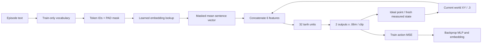

# S1.2 — Tiny Language Representation

## Problem

S1.1直接把两条literal指令映射为one-hot。本任务把中间过程展开：文本如何分词、变成ID、
查可学习embedding、汇聚成句子向量，再影响动作？模型遇到未知词会丢失什么信息？
范围仅S1.2，未实现视觉encoder，也不扩展为S1.6的paraphrase泛化任务。

## Intuition

ID是词表中的地址，不是词义或大小关系。Embedding是可训练表格，每个词占一行；
把有效词向量平均得到句子向量，再拼接当前位置。训练动作误差会一路反传到词向量。
PAD表示不存在的槽，UNK表示存在但不认识的词，两者不能混为一谈。

## Input / Output Contract

CPU NumPy，无新依赖/安装、公开数据/模型下载。复用S1.1原始generator和契约，
60 synthetic episodes，30 independent reset groups，各左右两条，T10/T+1=11，dt=.1s。
train groups0–23共480actions，validation groups24–29共120actions；先split再fit词表。
目标left[−.24,0]、right[.24,0]m；world XY ideal point，动作每分量限幅±.06m，H=E=1。
原始NPZ+JSON不归一化，预算结束truncated，success独立。

| 数据 | shape / dtype | 含义、单位、时间 |
|---|---|---|
| raw state/action | (11,2)/(10,2) float32 | measured world XY[m]，state_t→action_t→state_(t+1) |
| raw clock | (11,) float64 | episode-relative seconds，0…1 |
| text | string；export (N,) Unicode | episode指令，训练只含move left/right |
| IDs | (N,4) int64 | 右侧PAD，最大4词；整数索引，无物理单位 |
| token mask | (N,4) bool | True=真实词，包含UNK；False=PAD |
| embedding table E | (5,4) float32 | 每词4维可学习无量纲特征，非world坐标 |
| lookup | (N,4,4) float32 | batch、token槽、embedding通道 |
| sentence z | (N,4) float32 | masked mean，无时间序列含义 |
| fused input | (N,6) float32 | [world_x/.3,world_y/.3,z_0…z_3]，当前状态 |
| hidden/output | (N,32)/(N,2) float32 | tanh hidden；线性输出为无量纲delta |
| decoded/executed action | (N,2) float32 | 输出×.06m，再clip到±.06m，作用于t→t+1 |

### Tokenizer边界

`str.lower().split()`：大小写折叠、按空白分词；不去标点，不做subword，不猜同义词。
只从train文本建立sorted词表：`<PAD>:0, <UNK>:1, left:2, move:3, right:4`。
`move left`→IDs[3,2,0,0]、mask[T,T,F,F]。
空句子、超过4词拒绝，不静默截断；`right!`与`right`不同，前者OOV。

默认`--unk-policy reject`：未知词在执行前拒绝。实验开关`map`：未知词映射ID1，mask=True。
PAD与UNK初始都为零向量，但只有PAD被mask掉。训练中没有UNK样本，其向量一直是零，
不应把它当成学会了“未知词的意思”。known词行由动作loss更新。
所有词都在词表内，也不代表句子语义可理解；模型没有grammar/否定/词序机制。

## Concepts

Tokenization是离散字符串处理，不可微；embedding lookup后的浮点参数可以反传。
Mask来源是实际token槽，不是向量数值是否为零。这里token mask与S0 action-label mask语义不同。
Mean pooling是bag-of-words表示：词序打乱不改变数学结果；重复词会改变相对权重。
训练只见`move left/right`两种共现模式，单个词向量语义不可唯一辨认；没有预训练语义。

未知词probe预先固定：`move port`→left、`move starboard`→right、`please move left/right`。
这些goal由评价器人工标注，绝不传入policy；port/starboard只是本toy的左右标签约定。
每类6个未见reset，共24episodes，拒绝也保留在完整分母，不把拒绝叫成控制成功。
这不是独立大规模泛化benchmark，也没有validation选epoch或多seed统计。

## Mathematics

词ID I_(n,k)，mask M_(n,k)∈{0,1}，词表E∈R^(5×4)。

z_n = Σ_k M_(n,k) E[I_(n,k)] / c_n，c_n=Σ_k M_(n,k)>0。

x_n=[p_n/.3,z_n]；h=tanh(xW1+b1)；u=hW2+b2；a_raw=.06u；
a_exec=clip(a_raw,−.06,.06)。L=mean((u−a*/.06)²)，物理raw MSE=L×.06²[m²]。
E(5,4)、W1(6,32)、b1(32)、W2(32,2)、b2(2)，共310参数。

由MLP反传得到dL/dz_n后，每个有效词槽贡献(dL/dz_n)/c_n，
相同ID的贡献必须相加：dE[v]=Σ_(n,k:I=v) M_(n,k)(dL/dz_n)/c_n。
`np.add.at`处理重复词/重复batch ID，不能用覆盖赋值。PAD梯度为0。
优化器沿用显式Adam(.9,.999,lr=.01,eps=1e−8)，全batch2000步、seed7。
固定scale不fit统计；tokenizer和embedding只使用train，没有未来state/success输入。

两个关键手算：

- `move port`/`move starboard`均为[3,1,0,0]，同state下表示/动作/确定性轨迹相同，无法区分两个目标。
- E[UNK]=0，`please move right`的z=(E[move]+E[right])/3，等于原z的2/3；零UNK不等于忽略UNK。

Known rollout10步，p_next=p+a_exec，末max|p−goal|≤.01m成功；保存所有trace/commands/error/stage。
推理latency包含tokenization、lookup、pooling、MLP和clip，排除环境；不能单独证明完整.1s控制周期可满足。

## Architecture / Data Flow



## Math / Architecture → Code

[script](../../scripts/s1_2_language_representation.py)：`words/fit_vocab/tokenize`对应文本→IDs；
`forward`查表并以mask选择真实槽后平均，避免PAD NaN污染；`gradients`把误差累加回embedding行。
`train`联合优化E与MLP，保存训练曲线及初始embedding；`checks`逐参数有限差分及边界验证。
复用S1.1 `dataset`写原始数据，再由`read_batches`读取raw；它附带的train.npz one-hot导出仅供上下文，
**S1.2训练输入在train_tokens.npz/validation_tokens.npz，不使用one-hot特征**。
`rollout`只接state和text，goal index仅用于末端评价。

## Minimal Experiment

仓库根目录，输出须新目录；先读本包至Mathematics：

```bash
.venv/bin/python scripts/s1_2_language_representation.py --output tmp/my_s1_2
# 先预测reject→map对词表/权重/known结果/OOV失败stage的影响，再运行：
.venv/bin/python scripts/s1_2_language_representation.py --unk-policy map --output tmp/my_s1_2_map
```

打开tokenizer.json与report.json的diagnostics，手算IDs、mask和句子向量。
weights.npz含初始/训练后embedding、MLP；tokens.npz含text、IDs、mask、sentence、physical state/action及group。
全部NPZ读取allow_pickle=False，artifacts/env保持ignored。

## Expected Result

已知两指令可学习区分，但不能预设闭环必定成功。
reject→map不影响train文本、词表、split、初始化、权重或known输出，只改变OOV执行方式。
未知词从拒绝变为可执行，不等于理解了未知词；同ID冲突无法靠增加MLP训练解决。
增加零UNK会改变mean分母，默认两词训练没有覆盖这种句子向量。

## Actual Result

2026-10-17 CPU，repo .venv Python3.14.7 / NumPy2.5.4，actual模块均在venv；无安装/下载。
默认与map训练完全一致，跨run逐值核对weights、initial embedding、train/validation tokens与metrics通过。

| 指标 | reject | map |
|---|---:|---:|
| train / validation samples | 480 / 120 | 480 / 120 |
| train raw MSE[m²] | 1.37478e−6 | 相同 |
| validation raw MSE[m²] | 1.60661e−6 | 相同 |
| validation executed MSE[m²] | 1.29141e−6 | 相同 |
| known held-out toy success | 12/12 | 12/12 |
| OOV probe success（含拒绝） | 0/24 | 0/24 |
| OOV拒绝 | 24/24 | 0/24 |
| OOV失败stage | tokenization rejected unknown word | 10步预算终点误差 |

map下四类probe各0/6，即使首步方向看似正确也未到目标。
同state[0,0]，move port/starboard都输出约[−.024463,.003399]m；
please move right约[.045106,−.000034]m，不能由首步方向推断成功。

梯度最大绝对差≈9.01e−13；float64小网络逐参数验证embedding+MLP，含重复词。
PAD NaN不影响输出、词序置换不变、UNK collision、零UNK使mean缩放2/3，以及7类非法输入拒绝通过。
raw契约/转移/终点/round-trip/group split复用S1.1检查；tokenizer、weights与token NPZ重载核对。
独立核对两模式权重/token不变、训练词表不含probe词、map轨迹转移和动作限幅。
known记录120次推理，map OOV另240次；reject OOV未推理，latency=null，不假造推理计时。

## Result / Explanation

学习到的embedding足够支持这个固定两指令point任务，不意味着比S1.1 one-hot更强或高效。
本包价值在于展示可训练语言通路和明确的信息损失：PAD与UNK、pooling分母、未知词碰撞和词序丢失。
降低known loss不能修复已被tokenizer合并的语义区别；需要词表/数据/表示的变化，但不在本任务自动扩展。

## Failure Analysis / Limitations

| 失败/限制 | 机制与证据 |
|---|---|
| OOV collision | port/starboard/right!共享UNK，方向信息丢失；不能通过MLP恢复 |
| 零UNK当PAD | mask=True仍计入平均；please导致句向量缩放，map rollout未成功 |
| punctuation | right!不是right；当前分词故意简单，report显式展示 |
| order / negation | move left与left move表示相同；不支持词序理解，未知not会被拒绝或UNK |
| repeated words | move left left加大left相对权重，属于未训练句式；不是幂等 |
| vocab leakage | train-only词表固定；不能为了让OOV通过而从validation/probes扩词表 |
| empty / overflow / invalid IDs | 明确拒绝，不静默截断或用负ID索引 |
| offline vs closed loop | 只known label低误差不保证OOV部署；保存完整24失败 |
| small evidence / uncertainty | 一个seed、6新reset、静态两目标，无视觉/接触/噪声或校准证据 |
| latency | 仅成功调用的局部计时，含tokenization；不是完整robot时延或S1.1公平速度比较 |

## Relation to Robotics

语言表示只改变条件编码；physical action的frame、anchor、dt和controller契约不变。
真实机器人仍须审计传感和执行接口。旧仓库未修改/导入；本包不是视觉语言动作模型。

## Interview Capsule / Notes

30秒：我用train-only词表把两条指令变成token IDs，查4维learned embedding，再masked mean与world XY拼接进MLP。
310参数CPU NumPy手写反向，held-out known12/12；OOV拒绝24条，映射UNK后仍0/24，不能称语言泛化。

2分钟：解释IDs是索引、E可微、mask与零向量不同，重复ID梯度累加；说明零UNK改变平均分母，
不同OOV碰撞成同ID导致信息不可恢复。模型只在两种词共现上训练，句向量没有词序，单词语义不可辨识。
闭环、失败stage、latency保留完整分母；不把首步正确方向或低known loss叫未知语义理解。

## Likely Follow-up Questions

1. 从`move left`到动作，逐层shape/dtype/unit是什么？哪些参数可学习，ID本身可微吗？
2. PAD和UNK为何不同？手算`please move right`在零UNK下的mean，为什么不是原向量？
3. 为什么move port/starboard碰撞后同state会输出相同动作？能靠更多MLP训练解决吗？
4. masked mean丢失什么？left move、move left left与原句的表示分别怎样变化？
5. reject→map哪些东西不变？0/24的两种失败stage各是什么，如何区分拒绝、可执行和理解？

## Must Remember

ID≠语义；PAD≠UNK；零向量≠不存在；mean丢词序；词表train-only；known成功≠OOV理解。

## My Verification

- [x] Run：运行默认，读tokenizer/embedding/token mask与known/OOV报告。
- [x] Modify：先预测reject→map的权重/known/OOV结果与失败stage，再运行核对。
- [x] Explain：独立回答五问，手算零UNK平均与两个OOV的ID碰撞。

Current Task = S1.2；Next Task = S1.3（仅计划）。Engineering Complete + Learning Mastered（2026-10-17 用户确认），不自动推进。

2026-10-17 用户明确确认实验和预测均已完成，五项 Explain 准确覆盖token IDs→embedding→masked mean→
state融合→物理动作的shape/dtype/unit，以及310个浮点参数可学习、离散ID不可微。
正确手算零UNK下please使句向量变为原句2/3，区分PAD不存在与UNK存在；解释OOV碰撞丢失的信息
无法靠增加MLP训练恢复，mean忽略词序、重复词改变权重。
准确说明reject→map保持训练数据/词表/权重/known结果不变，并区分0/24的tokenization拒绝与执行后终点失败。
用户明确区分输入被接受、能产生动作与理解指令。学习状态依据用户报告确认，本轮未重跑实验。
