# S1.3 — Tiny Visual Encoder

## Problem

S1.2展开了语言表示，本节单独展开视觉表示：32×32 RGB怎样经过可训练CNN，变成空间feature map/token？
如果要定位目标，为什么不能随意把空间轴平均掉？只做本任务，不接语言、不实现S1.4多模态融合。

## Intuition

让同一个小滤波器滑过整张图，学习区分红目标、蓝干扰物和背景。每个空间格给出4维特征，
再算目标热图。保留每个格对应的像素中心，按热图加权平均得到位置；已知相机映射把像素位置转成world XY。
CNN学习识别局部图案，空间网格、坐标换算和控制器是显式固定规则。

## Input / Output Contract

CPU NumPy，无安装/下载；当前venv无Pillow，用标准库struct/zlib保存PNG预览。
独立场景契约`synthetic_visual_scene/1.0`，见输出dataset_contract.json；**不是episode训练集**。
120张静态场景，目标中心从13×13奇数像素格{3,5,…,27}²无放回选取：train96/validation24。
固定数据seed11，scene ID与target center在两split都不重叠；blue位置可跨split复用。
每图一个3×3 red square [240,20,20]、一个blue distractor [20,20,240]，背景[8,8,8]，
中心Chebyshev距离至少6像素，物体不重叠；无agent marker、文字、水印或success信息。
held-out只表示同renderer下未见目标中心，不代表新物体/真实场景/任意像素泛化。

| 层/数据 | shape / dtype | 模态、单位、frame、时间 |
|---|---|---|
| raw RGB | (N,32,32,3) uint8 | HWC RGB 0…255；当前静态场景，非未来图像 |
| preprocessing | (N,32,32,3) float32 | /255→[0,1]；固定scale，不fit统计 |
| patches | (N,225,27) float32 | 15×15空间格，每格3×3×3，dy/dx/channel展开 |
| CNN kernel/bias | (27,4)/(4,) float32 | 等价3×3 RGB→4通道，stride2，valid、无padding |
| feature map F | (N,15,15,4) float32 | tanh后局部特征，无量纲，非物理坐标 |
| spatial tokens | (N,225,4) float32 | row-major空间位置序列，**不是225个时间步** |
| global mean | (N,4) float32 | feature在空间轴平均，仅供信息损失诊断 |
| heatmap logits/P | (N,225) float32 | 4→1共享线性head、空间softmax；无量纲 |
| predicted pixel uv | (N,2) float32 | u向右/v向下，单位pixel，soft-argmax坐标 |
| predicted world XY | (N,2) float32 | x向右/y向上，m；相机映射固定 |
| target_uv/index/world | (N,2)/(N,)/(N,2) int64/int64/float32 | generator标签，只进loss或评价，不进CNN |

Camera固定正交：u=16+x/.02，v=16−y/.02，.02m/pixel；无真实镜头、透视、延迟或标定误差。
stride2、kernel3、valid输出floor((32−3)/2)+1=15，感受野3×3。
格(r,c)的像素中心(u,v)=(1+2c,1+2r)；边缘像素31未被覆盖。
label center奇数且处于3…27，保证有对应格；未测试偶数/亚像素目标。

## Core Concepts

卷积在每个位置共享参数，容易复用局部检测器；它不自动输出物理位置。
空间token的内容是局部特征，其在数组中的位置与固定网格共同提供空间信息。
全局平均可能丢失位置；本实验在目标内部平移且无边缘/重叠变化时展示这个限制，不声称任何CNN的GAP都绝对不含位置。
热图softmax总和为1，即使没有目标也会输出某个分布；peak probability不是经过校准的可见性/成功概率。

## Mathematics

X_(n,j)∈R²⁷为第j格的RGB patch，W∈R^(27×4)，b∈R⁴，q∈R⁴。
F_(n,j)=tanh(X_(n,j)W+b)，s_(n,j)=F_(n,j)·q，
P_(n,j)=exp(s_(n,j)−max(s_n))/Σ_k exp(s_(n,k)−max(s_n))。

L=−(1/N)Σ_n log P_(n,j*_n)，cross entropy无量纲；j*由generator的red中心映射。
这是中心格分类监督，不是整张分割图，也不是BC action loss。

D=(P−one_hot(j*))/N；dq=Σ_(n,j) F_(n,j)D_(n,j)；
B_(n,j)=D_(n,j)q⊙(1−F_(n,j)²)；dW=X_flatᵀ B_flat；db=Σ_(n,j)B。
参数共27×4+4+4=116。手写反向，Adam lr=.03、β1=.9、β2=.999、eps=1e−8，full batch400步、seed7。
不按validation选checkpoint；无预训练权重、learned language或world model。

uv_hat=Σ_j P_j grid_uv_j；world_hat=[(u_hat−16)×.02,(16−v_hat)×.02]m。
报告world每scalar MSE[m²]、平均欧氏误差[m]、pixel误差及peak cell accuracy。
均匀热图的网格均值是[15,15]pixel→[−.02,+.02]m，**不是world原点**。

## Architecture / Data Flow

```mermaid
flowchart LR
  R[Current RGB uint8] --> N[float32 /255]
  N --> C[3x3 stride2 Conv / 4 channels / tanh]
  C --> F[15x15x4 spatial feature map]
  F --> T[225x4 spatial tokens]
  T --> H[Shared 4-to-1 head / spatial softmax]
  H --> U[Soft-argmax on known pixel grid]
  U --> W[Fixed pixel-to-world mapping]
  W --> A[Fixed goal-error delta controller]
  P[Measured point XY] --> A
  A --> E[Ideal point update / fresh observation]
  E --> P
```



## Math / Architecture → Code

[script](../../scripts/s1_3_visual_encoder.py)：`render/make_data`生成raw RGB与独立标签/scene split；
`patches`显式展开3×3 stride2窗口，不使用黑盒视觉encoder；`forward/gradients/train`实现CNN/CE反向/Adam。
`coordinates/pixel_to_world`是固定readout；`evaluate`做held-out定位评价；`rollouts`接预测目标与真实当前点执行。
`checks`逐参数有限差分、patch顺序/stride oracle、像素与world手算及5类输入拒绝。
`png`只使用标准库输出预览，未安装Pillow，也未更改旧实验依赖。

## Minimal Experiment

在仓库根目录执行，新输出目录；先读到Mathematics：

```bash
.venv/bin/python scripts/s1_3_visual_encoder.py --output tmp/my_s1_3
# 先预测visible→occluded对训练、特征和选定评价的影响，再执行：
.venv/bin/python scripts/s1_3_visual_encoder.py --observation occluded --output tmp/my_s1_3_occluded
```

每次都记录visible、occluded、blank三条件，`--observation`只选择主报告条件
(selected_observation/selected_successes)，不改训练或重新定义目标。这样两次可以直接核对同一组对照。
visible原图；occluded通过不绘制红物体模拟完全遮挡，blue仍在；blank只留背景。
评价目标保留原物理位置，不因遮挡改标签；不声称模拟真实遮挡几何。

打开preview.png：每行一个validation scene，三列依次是原RGB、相对峰值归一化热图、遮红RGB。
注意PNG热图为可视化单独拉伸亮度，亮点不能当成绝对置信度；report记录真实概率。
train/validation.npz存raw RGB和labels；*_features.npz存F/tokens/GAP/P/predicted coordinates；
weights.npz存kernel/bias/head和initial_kernel，dataset_contract.json声明frame/shape/split。
全部NPZ禁用pickle，生成物在ignored tmp中；不覆盖已有目录。

## Expected Result

可学习的局部检测器有机会在未见目标中心定位红目标，但不预设一般视觉泛化。
保留空间位置的readout会随目标移动；对本实验的内部平移，GAP近似不变。
遮红/blank下输入信息缺失，低train CE不能保证成功；输出坐标不表示模型已检测“目标存在”。
visible→occluded不改变raw、split、weights、visible特征/metrics或已定义三条件结果，仅切换主报告条件。

## Actual Result

2026-10-17 CPU，repo .venv Python3.14.7 / NumPy2.5.4，实际模块在.venv/lib/python3.14/site-packages。
启动发现Pillow缺失，本任务无需它，未修复/安装；PNG用标准库保存并已查看。

| 指标 | visible | occluded | blank |
|---|---:|---:|---:|
| held-out scenes | 24 | 24 | 24 |
| world MSE[m²] | 5.188e−8 | .02354 | .02367 |
| mean Euclidean error[m] | .0003093 | .20838 | .20904 |
| mean pixel error | .01547 | 10.419 | 10.452 |
| peak cell accuracy | 24/24 | 0/24 | 0/24 |
| toy closed-loop success | 24/24 | 0/24 | 0/24 |

train world MSE4.905e−8m²；仅train fit的constant mean-goal baseline在validation为.02539m²。
Oracle真实目标+同controller成功24/24。每条件从同起点[0,−.12]m执行10次，dt=.1s，
每次重新渲染当前static scene、运行CNN并读取真实point position；这就是perception+fixed controller闭环，未学习动作policy。
末max|point−真实goal|≤.01m成功；预算结束均truncated，success独立。
静态相机未绘制agent，RGB不随point移动改变；刷新图像不意味着测试了动态视觉反馈/运动目标。
所有失败stage=final goal error after 10-step budget，完整24条轨迹/动作/estimate保留。
每条件240次CNN+delta-controller局部延迟保存median/P95；oracle跳过CNN，不拿它做推理速度比较。

目标从pixel[5,5]移至[11,5]时，GAP最大差≈5.96e−8（float32舍入），
预测world x从−.219705到−.099883m，正确跟随+.12m移动。
交换RGB的R/B通道把red目标移到原blue中心[23,23]，预测[.139766,−.139766]m，max误差≈.000234m。
这是两个定点probe，不是广泛物体识别证据。

有限差分梯度最大差≈2.19e−11，覆盖全部116参数；patch顺序/stride与相机坐标oracle、5拒绝检查通过。
raw RGB/label NPZ、weights和features重载逐值核对；split/target中心不重叠；
两CLI模式weights/raw/features逐值一致；独立检查所有rollout的T/T+1、加法、限幅与完整分母。

## Result / Explanation

本实验显示tiny learned CNN能对这个固定renderer中的红square进行局部定位，空间readout保留位置并支持toy控制。
极小误差得益于完全确定的颜色/尺寸、无噪声相机、目标精确落在输出网格；不能外推为亚像素真实定位精度。
遮掉目标后仍输出坐标，是softmax/readout必然有输出，不代表模型知道目标在哪里。

## Failure Analysis / Limitations

| Failure / limit | 机制与当前证据 |
|---|---|
| RGB/BGR/HWC混淆 | input检查uint8 NHWC；channel swap改变检测对象，不能随意调序 |
| world vs pixel axes | u右v下，world y上；oracle验证符号与.02m/pixel |
| spatial pooling | GAP在指定平移近似不变，不足定位；保留网格再读出 |
| invisible target | occluded/blank均0/24，softmax仍归一化，不是可见性检测 |
| stride / aliasing / border | 只测试奇数网格中心和固定3×3大小，不声称任意位置/尺寸/边缘泛化 |
| spurious color shortcut | red颜色就是本任务定义，无纹理/光照变化，不代表对象语义学习 |
| label leakage | target_uv/world/index仅作训练标签/评分，CNN只接RGB；controller用预测goal和当前state |
| train/validation leakage | 场景ID与目标中心分离；renderer与物体类型共享，非严格分布外场景 |
| calibration/dynamics mismatch | 固定正交camera与ideal point加法，无真实servo/contact或标定漂移 |
| uncertainty/latency | peak未校准，局部推理计时不代表完整robot控制周期 |

## Relation to Robotics

本包是perception→geometry→controller接口示例；与S1.1/S1.2的语言条件policy分开。
没有合并多模态模块，留S1.4；未读改或导入sibling repo。

## Interview Capsule / Notes

30秒：我手写116参数3×3 stride2 CNN，把32×32 RGB变为15×15×4空间特征，再用热图soft-argmax和显式相机映射定位。
24未见中心toy闭环24/24，遮红/blank0/24；GAP平移不变揭示空间信息丢失，不能当真实视觉泛化。

2分钟：展开patch/tanh/head/CE反传、spatial tokens与时间轴区别；说明learned局部检测和固定grid/calibration/controller的边界。
列出控制限幅/预算、oracle与train-mean baseline、失败全分母和延迟范围；强调颜色格点synthetic小误差的限制。

## Likely Follow-up Questions

1. RGB到feature map/tokens/heatmap/world goal/action各层shape/dtype/unit/frame是什么？为什么输出15×15？
2. CNN学了哪些参数？soft-argmax、相机映射、controller分别学了吗？CE与world MSE有什么区别？
3. 为什么GAP会在本平移probe丢位置？225个token是时间吗，哪些信息保留在其数组位置里？
4. visible→occluded哪些量不变，哪些评价失败？为什么softmax总能输出目标位置却不代表目标可见？
5. 如何解释24/24和.31mm？oracle/blank对照、独立场景划分、闭环失败与latency各证明什么、不能证明什么？

## Must Remember

feature不是物理坐标；空间token不是时间；pooling会丢位置；有输出≠看见；toy小误差≠真实视觉精度。

## My Verification

- [x] Run：运行默认，打开preview和raw/features/report，追踪RGB→CNN→grid→world→controller。
- [x] Modify：先预测occluded主条件切换的训练不变量和失败，再运行核对。
- [x] Explain：独立回答五问，手算15×15与pixel[7,5]→world[−.18,.22]m。

Current Task = S1.3；Next Task = S1.4（仅计划）。Engineering Complete + Learning Mastered（2026-10-17 用户确认），不自动推进。

2026-10-17 用户确认实验和预测均已完成；五项 Explain 准确覆盖RGB/patch/CNN/spatial token/
heatmap/pixel/world/action的shape、dtype、单位与frame，15×15输出计算，116参数与固定几何/控制边界。
正确区分CE无量纲分类损失与world MSE[m²]；解释GAP内部平移近似不变及row-major索引恢复空间位置。
用户正确描述可见与遮红条件下推理RGB/feature/目标估计的差异、训练不变量，以及softmax必有输出不等于看见目标。
两CLI运行均保存全部三条件，flag仅选择主报告条件，不会重训遮挡模型或覆盖visible特征。
用户准确界定24/24与平均欧氏误差.31mm的synthetic证据范围，说明oracle、blank、独立目标中心split和局部latency的限制。
学习依据用户Run/Modify/Explain报告确认；本轮只更新文档，未重新执行实验。
