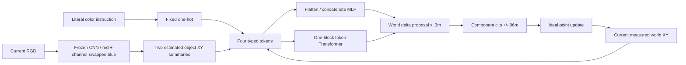

# S1.4 — Multimodal Fusion

## Problem

S1.1–S1.3分别处理任务条件、文本表示与视觉定位。本节比较同一组当前信息如何通过
concatenate MLP或token Transformer融合。三个信息源必须各有用途：RGB决定物体在哪里，
语言决定选哪个颜色，proprioception决定从哪里出发。
只做融合对照，H=E=1；不实现S1.5完整patch-token VLA/action chunk或S1.6语言泛化。

## Intuition

同一场景、同一当前位置，红/蓝指令应该产生不同位移；同一指令换场景，目标位置应随RGB变化；
接近目标后，当前state决定何时停住。把这些条件压成向量拼接，或分成带角色的token相互attention，
都是融合方法。比较必须保持信息源、数据划分、动作语义和预算一致，不预设Transformer更好。

## Input / Output Contract

CPU NumPy，无新依赖/安装/数据或权重下载。保留S1.3源脚本不变，每次在新输出中复现它的scene generator。
120场景，train96/validation24，scene ID和**red中心**不重叠；blue中心允许跨split复用。
每scene生成4个独立当前state，seed23、world XY各轴uniform[−.26,.26]m；每state配红/蓝两条指令。
train768/validation192examples；同scene的所有states与语言pair始终同split，训练不是episode timestep split。
不把这些独立snapshot伪装成连续expert轨迹，只有评价rollout才有T/T+1时序。

### 视觉与语言表示边界

先只用train96图像训练S1.3 red定位CNN400步，随后冻结116参数，两融合模型共用。
red位置来自CNN soft-argmax+固定camera；blue位置来自**同一detector作用于R/B交换后的RGB**。
这是显式颜色对称先验，不是新训练的通用双物体encoder。CNN不接目标标签作输入，不读validation fit。
语言只支持`move to red`/`move to blue`，本节用固定two-class one-hot隔离融合差异，
不复用S1.2 left/right权重来猜color语义，也不声称训练了自然语言encoder。
因此这是**有强先验的对象位置summary融合**，不是raw RGB/text端到端Transformer。

| 字段/层 | shape / dtype | 单位、坐标系、时间含义 |
|---|---|---|
| source RGB | (N,32,32,3) uint8 | 当前静态scene RGB，HWC；无agent/文字/未来信息 |
| frozen CNN spatial features | (N,225,4) float32 | S1.3内部空间格；本融合不直接消费225patch tokens |
| visual summaries | (N,2,2) float32 | red/blue estimated world XY[m]，不是标签真值 |
| current state | (N,2) float32 | 当前measured world XY[m]，不含未来state |
| language | (N,) Unicode | 两literal条件，各编码[1,0]/[0,1] |
| fusion tokens X | (N,4,4) float32 | 当前四个角色，全部无量纲，非四个时间步 |
| proposal label | (N,2) float32 | 真实selected goal−current state，world delta[m]；监督标签 |
| model output u | (N,2) float32 | 无量纲；×.3m得到unbounded位移proposal |
| executed action | (N,2) float32 | 每分量clip(proposal,−.06,.06)m，t→t+1执行一次 |

四token的固定顺序与内容：

1. red：`[red_x/.3,red_y/.3,1,0]`。
2. blue：`[blue_x/.3,blue_y/.3,0,1]`。
3. language：`[0,0,red_bit,blue_bit]`。
4. state：`[state_x/.3,state_y/.3,0,0]`。

XY依旧是world x右/y上，camera u右/v下，u=16+x/.02、v=16−y/.02。
比例/.3m事先固定，无normalizer fit。输入不含goal truth、proposal labels、success、episode future或scene ID。
source train/validation.npz及dataset_contract.json保留S1.3红目标监督语义；
新的*_fusion.npz与fusion_contract.json明确附加颜色任务、当前state和proposal标签，不覆盖source原件。

**proposal_label_m不是executed action**：它可超过.06m。训练loss拟合完整剩余位移，执行时另行限幅。
`executed_label_m`是从真实goal−state限幅得到的expert命令；报告两种误差，避免混淆尺度和执行语义。

## Core Concepts

Concatenate给各角色固定feature slots，MLP可学习交互；不是简单对三种输入求和。
Transformer给各角色可学习type embedding，经self-attention允许内容交互；最后读取state token输出proposal。
四个token都来自当前时刻，故没有temporal causal mask或PAD。attention不是解释性或因果贡献证明。
这里两模型独立从头训练，CNN冻结；没有端到端微调视觉、自然语言迁移或大模型预训练。

模态消融是**训练后输入内容置零**，保留角色、对象颜色marker与网络参数；不是重新训练的无模态baseline。
no_vision把两物体XY置0，no_language把颜色条件置0，no_state把当前XY置0。
零是人为干预值，不代表传感器真的观测到缺失；消融输入可能分布外，失败不证明模型实现了语义理解。

## Mathematics

### Concatenate（610参数）

x=flatten(X)∈R¹⁶，h=tanh(xW1+b1)∈R³²，u=hWo+bo∈R²。
W1(16,32)+b1(32)+Wo(32,2)+bo(2)。输入信息与Transformer相同，固定slots隐含角色。

### Token Transformer（618参数）

Z0=XWp+T，Wp(4,8)，T(4,8)为可学习角色embedding。
N1=LN(Z0)，Q=N1Wq，K=N1Wk，V=N1Wv；单头d=8。

A=softmax(QKᵀ/√8)，softmax按key轴，每row总和1。
Z1=Z0+(AV)Wo；N2=LN(Z1)；H=tanh(N2Wf1+bf1)∈R^(4×16)；
Z2=Z1+HWf2+bf2；u=Z2[state]Wout+bout。

LN按每token的8通道归一化：LN(z)=(z−mean(z))/sqrt(var(z)+1e−5)，
**无可学习gamma/beta**；是每次输入的运算，不从validation拟合统计。
Q/K/V/Wo各(8,8)，无投影bias；FFN(8,16)+(16,)+(16,8)+(8,)；head(8,2)+(2,)。
单block、单head、pre-LN、两次residual、tanh FFN；无dropout、额外CLS或时间位置编码。
角色embedding适合固定四summary角色，不等同于完整图像空间position embedding。

### Loss / 反向 / 执行

L=mean((u−proposal_label_m/.3)²)，无量纲；proposal MSE=.3²L[m²]。
executed MSE=mean((clip(.3u,±.06)−executed_label_m)²)，m²。
反传从MSE经过readout、FFN残差、LN、self-attention直到Wp/T；冻结CNN无梯度更新。

softmax反向：dS=A⊙(dA−Σ_key(dA⊙A))。
LN反向：inv_std×(g−mean(g)−normalized×mean(g×normalized))。
矩阵乘法按转置链式反传，batch/role共享权重梯度求和。
`checks`对两模型全部参数逐个finite difference核对，包括LN与Q/K/V；测试使用float64，实际训练/推理float32。
Adam lr=.003、β1=.9、β2=.999、eps=1e−8，full batch1600更新、seed7；两模型同epoch/优化器，非同初始化张量。
CNN训练Adam设置沿用S1.3，不与fusion optimizer混为一谈。

## Architecture / Data Flow



## Math / Architecture → Code

[script](../../scripts/s1_4_multimodal_fusion.py)：`visual_positions`只消费RGB，显式R/B先验；
`tokens`构造四角色和post-encoding消融；`forward/gradients`展开两融合路径和完整反向；
`layer_norm/norm_backward`展示LN；`fit`只更新fusion参数。
`make_batches`按source scene split生成same-state language pairs和独立proposal标签；
`rollout`每次重新取visual summaries与真实state，执行clip；`reference_rollouts`提供真目标/冻结视觉手写路由参照。
`checks`逐参数梯度核验及5类输入拒绝；CNN/data/weights保存NPZ禁止pickle，模型reload后比较输出。
`attention_probe.npz`存同RGB/state不同指令的tokens、(2,4,4) attention和proposal，不将attention权重当因果解释。

## Minimal Experiment

仓库根目录，新输出目录；无新依赖/下载，不依赖旧tmp权重：

```bash
.venv/bin/python scripts/s1_4_multimodal_fusion.py --output tmp/my_s1_4
# 先预测扰动会改变哪些量，再运行：
.venv/bin/python scripts/s1_4_multimodal_fusion.py --kick-x .12 --output tmp/my_s1_4_kick
```

每次保存两模型full/no_vision/no_language/no_state；kick参数**实际改变rollout中的world position**，不只是报告切换。
第4次转移后加+.12m world x，动作命令不含该外扰；下一步读取受扰真实state。
输出scenes.png是前4个validation RGB，固定标定与source原件保持不变。
看report的train、conditions离线误差/rollout、shape_trace和same_rgb_state_different_language_proposals_m。
看*_fusion.npz输入/标签、*_weights.npz、frozen_cnn.npz、fusion_contract.json与attention_probe.npz。

## Expected Result

两模型应有机会利用三种条件，结果不保证相同；不能从结构复杂度预设Transformer更强。
no_language下paired相同state/RGB的输入相同，确定性轨迹也相同，无法同时成功达到两个不同颜色目标。
no_state无法随真实当前位置更新remaining delta，容易不断输出同一proposal并overshoot。
扰动保持data/split/CNN/fusion weights/offline error不变，改变physical trace和下一步反馈。
成功数不一定变化：预算可能足够恢复，也可能收敛到同一有偏终点；需看trace/error而非预设增减。

## Actual Result

2026-10-17 CPU，repo .venv Python3.14.7 / NumPy2.5.4，实际NumPy在venv内；无安装/下载。
以下采用**最终float32实现**、seed7/1600updates：

| 指标 | concatenate | Transformer |
|---|---:|---:|
| fusion参数（另共用116冻结CNN参数） | 610 | 618 |
| train proposal MSE[m²] | 1.857e−5 | 2.346e−4 |
| validation proposal MSE[m²] | 3.659e−5 | 2.469e−4 |
| validation executed MSE[m²] | 4.853e−6 | 4.699e−5 |
| full closed-loop success | 44/48 | 8/48 |
| no_vision / no_language / no_state | 各0/48 | 各0/48 |
| full终点max-component error：median/max[m] | .004079 / .017667 | .016509 / .053685 |
| +.12m kick full success | 44/48 | 8/48 |
| +.12m kick三消融 | 各0/48 | 各0/48 |

每模型每条件24scenes×2languages=48，起点同为[0,−.12]m，10次动作、11states、dt=.1s。
每分量限幅±.06m；最终max|state−真实selected goal|≤.01m成功，预算结束truncated，success独立。
所有失败stage=final goal error after 10-step budget，全部trace/proposals/commands/goal/error保留。
同预算下oracle真目标与frozen-visual+手写颜色路由均48/48，nominal和kick都如此。
这说明本样本的视觉与执行接口可以完成任务，fusion拟合/闭环偏差是本实验剩余误差的来源；
不能据此定位到某个attention head或推断普遍架构优劣。

完整batch shape trace：concat(N,4,4)→(N,16)→(N,32)→(N,2)；
Transformer→(N,4,8)，A(N,4,4)，FFN hidden(N,4,16)，state readout(N,8)→(N,2)。
probe只取一组两条指令，文件N=2；训练N768、validation N192。
每条件480次推理保存median/P95，计入两CNN+encoding+fusion+clip，不含render/environment；
消融仍执行CNN后置零，不能拿它的计时声称省去模态计算的收益。参考控制器使用cache，不比较推理速度。

梯度最大绝对差concat≈1.03e−11、Transformer≈2.02e−9；5类拒绝检查通过。
独立核对paired no_language输入/输出相同、attention各row和1、runtime float32、CNN冻结、
跨kick权重/data/offline metrics/attention probe逐值一致，及rollout T/T+1、外扰时序、加法、限幅、完整分母。
已查看scenes.png；所有artifact/env ignored，无commit/push。

## Result / Explanation

这是一个fusion learning实验，不是性能达标演示。两个模型都呈现模态依赖，但训练后置零可能制造分布外输入，
0/48不能单独证明语义grounding。concat本设置拟合和闭环优于Transformer，不表示Transformer一般更差。
两者参数量相近但不相等，优化路径/归纳偏置不同；只一个seed、固定训练预算，不是公平全面benchmark。

## Failure Analysis / Limitations

- Transformer train误差也较高，当前记录支持本设置拟合/优化不足与闭环残差，不能只归因于泛化失败。
- 一些终点误差在.01m附近，严格阈值会把小bias判失败；保留error而不只报告success。
- 修正过`np.sqrt(8)`的NumPy float64 scalar导致attention提升dtype的问题：现在用Python常数保持float32并断言。
  初步混合精度运行曾得到不同结果，不用于最终比较；这显示该训练对数值精度敏感，未做多seed稳定性证明。
- CNN只在train red定位上训练，blue依靠固定channel swap；不是端到端学习object representation或语言语义。
- 四summary tokens已经由视觉提取位置，Transformer没有在225image patches中寻找目标；不等同S1.5 VLA。
- Language one-hot只覆盖两literal；不学习词序、同义词、未知词或自然语言泛化。
- 源red中心held-out，但blue位置可重复，固定颜色/尺寸/camera共享；不能称全部物体位置OOD。
- 消融后缺内容但仍有slot/type标记；no_state不断同输入输出同proposal，错误不等同现实sensor失效策略。
- 静态RGB、无agent marker，视觉不随point移动；只测试measured state反馈及固定外扰，不测试动态视觉伺服。
- attention权重未做因果解释，不是校准风险；局部latency不证明完整控制周期实时性。

## Relation to Robotics

模态融合处于perception/task encoding与controller之间。本任务显式区分剩余位移proposal与限幅后的executed delta，
保持world frame/anchor/dt一致；不导入或修改sibling repo。真实机器人还需servo/IK、延迟与安全审计。

## Interview Capsule / Notes

30秒：我把冻结CNN红蓝位置、literal任务和当前XY编码为四token，对比concat MLP与单层pre-LN Transformer。
手写反向与数值梯度验证；同scene分组held-out，float32下44/48与8/48，三模态置零均0/48，完整失败保留。

2分钟：解释summary视觉先验与raw patch VLA的差别，展开Q/K/V/softmax/residual/FFN、type embedding和state readout。
区分proposal监督与executed-action误差，说明oracle48/48帮助定位fusion残差；单seed不能判定架构优劣，
消融是输入干预而非无模态重训，attention也不是解释。加扰动不改offline loss，但要重看闭环trace。

## Likely Follow-up Questions

1. 三种模态如何变成(N,4,4)？哪些数据来自CNN预测、哪些来自真实state、哪些只是label？为什么不直接复用left/right语言权重？
2. concat与Transformer逐层shape怎样？type embedding、Q/K/V、softmax轴、residual、LN、FFN和state readout各做什么？
3. proposal与executed delta怎样区分，loss是什么单位？为何限幅后的低MSE不保证10步成功？
4. no_vision/no_language/no_state究竟改了什么？paired no_language为什么无法同时成功？这些消融能证明与不能证明什么？
5. kick0→.12m哪些量不变、在哪一时刻改state？44/48与8/48、oracle48/48、float32敏感性和局部latency应如何解释？

## Must Remember

融合先固定信息边界；summary token≠raw patch token；attention≠解释；proposal≠executed action；单seed结果≠架构优劣。

## My Verification

- [x] Run：运行默认，查看两模型shape trace、同RGB/state不同指令、offline与四条件rollout。
- [x] Modify：先预测kick0→.12对data/weights/offline/trace/success的影响，再运行并核对第4次转移。
- [x] Explain：独立回答五问，画出concat与Transformer数据流并解释未成功的样本。

Current Task = S1.4；Next Task = S1.5（仅计划）。Engineering Complete + Learning Mastered（2026-10-17 用户确认），不自动推进。

2026-10-17 用户确认实验和预测均已完成，五项 Explain 准确覆盖冻结CNN预测红蓝位置与固定R/B先验、
真实当前state、literal one-hot及四角色token；监督标签不进入融合输入，left/right embedding不具有已验证的color语义迁移能力。
准确展开concat与Transformer的shape、参数量、type embedding、pre-LN、Q/K/V、key轴softmax、residual与FFN。
准确区分完整位移proposal和限幅后的executed delta，说明无量纲loss与物理MSE的.09比例及闭环误差来源。
正确解释三模态post-encoding置零干预、paired no-language确定性轨迹冲突，以及干预敏感性不等于一般语义理解或重训结论。
明确kick在tick3动作后即第4次转移后施加，下一步才读取受扰state；保持训练/权重/offline不变量，闭环成功数未必改变。
正确界定44/48与8/48为float32单seed证据，Transformer训练误差亦高，oracle/视觉参考与局部latency各有明确限制。
学习状态依据用户Run/Modify/Explain报告确认，本轮仅更新文档，未重新执行实验。
