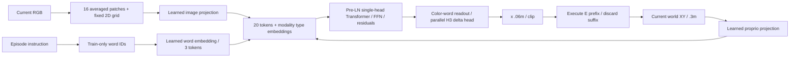

# S1.5 — Tiny Transformer VLA

## Problem

把当前RGB、指令词和proprioception真正接入Transformer，直接预测未来H个**实际位移动作**。
S1.4用已定位的object summaries与剩余位移proposal，本节改为整图patch tokens、可学习word embedding、
proprio token和action-chunk监督。仅推进S1.5，不自动进入语言泛化S1.6或扩展benchmark S1.7。

## Intuition

把图像切成16格，每格带颜色统计和空间位置；指令有3个词；再加入当前点的位置。
Transformer在同一当前时刻的20个token间交换信息，颜色词的输出特征经一个并行head产生H3×XY动作。
H=3表示模型输出3次未来命令，E表示这次实际执行几条；执行前缀后重新观察，旧后缀丢弃。

**本任务工程链路完成，但模型控制失败**：最终单seed模型nominal/disturbed均0/16，不能称任务能力达标。
理解数据流、验证边界与分析这个失败，是本学习包的验收内容。

## Input / Output Contract

CPU NumPy，无安装、数据/模型下载，不依赖旧tmp权重。新renderer保持32×32 RGB、world XY与.02m/pixel；
物体中心限定{4,12,20,28}²，恰在8×8patch中心。不同于S1.3的奇数格，**这是新数据分布，不混用旧权重**。
每图一个red和blue的3×3square，颜色[240,20,20]/[20,20,240]、背景[8,8,8]；agent不画在RGB中。

240种有序red/blue不同中心layout中seed11抽40种，无放回，前32train、后8validation。
每layout配两指令，64train/16validation episodes；同layout红蓝episode整组split，布局不重叠。
单物体中心可跨split重复，不声称新物体/新位置/OOD泛化。
Expert从world[0,−.12]m出发，每步clip(goal−state,±.06)m，T8、dt=.1s，保留9个state/image/clock。
所有示范预算结束truncated，success独立评价；raw符合embodied_episode/1.0，NPZ+JSON保存physical units。

| 字段/层 | shape / dtype | modality / unit / frame / time |
|---|---|---|
| raw RGB | (9,32,32,3) uint8 | RGB HWC，当前静态scene；包括terminal T |
| raw proprioception | (9,2) float32 | measured world XY[m]，t=0…8 |
| raw action | (8,2) float32 | executed world delta[m]，转移t→t+1，每分量±.06 |
| raw timestamp | (9,) float64 | 相对秒0… .8 |
| anchor RGB/state/text | (N,32,32,3)/(N,2)/string | 只取t；future labels/result不进入model |
| patch features | (N,16,5) float32 | 8×8区域mean RGB/255，加固定2Dpatch中心坐标，无量纲 |
| word IDs | (N,3) int64 | lower/split；move/to/red或blue，离散索引 |
| projected context | (N,20,16) float32 | 16image+3word+1proprio，当前时刻，多模态而非20时间步 |
| attention | (N,20,20) float32 | key轴softmax，每query row sum1；无时间causal mask |
| FFN hidden | (N,20,32) float32 | tanh，无物理单位 |
| readout | (N,16) float32 | 第18号token，即末尾颜色词；0-based index |
| output chunk | (N,3,2) float32 | head无量纲输出×.06m；预测a_t,a_(t+1),a_(t+2) |
| action_mask/index | (N,3) bool/int64 | source index有效性，padding index−1；只进入loss |

### 视觉/语言简化

Patch grid4×4，row-major；每格是8×8 RGB均值，无CNN目标检测、object coordinates、red/blue通道交换或预训练encoder。
5维patch feature为[mean_R/255,mean_G/255,mean_B/255,(u_center−16)/16,(16−v_center)/16]。
固定空间坐标来自patch网格，不是物体标签；camera仍u=16+x/.02,v=16−y/.02，world y上/image v下。
**mean pooling丢弃patch内部细节**，所以当前物体限定patch中心；未测试亚patch位置/尺寸/遮挡。

词表只fit train文本：PAD0、UNK1、blue2、move3、red4、to5。
`move to red`→[3,5,4]，blue→[3,5,2]。只有两种三词指令，无PAD槽进入当前context；
保留PAD/UNK零行但从不训练，未知/空句/重排指令直接拒绝。case与空白由lower/split归一化。
这是tiny train-from-scratch word embedding，不是预训练语言或paraphrase能力。
没有单独word-order position embedding；固定末尾颜色词读出与两条受限句式不证明语法理解。

## Core Concepts

- 视觉从整张RGB生成patch内容，词表从train建立，全部可学习参数共同由action loss优化。
- 输入proprio是当前测量，训练state/.3m、action/.06m使用预定义scale，不fit validation统计。
- Head并行回归H个未来命令，不是复制一个动作H次，也不是autoregressive token generation。
- 训练时future动作只作监督；mask不进入forward/predict，不让模型偷看示范何时结束。
- 所有context已在t时刻可见，可做双向attention；与未来action标签的时间因果分开。
- 当前图像静态且无agent，proprio提供点位置反馈；不声称测试了动态camera/视觉伺服。

## Mathematics

I∈R^(N×16×5)，word IDs J∈N^(N×3)，p∈R^(N×2)[m]。

Z_image=I Wi+type_image；Z_words=E[J]+type_language；
Z_state=(p/.3)Ws+type_state；Z0=concat_tokens(Z_image,Z_words,Z_state)∈R^(N×20×16)。

N1=LN(Z0)，Q=N1Wq，K=N1Wk，V=N1Wv；A=softmax(QKᵀ/√16)。
Z1=Z0+(AV)Wo；N2=LN(Z1)；F=tanh(N2Wf1+bf1)；Z2=Z1+FWf2+bf2。
u=reshape(Z2[:,18]Wout+bout,N,3,2)，a_raw=.06u[m]，a_exec=clip(a_raw,±.06)[m]。

单block、单head、pre-LN、两残差、tanh FFN；LN按每token的16通道，eps1e−5，无affine参数。
Wi(5,16)、word E(6,16)、Ws(2,16)、types(3,16)：256参数；
Q/K/V/Wo各(16,16)：1024；FFN16→32→16及bias：1072；chunk head(16,6)+(6,)：102；总2454。
没有learned world model、固定goal-error控制器或图像定位oracle进入policy。

### Masked loss与反向

L=Σ_(n,k,j) M_(n,k)(u_(n,k,j)−a*_(n,k,j)/.06)² / (2ΣM)，无量纲。
物理raw masked MSE=.06²L，单位m²；执行clip后的masked MSE另报。
实现先索引真实label槽，再计算差，padding NaN不影响loss或梯度；全空mask拒绝。
D在valid slots为2(u−target)/(2ΣM)，padding为0，经过head/FFN/LN/attention回传至image/word/state/type参数。
重复word ID梯度用np.add.at累加。全2454参数逐entry finite difference，检查用float64，runtime float32。

训练固定2400 updates、batch32无放回抽样、init seed7/sampler seed8；Adam lr.002、β=.9/.999、eps1e−8。
steps不是epochs：每步只取32/512anchors；不按validation选checkpoint，但本任务曾用同一validation检查原型，
因此这不是全新未触碰test set或稳健泛化benchmark。

## Architecture / Data Flow



## Math / Architecture → Code

[script](../../scripts/s1_5_tiny_transformer_vla.py)：`render/world`定义新patch-center场景与world映射；
`make_dataset`生成validated raw episodes，整layout先split，再复用S0.2 make_windows/audit_windows、history1/H3。
`image_tokens`展开4×4区域mean与固定坐标；`fit_vocabulary/encode_text`处理train词表和已知三词句。
`forward/gradients`显式实现全部学习路径；复用S1.4已展开的LN/反向辅助函数，不复用它的定位器或权重。
`predict`只接当前RGB/state/text/weights/vocab，输出执行范围内的H3chunk；`rollout`只执行前缀再重新观测。
`checks`核对全参数梯度、padding NaN loss/gradient隔离和5拒绝输入。

## Minimal Experiment

仓库根目录，输出必须新目录；先读Problem→Math：

```bash
.venv/bin/python scripts/s1_5_tiny_transformer_vla.py --output tmp/my_s1_5
# 先预测H3固定、E1→3对data/weights/loss/feedback/rollout影响，再运行：
.venv/bin/python scripts/s1_5_tiny_transformer_vla.py --execute 3 --output tmp/my_s1_5_e3
```

看scenes.png、model_contract.json、tokenizer.json、episodes/*/episode.npz/json及train/validation_chunks.npz。
report保存train curve、raw/clipped masked MSE、zero-action baseline、paired同state/RGB不同词chunk和完整rollout。
attention_probe.npz保存N2、attention(2,20,20)，不是把attention当成解释或置信度。
weights.npz含所有参数；所有NPZ禁用pickle，artifacts/env ignored。

### 执行实验

同8validation layouts×2languages=16条/条件，budget8步、dt=.1s；nominal无扰动，disturbed第2次转移后+.12m world x。
E1每.1s反馈，8次policy calls；E3每次最多.3s反馈，3次calls（prefix3/3/2），最后由显式budget截断。
每次仅真实执行动作更新state，扰动独立加入；旧chunk后缀不自动知道扰动。
成功：最终max|point−真实selected goal|≤.01m，预算truncated与success独立。
Oracle只作为参照，用真实goal与known ideal point unroll生成chunk，同样执行E前缀和接受扰动；不进入learned policy。

## Expected Result

预期首先是tensor/time/mask和训练链路可审计，不预设小Transformer能学会任务。
E1→3不改变训练数据、vocabulary、weights、H/label masks/offline loss，改变执行前缀、反馈频率和真实trace。
更短前缀提供更多观测机会，但如果模型本身未学会正确动作，不能保证恢复成功。
低离线loss需与零动作基线和闭环对照，尤其大量到达后zero动作可能让平均loss显得较小。

## Actual Result

2026-10-18 CPU，repo .venv Python3.14.7 / NumPy2.5.4，actual module在.venv/lib/python3.14/site-packages。
无安装/下载；NumPy通过本任务验证，不推断未来Torch兼容。

| 项 | train | validation |
|---|---:|---:|
| episodes / anchors | 64 / 512 | 16 / 128 |
| action shape | (512,3,2) | (128,3,2) |
| valid action tokens | 1344 | 336 |
| raw masked MSE[m²] | 5.49110e−4 | 5.66041e−4 |
| clipped masked MSE[m²] | 5.47313e−4 | 5.64488e−4 |
| zero-action baseline MSE[m²] | 9.83482e−4 | 6.01190e−4 |

末anchor7的action indices[7,−1,−1]、mask[T,F,F]；train valid chunk slots中768个合法zero-vector，不能按数值判断padding。
init首步train raw MSE≈1.021e−3，2400步≈5.491e−4，仍显示明显拟合不足。
validation只略优于zero baseline；两指令首chunk数值不同，但方向/幅度/闭环均不足，不能称learned grounding成功。

| 结果 | E1 | E3 |
|---|---:|---:|
| learned nominal success | 0/16 | 0/16 |
| learned disturbed success | 0/16 | 0/16 |
| oracle nominal / disturbed | 16/16 / 16/16 | 16/16 / 16/16 |
| calls per rollout | 8 | 3 |
| nominal terminal max-component error median/max[m] | .24250 / .40148 | .25048 / .39201 |
| disturbed terminal error median/max[m] | .31005 / .54857 | .31625 / .47499 |

所有learned失败stage=final goal error after 8-step budget，完整16/16分母保留；所有trace/commands/chunk decisions保存。
短前缀没有补救失败模型；也不能因两条件成功数同0就说执行前缀无影响，error/trace确实不同。
每条保存局部推理median/P95/sample count；含patch/tokenizer/Transformer/clip，排除render/environment，oracle跳过模型。
E1每条件128calls，E3为48calls；计时不是完整robot时延或部署实时性证明。

全2454参数finite difference最大绝对差≈1.08e−10；padding NaN不改loss与梯度，5拒绝输入通过。
raw/schema/transition/round-trip、S0.2 source-index/mask/scene split审计、weights reload通过。
独立核对跨E data/weights/attention/train curve/offline metrics逐值相同，runtime attention float32与row sum1，
以及T8/T+1、budget、prefix实际执行、限幅、扰动时序、物理加法与完整失败分母。
已查看scenes.png，四layout红蓝图案与patch-center任务一致。

## Result / Explanation

完成了RGB→patch/word/proprio tokens→Transformer→action chunk→prefix rollout的可学习实现和评价。
**它尚未学成能完成任务的控制策略**。Gradient/schema PASS只排查指定实现问题，不证明优化已解决或架构有效。
真实结论是这个固定小数据/单block/mean-patch/训练预算设置失败，下一步学习应能解释失败而非包装成成功。

## Failure Analysis / Limitations

- 初版读取proprio token，train MSE≈5.010e−4、闭环0/16；单block proprio query当层尚未混入语言。
  改为读取颜色词，使query直接含任务条件，固定数据/预算重跑；最终仍0/16，**未证明读出修改解决了问题或更优**。
- train loss仍高、validation接近零动作基线，证据更符合欠拟合/优化与表示限制，不能只怪validation分布偏移。
- learned chunk后几步偏置、闭环输入离开expert分布，可能共同导致漂移；本实验未隔离每个因素的因果份额。
- patch mean严重丢细节，物体只在格中心；固定position是先验，未测试真实image、纹理、遮挡或亚patch变化。
- 只一个init/sampler seed，原型和最终检查共用validation；不是独立test、超参比较或architecture superiority证据。
- 只有两条已知三词指令，未知/重排拒绝，无word-order编码；不能称自然语言泛化，留S1.6。
- 训练label是actual future delta，不是S1.4完整goal-error proposal，不能混用它的scale/成功数作公平对比。
- 后续chunk未接受真实未来反馈，只是一次并行预测；没有action-token autoregression、learned world model或contact dynamics。
- 静态RGB不画agent，proprio负责点反馈；不是动态视觉伺服。Oracle16/16只说明本ideal预算可达。
- 不做额外大模型/数据下载来掩盖失败，不扩张当前任务；后续若要修复，应先提出针对欠拟合的受控实验。

## Relation to Robotics

VLA处于任务/视觉/state到动作的接口层，真实执行仍需controller/servo/安全边界；本toy是理想world delta加法。
明确H、E、dt与feedback，不把NPZ mask当在线结束信号；旧sibling repo未修改或导入。

## Interview Capsule / Notes

30秒：我用NumPy实现2454参数单block Transformer，把整图16平均patch、3learned word和1proprio token映射到H3实际delta。
先layout-group split再causal windows，手写反向全参数验证；offline略优于零动作，但closed-loop0/16，oracle16/16，如实记录失败。

2分钟：展开fixed spatial grid和learned projections、color-word query/readout、parallel chunk head、masked MSE与训练后clip。
解释E1/E3保持weights/loss不变但feedback/calls/trace改变；短E不能拯救未学会动作的模型。
承认mean-patch、单seed、原型共用validation与欠拟合，不把工程验证或小loss当VLA控制成功。

## Likely Follow-up Questions

1. 与S1.4不同，RGB/text/state怎样变成20×16 context？哪些是固定运算，哪些参数由action loss训练？
2. 为什么选择index18颜色词读出？single-block proprio query的局限是什么，修改后是否有成功证据？
3. H3 action chunk、mask、实际delta与S1.4 proposal有什么区别？手算T8末anchor7的mask/index与loss分母。
4. E1→3哪些量不变，calls/feedback/扰动后prefix怎样变？为什么0/16保持不变不代表轨迹相同？
5. 如何利用zero baseline、train/validation loss、oracle和完整失败判断当前结果？梯度PASS、不同指令输出和局部latency各不能证明什么？

## Must Remember

完整pipeline≠策略学成；当前context不读未来；H/E/dt分开；真实zero参与loss；低MSE需比baseline；失败全分母保留。

## My Verification

- [ ] Run：运行默认，追踪raw/window/tokens/chunk与完整0/16失败，读oracle及zero baseline。
- [ ] Modify：先预测H3固定、E1→3不变量、calls/feedback/error，再运行并核对第2次转移扰动。
- [ ] Explain：独立回答五问，说明为什么工程验证通过却不能称学会控制。

Current Task = S1.5；Next Task = S1.6（仅计划）。Engineering Complete（含失败实验），Learning等待用户确认，不自动推进。
