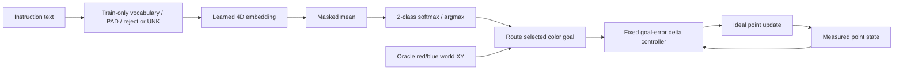

# S1.6 — Language Generalization

## Problem

同一目标换一种说法，模型能否选对？必须区分未见句子中的已知词重组、未知词、颜色别名和词序关系，
不能只用一条新表达的成功声称语言泛化。S1.5控制仍0/16，本节不修复或替换它；单独隔离语言目标选择，
再通过oracle几何+固定控制器检验接口，避免把语言和动作错误混为一谈。仅本任务，不启动S1.7。

## Intuition

精确字符串查表遇到新句子会失败。一个learned word embedding+mean classifier可能依靠red/blue跨句式选对颜色，
即使它不认识grab/block。把颜色词也换掉、或者让两种颜色同时出现，就能检查这个成功究竟靠什么信息。

## Input / Output Contract

CPU NumPy，无安装、公开文本数据/预训练weights下载。四条人工训练指令，每条只出现一次：

| train text | evaluator target class |
|---|---|
| pick red cube | 0=red |
| pick blue cube | 1=blue |
| move red object | 0=red |
| move blue object | 1=blue |

**任务语义明确简化为“到达指定颜色goal”**，pick/grab等词不代表实现了抓取、物体形状识别或不同技能。
模型是text-only目标类别选择器，不读取RGB/state/物体坐标，不是S1.5的action Transformer。

固定独立probe列表在训练前定义，训练不使用其文本或标签拟合词表/weights：

| group | phrases / meaning |
|---|---|
| seen | 4条训练句，用来检查拟合；不是泛化证据 |
| recombination | move red/blue cube、pick red/blue object，共4条；词已见，verb/noun组合未见 |
| oov_verb_noun | grab red/blue block、move red/blue item，共4条；red/blue保留 |
| oov_color | pick crimson/cobalt cube、move crimson/cobalt object，共4条；人工标注crimson→red、cobalt→blue，仅用于评分 |
| order_stress | move red object instead of blue→red；move blue object instead of red→blue，共2条 |

后四组与train lower/split规范化后的完整字符串交集为0。该列表很小、人工构造，不是独立大规模语言benchmark；
seen4句、held-out14句，不能把六次scene重复执行当成六倍独立语言样本。

| 字段/层 | shape / dtype | modality / units / temporal meaning |
|---|---|---|
| text | string；诊断export (18,) Unicode | 一次任务的恒定指令 |
| token IDs | (N,8) int64 | right PAD；无物理单位；按空白词，不是时间 |
| mask | (N,8) bool | True=真实词，UNK也为True；PAD False |
| embedding E | (8,4) float32 | trainable word table，无量纲 |
| lookup | (N,8,4) float32 | 每词4维 |
| sentence z | (N,4) float32 | masked mean，无词序机制 |
| logits / probability | (N,2) float32 | red/blue logits、softmax；未校准置信度 |
| predicted class | int / argmax | 0 red或1 blue；不是动作或物理坐标 |
| bridge scene goals | (2,2) float32 world XY[m] | **oracle物体位置**，只给固定bridge，不给语言模型 |
| bridge state/action | (2,) float32 | measured current world XY / executed world delta[m]，t→t+1 |

### Tokenizer

`lower().split()`，保留标点；非空、最多8词，超长拒绝不截断。只从四train句fit词表：
PAD0、UNK1、blue2、cube3、move4、object5、pick6、red7。
默认`--unk-policy reject`，未知词拒绝；实验`map`将所有未知词映射1。
PAD/UNK初始零且训练中都不出现，保持零；UNK在推理mask=True，仍计mean分母，不等于删除词。
完整语句不作白名单过滤，否则无法测试新组合；只有tokenization/最大长度约束，不代表支持grammar。

## Core Concepts

1. Exact lookup baseline规范化后只匹配train四句，不猜同义词；未见整句拒绝，即使每个词都认识。
2. Learned classifier在word level组合，可通过颜色线索跨新句式，不等于理解verb/noun或完整语义。
3. OOV输入被接受、类别预测正确、真实robot完成任务是不同层次。这里最多评价前两项和oracle bridge。
4. 颜色别名标注是评价者约定，不进入tokenizer/classifier；没有外部知识来源推断crimson/cobalt。
5. Mean表示丢失顺序；相同词多重集一定同表示（float32求和次序可有微小舍入差），训练更多无法恢复丢失关系。
6. 训练小型语言selector是新的受控实验，S1.5训练/encoder/失败记录均不修改，不声称实现语言泛化VLA。

## Mathematics

ID I_(n,k)，mask M_(n,k)，c_n=Σ_k M_(n,k)>0。
z_n=Σ_k M_(n,k)E[I_(n,k)]/c_n；logits=zW+b，W∈R^(4×2)，b∈R²。
p=softmax(logits)，L=−mean(log p_(n,y_n))，无量纲cross entropy。

总参数8×4+4×2+2=42，包括保留PAD/UNK行；E、W、b联合训练。
D=(p−one_hot(y))/N；dW=zᵀD，db=ΣD，dz=DWᵀ。
每valid槽dE[ID]累加dz_n/c_n，重复ID用np.add.at；PAD梯度0。
Adam lr=.03、β=.9/.999、eps=1e−8，full batch4、800updates、init seed7；只train优化，不按probe调checkpoint。

未知颜色碰撞：pick crimson cube与pick cobalt cube都变[6,1,3,0,…]，同mask→同z→同概率。
两组互为red/blue目标的同ID pairs，各最多正确一个，故本balanced probe最高2/4。
Order stress两句词多重集相同，即使未来把instead/of加入词表，mean仍丢主目标/排除目标关系，最高1/2。
这不依赖当前embedding是否充分训练，是表示层的信息边界。

## Architecture / Data Flow



Expected target annotation仅供loss/评分；fixed bridge按**预测**类别路由oracle位置，不能按expected class纠正模型。
额外oracle参考才使用expected class，以检验可达性；classifier不读取annotation、scene或成功结果。

## Math / Architecture → Code

[script](../../scripts/s1_6_language_generalization.py)：`TRAIN/EVALUATION`冻结phrase split；
`fit_vocab/tokenize`只用train、生成8词槽与OOV策略；`forward/gradients/train`显式embedding mean、CE、反向/Adam。
`decide`输入仅text/vocabulary/weights/policy，输出类别与diagnostics；`evaluate`在模型决策之后才读expected label评分。
`bridge`固定反馈执行器，`make_scenes`seed41选六个静态layout；复用S1.5 render/world展示，不导入它的权重或动作策略。
`checks`全42参数finite difference、PAD NaN、ID/mean碰撞、normalized phrase与词表隔离、5拒绝输入。

## Minimal Experiment

仓库根目录，新输出目录；先读至Mathematics：

```bash
.venv/bin/python scripts/s1_6_language_generalization.py --output tmp/my_s1_6
# 先预测reject→map对weights/known组/OOV各组的影响，再运行：
.venv/bin/python scripts/s1_6_language_generalization.py --unk-policy map --output tmp/my_s1_6_map
```

查看probe_manifest.json固定split/语义边界、tokenizer.json、report.json的分类/拒绝/失败stage，
以及text_diagnostics.npz的IDs/mask/sentence/probability。
**diagnostic NPZ总使用强制map计算OOV向量**，只供分析；reject运行不会因此接受或执行OOV指令。
weights.npz、tokenizer与diagnostic arrays重载逐值验证，NPZ禁止pickle；outputs/.venv ignored。
scenes.png展示bridge六个布局，无文本或模型输入；classifier完全不看图像。

### Isolated oracle-control bridge

每条指令在相同6布局执行；已接受则从[0,−.12]m出发8次动作，dt=.1s，H=E=1，
a=clip(oracle_position[predicted_class]−measured_state,±.06)m，p_next=p+a。
最终max|p−oracle_position[expected_class]|≤.01m成功；已执行budget→truncated=True，success独立。
拒绝则0动作/1初始state，truncated=False，保留在分母，不把拒绝叫成闭环成功。

这段控制器和位置均是oracle接口，仅把语言类别错误映射为“走错目标”的可观察结果；
其成功数会重复类别准确率，**不是独立的视觉/控制学习证据**。S1.5 learned VLA仍0/16。

## Expected Result

Exact lookup对seen可成功，对新组合无法匹配。Learned mean有机会利用已知颜色词处理新表达，不能预设通用语义。
reject→map保持vocab/weights/train curve/known预测不变；从拒绝到执行不保证正确，
尤其未知颜色和两颜色词序表达存在不可恢复碰撞。不能为了OOV分数把probe词加入训练词表。

## Actual Result

2026-10-18 CPU，repo .venv Python3.14.7 / NumPy2.5.4，actual module在.venv/lib/python3.14/site-packages。
无新依赖/安装/下载；final seed7训练CE从首步.67385降到800步7.641e−5。

| group | unique phrases | reject target correct | map target correct | exact lookup |
|---|---:|---:|---:|---:|
| seen | 4 | 4/4 | 4/4 | 4/4 |
| recombination | 4 | 4/4 | 4/4 | 0/4（整句miss） |
| oov_verb_noun | 4 | 0/4（拒绝4） | 4/4 | 0/4 |
| oov_color | 4 | 0/4（拒绝4） | 2/4 | 0/4 |
| order_stress | 2 | 0/2（拒绝2） | 1/2 | 0/2 |

| bridge success（6layouts/phrase） | reject | map |
|---|---:|---:|
| seen / recombination | 各24/24 | 各24/24 |
| oov_verb_noun | 0/24 | 24/24 |
| oov_color | 0/24 | 12/24 |
| order_stress | 0/12 | 6/12 |

Expected-class oracle参考所有组均全成功（每组24/24或12/12）；说明toy目标可达，不是learned language控制能力。
Exact lookup bridge只seen24/24，新句失败stage=exact_instruction_lookup_miss。
默认OOV失败stage=tokenization_rejected，无执行；map中错误类stage=language_target_selection，已执行8步走向错误颜色。
本次没有controller_final_goal_error，但实现与报告保留该可能stage，不偷换成目标分类成功。

map未知颜色两pair都预测red，概率约.5002/.4998；同ID不能区分别名，2/4不是学会颜色同义词。
order两句都预测blue，概率约.49364/.50636，float32有微小舍入但同argmax，1/2不能称理解instead of。
OOV verb/noun4/4保留已知颜色词，训练也把verb/noun变化与目标类别解耦，因此可由color shortcut解释。

完整42参数finite difference最大差≈7.10e−12，PAD NaN不影响输出，OOV collision/mean order collision、
train/probe词表与规范化整句隔离、5非法输入拒绝通过；model/tokenizer/diagnostic NPZ重载通过。
独立inline核对跨reject/map权重/vocab/train curve/diagnostic arrays不变，所有bridge的拒绝无动作、
8actions/9states、物理加法/限幅/成功阈值、全分母与oracle全可达。
已查看scenes.png六layout；text latency只按每unique phrase一次接受的推理记录median/P95，
每组2或4samples、拒绝组null，排除bridge，不能作稳定性能benchmark或整机实时证明。

## Result / Explanation

证据支持小型word模型比整句查表更能处理这个人工任务中的已知词重组。它也暴露了泛化定义的重要性：
颜色词保留时的未知verb/noun成功，不需要模型理解那些未知词；未知颜色与词序对照揭示边界。
这不是大模型语义、组合逻辑理解或真实pick/grab技能证据，不改写S1.5失败结论。

## Failure Analysis / Limitations

- 四train句/一个seed，仅14held-out新句，人工按颜色标注；不能推广为自然语言泛化。
- 三词训练、六词stress，OOV与长度同时变化；stress的mean碰撞证明顺序信息丢失，但不能量化各分布偏移贡献。
- UNK从未训练，零向量仍进入分母；通过map接受不等于未知词语义学习。
- bag-of-words舍弃主从/否定/排除关系；两句相同词多重集无法由这个classifier区分。
- 没有颜色词时的近.5概率不代表模型具有经过校准的“不知道”；未设confidence拒绝阈值或评估校准。
- known-color shortcut可产生有限准确率，不证明理解verb/noun、形状或完整句子；不把不同词表达当不同物理技能。
- six-scene bridge只重复text类别，oracle位置与固定controller完美，不是learned VLA成功、场景泛化或真实robot证据。
- 没有fine-tune/fix S1.5；下一阶段如果评价其闭环，仍须保留0/16，不将本bridge的成功冒充原模型进步。

## Relation to Robotics

语言可作为goal selector，随后接感知/几何/控制；分开测能避免把接口失败混为语义失败。
本节frame/world delta/dt不变，但使用oracle geometry隔离问题；真实robot还需要物体识别和动作技能。
sibling repo未修改或导入。

## Interview Capsule / Notes

30秒：我用42参数train-only embedding mean classifier，4句训练后做新组合、OOV词类、未知颜色和语序对照。
known词重组4/4，UNK下unknown verb/noun4/4，但unknown颜色2/4、语序1/2；配oracle bridge隔离语言，不称修复VLA。

2分钟：展开词表/完整句split、PAD/UNK/mean和分类梯度；解释整句lookup对照、碰撞上界与颜色捷径。
报告分类正确、拒绝、走错目标三种结果，六layout重复不能增加独立语言样本；概率/latency/bridge都要明确证据边界。

## Likely Follow-up Questions

1. 四train句如何构成42参数模型？text→IDs/mask→embedding→sentence→class各shape/dtype是什么，标签何时使用？
2. seen、known-word重组、OOV verb/noun、OOV color与order stress分别测试什么？为何规范化后不重叠且vocab train-only重要？
3. map下grab red block成功能说明什么，不能说明什么？UNK零向量与被删除的词有什么区别？
4. 未知颜色最高2/4、order pair最高1/2为何来自表示碰撞？更多训练或仅把instead/of加入词表能解决吗？
5. reject→map哪些量不变，拒绝/分类错/控制错如何定位？oracle bridge24/24能否证明S1.5修复或真实robot泛化？

## Must Remember

新句≠新语义；known颜色捷径≠理解OOV；mean丢关系；碰撞先于模型；分类/拒绝/执行分开；oracle bridge≠learned VLA。

## My Verification

- [ ] Run：运行默认，读固定split、train-only vocab、分类与拒绝，以及oracle bridge边界。
- [ ] Modify：先预测reject→map对weights/known/OOV分组结果和stage的影响，再运行核对。
- [ ] Explain：独立回答五问，手算unknown-color ID碰撞与order stress的mean不变性。

Current Task = S1.6；Next Task = S1.7（仅计划）。Engineering Complete，Learning等待用户确认，不自动推进。
