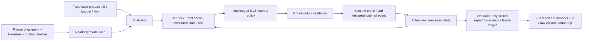

# S1.7 — Closed-loop VLA Rollout

## Problem

为冻结的S1.5 policy建立可复核的闭环评价：success、action error、failure stage和latency分开报告。
S1.5尚未学会控制，S1.6是独立语言+oracle bridge，不能用它替换policy后宣称VLA进步。
本节不训练、不修复模型，不自动进入Stage2。

## Intuition

离线给模型看expert走过的state；闭环则执行模型自己的动作，再看实际落到哪里。
同样一个loss数值可能来自不同状态和不同动作槽。冻结权重，固定case列表，记录完整失败，才能比较执行前缀或扰动。
“不接受指令”也占一次attempt，但不能伪造一条零动作episode；“推理快”也不能证明能控制或整机实时。

## Input / Output Contract

CPU NumPy，无新依赖/安装/数据或weights下载。默认直接读取ignored `tmp/s1_5_final`，**不重新训练**。
来源要求weights.npz、tokenizer.json、model_contract.json、validation_chunks.npz、report.json；
校验schema、参数keys/shapes/float32/finite、词表、train/validation scene隔离。
所有2454参数在内存设readonly；五份artifact记录SHA256并在评价前后比较，记录训练seed7/2400steps与七个本地源码hash。
5次warm-up及输入/goal隔离audit在正式case前执行，不计入统计；不调用optimizer或更新统计。

若默认checkpoint不存在，先使用自己已完成的S1.5目录：`--checkpoint tmp/my_s1_5`。
若目录尚未生成，需按S1.5学习包生成checkpoint，再明确选择该目录；脚本缺文件会报错，不偷偷重训或下载。

### 固定protocol

沿用S1.5的8validation layouts（曾用于原型/验证，**不是独立新test set**），每layout两颜色指令：

| condition | start world XY[m] | external event / text |
|---|---|---|
| nominal | [0,−.12] | 原始两literal指令，无kick |
| disturbed | [0,−.12] | 第2次transition后world x+.12m |
| shifted_start | [.18,.12] | 换起点，目标和RGB不变，不重训练 |
| unsupported_text | [0,−.12] | grab red/blue block；原S1.5 tokenizer拒绝，不接S1.6转换器 |

每条件16attempts/策略，三策略learned/oracle/zero；共192attempts/run，条件间共享相同8layout groups。
不要把64cases当64独立场景；pair与多条件重复均须在解释分母时说明。
Oracle直接读evaluator goal生成ideal-point chunk；zero无视文本输出zero，二者不是与learned信息条件公平的替代模型。
特别是oracle的unsupported成功并不证明它理解了这些句子，只是上界控制器绕过解析。

| Item | shape / dtype | modality / unit / frame / time |
|---|---|---|
| policy RGB | (32,32,3) uint8 | 当前静态scene RGB；no agent marker，固定正交camera |
| policy state | (2,) float32 | 当次decision tick的measured world XY[m] |
| policy text | string | episode条件；原S1.5词表/grammar约束，不重解释 |
| policy chunk | (3,2) float32 | clipped world displacement[m]，每component±.06，H3 |
| raw rollout state | (T+1,2) float32 | 实际点轨迹，含外扰后测量 |
| raw action | (T,2) float32 | 真正执行的命令，不含外界kick；dt=.1s |
| raw RGB / clock | (T+1,32,32,3) uint8 / (T+1,) float64 | 同步静态scene / nominal simulated seconds |
| evaluator expert command | (T,2) float64分析/JSON | 对actual pre-action state算counterfactual expert，不能传learned policy |
| loop timing | 每decision float ms | 实际wall-clock计算耗时，非simulated timestamp |

只做explicit input/output接口检查，不将通过解释为物理安全/部署正确。
发生拒绝时T=0、trace只有初始state，保留report记录，但不导出不满足T>0的raw episode。
有执行的176条episode/run按embodied_episode/1.0输出NPZ+JSON、validator及round-trip；
external kick在provenance显式记录，不把state突变偷偷重标成policy action。

## Core Concepts

- 同一个checkpoint和protocol，改变E只影响实际prefix/feedback，不应改变权重、expert-state offline score或case目标。
- E1每episode8次decision；E3为3次，prefix3/3/2；budget始终8commands，成功看最终点，没有early success stop。
- visited-state action error在实际轨迹上评分；给模型的输入仍只到decision tick，不把evaluator expert混进执行。
- failure stage描述观察到的pipeline失败位置，不据此推断联合模型究竟是哪种模态出了错。
- 记录ever_in_goal/first_goal_tick与最终success的区别，曾经过目标不等于最终成功。
- 文件hash与readonly保护来源一致性，不代替模型能力验证；本节测试仍只是旧validation与固定条件。

## Mathematics

### 动力学与执行

在decision tick t，π(RGB_t,p_t,ℓ)输出A_t∈R^(3×2)[m]，只执行min(E,remaining_budget)条。

p_(t+1)=p_t+a_t+k_(t+1)，k_2=[.12,0]m仅disturbed非零，其余0。
E3在tick0输出三步，第2步后发生kick，第三步仍是旧后缀；到tick3才重新观察。

success=[completed_steps=8 AND max|p_8−g_original|≤.01m AND 无runtime拒绝/contract failure]。
仅评价最终state；预算结束truncated=True，即使success也不代表natural terminal。

### 两类action error

1. **Expert-state offline**：复用S1.5 validation128anchors的H3labels/mask，336有效slots、672scalars；
   raw预测与clip后MSE分别报告。训练标签/未来mask只用于这段评价。
2. **Visited-state online**：每次真实动作前，evaluator算a*_t=clip(g_original−p_actual_t,±.06)m。
   MSE_visit=Σ_(episodes,t,j)(a_executed−a*_t)² / (2Σcompleted_steps)，单位m²。

每个完整16episode条件有128actions/256scalars；全拒绝组0scalars→MSE=null，不伪造0误差。
Episode attempts分母仍16，拒绝计失败。组均值按所有真实action scalars加权，不平均不等长episode的MSE。
Offline含重叠future chunks、expert states；online是actual actions、visited states和可能stale suffix，
**状态分布、目标槽及权重都不同**，差值不能全归因于covariate shift，更不能当同一loss的公平直接排名。
不同策略也访问不同state，所以跨策略visited MSE只描述各自轨迹，不是统一测试输入的预测误差。

### 失败stage

- policy_input_rejection：原tokenizer/输入接口拒绝，本次0动作，failure_message保留原因。
- policy_output_contract：chunk shape/dtype/finite/限幅检查失败，不能照常执行坏命令；本次未自然观察到该stage。
- final_goal_error_after_budget：完成8步但最终超过.01m阈值；**不是对vision/language根因的归类**。
- 成功stage=None；独立记录completed_steps、truncated、ever_in_goal，避免混淆。

## Architecture / Data Flow



Oracle/zero使用同一执行循环，但不冒充learned policy。label反事实干预只改evaluator goal不改text/RGB，
检查learned commands/trace完全不变，确认评分goal没有进入policy。

## Math / Architecture → Code

[script](../../scripts/s1_7_closed_loop_evaluation.py)：`load_checkpoint`冻结契约与权重，`protocol`生成64case manifest；
`run_case`依次计render、policy、执行prefix和evaluator loop，并计算visited-state reference；
`validate_chunk`界定输出边界；`export_episode`只为实际执行的轨迹导出physical raw，kick语义显式保留。
`summarize`按完整attempt与真实action scalar汇总，`offline_metrics`独立计算expert-state chunk error。
`checks`验证真实unsupported拒绝、evaluator goal隔离与4坏chunk rejection；不使用S1.6 language bridge。

## Minimal Experiment

仓库根目录，已存在S1.5 checkpoint，新输出目录：

```bash
.venv/bin/python scripts/s1_7_closed_loop_evaluation.py --output tmp/my_s1_7
# 先预测E变化的不变量、MSE口径、calls和失败stage，再运行：
.venv/bin/python scripts/s1_7_closed_loop_evaluation.py --execute 3 --output tmp/my_s1_7_e3
```

若自己的source在其他目录，两条均加相同`--checkpoint tmp/my_s1_5`。
看source_evidence.json、protocol.json、report.json与summary.csv；raw episodes在episodes/<policy_case>/episode.npz/json。
检查unsupported组：16attempts、completed0、MSE null；不可从平均成功率中删除，也不应把它标为终点控制失败。
所有artifact在ignored tmp，source checkpoint只读；不更改repo源码策略或其weights。

## Expected Result

冻结旧模型应重现S1.5 nominal/disturbed失败；通过细分协议揭示“同0/16”背后的不同阶段和不同error。
oracle验证该ideal dynamics/预算可达，zero揭示不行动也可有数值不大的误差，但不能完成任务。
E3 oracle在kick后的stale action可能偏离当时expert，即使最终恢复成功；在线动作误差与终点success不是同义词。
latency应清楚定义测量范围，不能从本地微秒/毫秒toy运算证明完整机器人实时性。

## Actual Result

2026-10-18 CPU，repo .venv Python3.14.7 / NumPy2.5.4，actual模块在venv内，无安装/下载/训练。
默认source weights SHA256 `2538a3fff8fad49ac29f8599f98ebfb77ba473a29ab3ca21234a9c157fba5397`。
checkpoint五文件hash与源码hash存source_evidence，两E运行来源一致；weights内存readonly。

| condition（每格16attempts） | learned E1 | learned E3 | oracle E1/E3 | zero E1/E3 |
|---|---:|---:|---:|---:|
| nominal | 0/16 | 0/16 | 16/16 | 0/16 |
| disturbed | 0/16 | 0/16 | 16/16 | 0/16 |
| shifted_start | 0/16 | 0/16 | 16/16 | 0/16 |
| unsupported_text | 0/16（拒绝） | 0/16（拒绝） | 16/16（绕过文本） | 0/16（忽略文本） |

Learned前三组各完成16条8步，stage均final_goal_error_after_budget；unsupported16条全为policy_input_rejection，0commands。
每run192attempts、176个有效raw rollout episodes，16个拒绝只存完整report记录，不造假action。
source nominal/disturbed learned trace与S1.5 E1/E3旧report逐值一致，不重新定义成功、不卡掉失败样本。

Offline raw chunk MSE5.66041e−4m²、clip后5.64488e−4m²；zero offline6.01190e−4m²，128anchors/672scalar分母。

| Learned visited-state action MSE[m²] | E1 | E3 |
|---|---:|---:|
| nominal | .00452874 | .00454267 |
| disturbed | .00468196 | .00377318 |
| shifted_start | .00417287 | .00394276 |
| unsupported_text | null（无执行） | null（无执行） |

Nominal zero自身visited MSE=.00310m²，仍0/16；不能仅靠这个指标说zero更“会控制”。
Oracle E1 visited MSE全部0；E3 disturbed为.0001828125m²，但最终16/16、终点error0，
说明stale suffix的当步误差与之后反馈恢复能同时存在。
Learned nominal terminal error median E1≈.24250m、E3≈.25048m；shifted_start≈.32915/.28991m，全部raw error保存。

### Latency范围

每decision记录render_ms、policy_ms、apply_prefix_ms（字段apply_ms）、local_loop_ms；按policy/condition汇总median/P95/max/count。
policy只含patch/tokenizer/Transformer/clip，render分开；loop含evaluator diagnostics/日志内存记录，
不含文件导出、真实sensor/transport/servo/plant延迟，也没有按dt实际sleep。

本轮nominal learned示例：E1 policy median/P95≈.1271/.1724ms（128calls），local loop≈.1494/.2055ms；
E3 policy≈.1435/.1889ms（48calls），loop≈.1777/.2309ms。值受本机调度影响，不冻结成性能承诺。
unsupported记录16次all-attempt拒绝耗时，accepted-policy统计null，不能把快速拒绝混入正常推理延迟。
每次5warm-up排除；tests额外调用也不计benchmark。oracle/zero模型复杂度/信息不同，其计时不作公平速度结论。
记录policy耗时超过该prefix nominal反馈区间的次数，本轮未观察到；这只是局部计算检查，不是hard real-time保证。

输入拒绝/count边界、evaluator goal反事实隔离与4类坏chunk拒绝检查通过；
raw validator/round-trip、hash前后一致、独立source/S1.5 trace regression、跨Eoffline/hash不变通过。
逐条独立重算192attempts/run的加法/kick、T/T+1、实际prefix、clip、expert action/reference MSE与成功阈值。
已查看scenes.png四布局，本地Markdown links、pip check、git diff --check通过。

## Result / Explanation

S1.7完成了评价工程，**没有修复S1.5的控制失败**。当前证据说明原policy在这些固定条件下未达目标，
而case/evaluator/ideal controller可达。失败阶段和visited-state误差给下一次受控排查提供证据，
不能跳到“语言错”“视觉错”或“换大模型即可”的根因结论。
Stage1工程与学习包S1.1–S1.7全部完成（S1.7于2026-10-18用户确认）；模型控制能力仍失败，保持双状态区分。

## Failure Analysis / Limitations

- 单checkpoint/单seed，旧8validation布局重复使用；无独立test或统计稳健benchmark。
- unsupported拒绝与执行后失败不同，不能都写“控制失败”，也不能删除拒绝以缩小分母。
- output检查发生在S1.5 predict clip之后，合法动作不代表raw预测良好、真实物理安全或部署正确。
- visited MSE的policy-dependent state/时间slot不同；不能直接把它与expert-state chunk MSE相减并全归因于分布偏移。
- stage是pipeline症状，不是模态因果诊断；参数/调度hash一致也不代表模型正确。
- shifted_start只一个人工新起点，disturbed只固定x kick；不声称任意扰动/状态鲁棒性。
- static RGB不画agent，proprio反馈为exact point state；没有camera motion、contact、噪声或servo dynamics。
- oracle直接使用true goal，unsupported也绕过解析；它的16/16不是语言能力或learned VLA成功。
- raw sim timestamp按dt定义，wall latency独立；没有真实sensor waiting/transport，不能用本轮小耗时证明整机实时。

## Relation to Robotics

评价接口连接policy、观测、执行和独立评分。真实部署要保留frame/action anchor/time、失败全分母与原始数据，
并测真实sensor/controller链路；本节仅ideal world XY toy。sibling repo未改动/导入。

## Interview Capsule / Notes

30秒：我冻结2454参数S1.5模型，记录weights/contract哈希，用四条件×16attempts对比learned/oracle/zero。
learned前三组0/16、unsupported拒绝0/16，oracle全可达；分开报告expert-state offline和visited-state action MSE及分阶段latency。

2分钟：解释E-prefix stale反馈、actual-state counterfactual reference、拒绝null action MSE但保留16attempts；
说明oracle E3受扰当步MSE非零却终点成功，latency只本地计算，旧validation不是新test。
保留176有效raw episodes和16拒绝记录，不用S1.6 oracle bridge冒充VLA改进。

## Likely Follow-up Questions

1. 为什么必须固定checkpoint/hash/协议、不能评价时重训或接S1.6 bridge？四组case各改了什么，哪些信息只给evaluator？
2. Expert-state chunk MSE与visited-state action MSE各在什么状态/动作槽上算，分母分别是什么？能直接比较差值吗？
3. 拒绝、坏chunk和budget后goal error的stage如何区分？unsupported组为何MSE null却success0/16，为什么不导出raw T0 episode？
4. E1→3哪些量不变，prefix/calls/kick后的反馈怎样变？oracle E3 disturbed动作MSE非零却16/16该如何解释？
5. 四段latency和simulated timestamp分别是什么？局部overrun0、oracle成功、hash不变、Stage1工程完成各不能证明什么？

## Must Remember

冻结协议；拒绝占分母；offline≠visited-state error；动作误差≠终点success；stage≠根因；本地latency≠整机实时；工程完成≠能力达标。

## My Verification

- [x] Run：加载已完成S1.5 checkpoint，查看source hash、四条件summary、raw与拒绝记录。
- [x] Modify：先预测E1→3的offline/hash/attempts与prefix/visited error/latency变化，再运行核对。
- [x] Explain：独立回答五问，手算16×8×2=256个visited action scalars与offline672的差别。

Current Task = S1.7；Next Task = S2.1（仅计划）。Engineering Complete + Learning Mastered（2026-10-18 用户确认；策略仍失败），不自动进入Stage2。

2026-10-18 用户确认实验和预测均已完成，五项 Explain 准确覆盖冻结2454参数/词表/contract/split/hash/协议，
四条件定义与真实goal/counterfactual expert只供evaluator；不评价时重训或替换成S1.6 bridge。
准确计算offline128anchors/336slots/672scalars与visited每完整条件16×8×2=256scalars，说明状态/槽/权重不同。
正确区分input rejection、output contract和budget goal error，unsupported0动作→MSE null但成功分母16，不造raw T0。
准确解释E1/E3不变量、prefix/calls与kick后tick2/tick3反馈，以及oracle E3当步MSE非零与最终恢复成功可并存。
用户正确区分render/policy/apply/local loop的包含关系，local loop不能再与子阶段相加，sim time不等于wall time。
明确局部overrun0、oracle成功、hash一致、Stage1工程完成均不能证明实时性/learned能力/模型正确/真实泛化。
Run/Modify/Explain依据用户报告勾选，Stage1学习完成；策略失败结论保留，本轮未重新执行实验。
