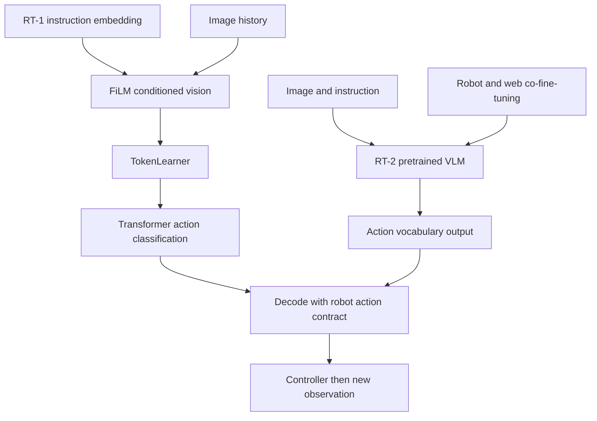

# S2.1 — RT-1 / RT-2 Overview

## Why / Problem

Stage1 已跑通 tiny VLA 工程，但 learned policy 闭环仍失败。本任务回答：
把动作离散化之后，RT-1 与 RT-2 的学习问题、预训练来源和部署代价有何区别？
只做架构阅读和可执行编码实验，不训练 RT 模型，不修复 S1.5，不进入 S2.2。预计学习 1 小时。

## Intuition

RT-1 先让语言影响“看什么”，再从视觉历史预测动作；RT-2 让已有视觉语言模型学习
一种新的输出用途：动作。把数值写成文本只是接口，语义迁移还依赖预训练与机器人监督。
本地实验把同一条 joint reference 分别写成 channel ID 和有序数字字符串，说明接口可以改变而物理语义不变。

## Sources / version boundary

查阅日期 2026-10-18；只使用原版 RT-1 / RT-2，不混入 RT-X、OpenVLA 或 action chunk 模型。

- [RT-1 paper v1](https://arxiv.org/html/2212.06817v1)，§5.1、Appendix C：架构与推理。
- [RT-1 official project](https://robotics-transformer1.github.io/)：输入输出、数据和实验语境。
- [RT-2 paper v1](https://arxiv.org/html/2307.15818v1)，§3、§4.2：动作词表、co-fine-tuning、迁移限制。
- [RT-2 official project](https://robotics-transformer2.github.io/)：变体与数据流。
- [RT-1 official code](https://github.com/google-research/robotics_transformer/tree/4569641b8111f3f402c32d8e24becd2a6e952ecc)，固定 commit
  `4569641b8111f3f402c32d8e24becd2a6e952ecc`；git ls-remote HEAD 核对。
  阅读 transformer_network.py 与 tokenizers/action_tokenizer.py；没有安装或执行 TensorFlow。
  RT-2 本任务为 paper/project study，没有检查官方完整策略源码，不声称 code reproduction。

## Core Concepts / Architecture

| 比较 | RT-1 原版 | RT-2 原版 |
|---|---|---|
| 条件路径 | 预训练 sentence embedding → FiLM 调制视觉 encoder | image + instruction → 预训练 VLM |
| 视觉路径 | EfficientNet → TokenLearner → Transformer | 取决于 PaLI-X / PaLM-E backbone，不能统一成 RT-1 |
| 动作接口 | 各维离散分类 | 将离散动作映射到 VLM 输出 token |
| 迁移问题 | 视觉/语言表征初始化 + robot demonstrations | web VLM 知识 + robot/web co-fine-tuning |
| 时间结构 | 历史观测预测当前动作 | 自回归生成当前动作各字段 |
| 本地对应 | S1.4 的条件视觉概念、S0.6 bins | S0.6 编码 + 新的输出词表接口；没有本地预训练迁移证据 |

RT-1 论文视觉摘要：每帧 81 个 features 压到 8 个，6 帧历史得到 48 个视觉 tokens。
48 不包含完整动作槽序列。语言经 FiLM 进入视觉路径，不能画成单纯尾部拼接 word tokens。
动作有 arm7/base3/mode1，共11字段；mode 是离散类别，不能当连续角度量化。
以上为 [RT-1 §5.1](https://arxiv.org/html/2212.06817v1) 的架构概述。

RT-2 主机器人动作8字段：terminate、位置位移3、旋转位移3、gripper extension。
PaLI-X 利用已有整数 token；PaLM-E 重用低频 token。数字字段数量不等于任意 tokenizer 的 subword 数。
参见 [RT-2 §3.2](https://arxiv.org/html/2307.15818v1)。其展示字符串有省略字段的不一致例子；
这里按论文明确列出的8字段契约理解，不复制该例子作可执行 payload。
两者不是 H=11/H=8 的未来动作 chunk；字段数、历史长度、未来 horizon 是三个不同轴。



### Official code reading

transformer_network.py：`_generate_masks` 区分视觉槽和动作槽，屏蔽动作标签依赖；
`_transformer_call_and_slice` 从 logits 选 ID；`call` 的推理循环按动作维读取结果。
不能仅凭 decoder-only 或代码循环，就声称当前维依赖之前生成的动作维；还必须读 mask。
该文件默认参数也不是论文完整配置。action_tokenizer.py 把 spec bounds 和各字段连接起来。
本地 S0.6 的 channel namespace 与中心解码是教学选择，不冒充官方 codec 的精确边界规则。

## Input / Output Contract

本地输入复用 S0.5 三条 synthetic train episodes；没有读验证集或 fit 公开 robot 数据。

| Item | shape / dtype | units / frame / time |
|---|---|---|
| raw references | (4,2) float32 | q1/q2 absolute joint reference，rad，joint axes；4次命令、dt=.1s |
| training ranges | (2,) float64计算 | 只用3条train共12命令；raw保持原值 |
| bin IDs | (4,2) int64 | 各字段共享0…B−1，字段位置提供语义；无物理单位 |
| channel IDs | (4,2) int64 | j×B+bin，S0.6的字段namespace |
| strings | 4条、每条2数字字段 | 一个时间步两个joint，绝非未来两步 |
| decoded | (4,2) float32 | 原joint absolute reference语义，rad；有损 |

不运行 vision/language encoder：没有真实 RGB tensor、embedding 或 FiLM 激活。
论文 shape 是阅读结果，不是本地前向执行。RT 真实 frame/controller bounds 必须查对应机器人契约；
此处 rad/joint/10Hz 仅属于本地 toy，不能套到 RT end-effector 输出。

## Mathematics

本地复用 S0.6：w_j=(high_j−low_j)/B，b_j=clip(floor((a_j−low_j)/w_j),0,B−1)，
中心解码 a_hat_j=low_j+(b_j+.5)w_j。in-range 理想误差≤w_j/2，float32另加1e−7rad容差。
本脚本不测试饱和后的原值误差界；选定train样本必须无饱和。
RT-2 的条件分解可写为 p(b_t|I_t,l)=∏_j p(b_(t,j)|I_t,l,b_(t,<j))；
j是当前动作字段，t才是控制时刻，不应把自回归字段解释成未来轨迹。
训练离散分类通常用 −Σlog p(label|context)，不等于物理MSE，更不等于闭环成功率。

## Math / Architecture → Code

[script](../../scripts/s2_1_rt_overview.py) 调用现有 fit_tokenizer/encode/decode，
再去掉channel offset、序列化、解析、加回offset并解码。`parse_action` 拒绝非数字、错长度与越界。
synthetic logits 有一个最高分text-only ID；限制到动作词表后它不能被选中。
这只演示合法词表约束；合法ID仍可能语义错误或导致控制失败。没有模型生成字符串。

## Minimal Experiment

已有 NumPy 即可，CPU，无安装、模型权重或dataset下载；输出目录必须不存在。

```bash
.venv/bin/python scripts/s2_1_rt_overview.py --output tmp/my_s2_1
.venv/bin/python scripts/s2_1_rt_overview.py --bins 16 --output tmp/my_s2_1_b16
```

Run：查看 report.json 的 action_signature、strings、IDs、误差界，以及 codec.npz 的 raw/decoded。
Modify：第二条先预测 B256→16 的 shape、字段数量、range、ID、量化界如何变化，再运行。
每字段半bin界放大16倍；实际误差不保证严格放大16倍。训练range、raw和时间语义不变。

## Expected Result

同一bin序列经两种接口完全一致；raw不变；解码误差在半bin界内；6个坏字符串拒绝。
未约束选择text-only ID=B，约束后选择3。B变化不改变每动作2字段和H1。

## Actual Result

2026-10-18，repo .venv Python3.14.7 / NumPy2.5.4；实际NumPy模块位于
`.venv/lib/python3.14/site-packages/numpy/__init__.py`。未安装依赖。
B256与B16两条命令分别输出 tmp/s2_1_verified、tmp/s2_1_b16_verified，均通过以上断言和NPZ重载。
详细数值记录于report；仅codec实验，不报告模型loss、robot success或推理latency。

## Explanation / Result

实验隔离了“动作数值→符号→物理解码”这层接口。换字符串没有产生语言理解或预训练知识。
语义迁移来自训练及数据；真实成功还受感知、动作覆盖、控制器和反馈影响。
RT-2论文的语义迁移不能推导出新的运动技能，见其§4.2；Stage1失败模型也没有因读完论文而改善。

## Failure Analysis / Limitations

| failure | 本任务边界 |
|---|---|
| 合法但错误的动作 | 词表限制只修格式，不能验证目标、碰撞或动作方向 |
| 字段/embodiment mismatch | 相同shape或ID不能统一rad、m、frame、gripper语义 |
| 时序混淆 | 多个字段不是chunk；历史窗口不是未来horizon |
| saturation / distribution shift | 半bin界只对in-range成立；本次无OOD控制实验 |
| 语义迁移过称 | 没有预训练、训练或held-out模型评价，不能证明web知识迁移 |
| latency | RT-1项目报告3Hz；RT-2论文55B为1–3Hz的multi-TPU服务，不是本机结果 |

大型模型成本只作硬件直觉：按2bytes/parameter，55B裸权重约110GB，未计激活/KV/训练状态。
本机CPU实验不运行这些模型，不据此估算可实现的控制速度。

## Relation to Robotics

网络输出还要经过detokenization、单位/frame/controller校验和执行，再获取新观测。
S1.7中offline误差和visited-state误差已不同，换成action tokens也不会消除闭环评价需求。

## Interview Capsule

30秒：RT-1用语言调制视觉历史，再预测离散动作；RT-2将预训练VLM扩展为动作输出，
混合robot和web数据继续训练。它的优势研究的是语义知识迁移，仍依赖robot动作监督及真实闭环评价。

2分钟：补充FiLM/TokenLearner的数据流、RT-2两种token映射方式、字段轴与时间轴的区别，
并说明本地只做codec/词表约束，未复现模型或获得论文成功率。动作合法不代表动作正确。

## Likely Follow-up Questions

1. 从image/instruction到action分别画两条路径：语言在哪里进入？哪些部分预训练？
2. RT-1的48视觉tokens、11动作字段，RT-2的8字段，分别对应哪个轴？为何不等于chunk长度？
3. 为什么数字字符串不自动等于一个数字一个LLM token？PaLI-X/PaLM-E如何处理？
4. B256→16有哪些不变量？半bin界怎样变化？为何实际误差未必同比变化？
5. 合法action token、semantic transfer、新运动技能、真实robot success之间有哪些不能直接推出的关系？

## Must Remember

接口转换≠语义迁移；动作字段≠未来horizon；paper evidence≠本地证据。

## My Verification

- [x] Run：自己运行默认实验，读report/NPZ，解释同一raw的两种ID。
- [x] Modify：先预测B变化，再运行并核对不变量、误差界。
- [x] Explain：用自己的话回答以上五问，区分论文结论与本地证据。

2026-10-18 用户明确确认实验和预测完成，并准确回答五项Explain；Learning Mastered。
解释覆盖两种预训练/条件路径、视觉token与动作字段/时间轴、VLM token映射、
B256→16不变量和半bin界，以及格式合法/语义迁移/新运动技能/闭环成功的证据边界。

Engineering Complete + Learning Mastered。Current Task=S2.1；Next Task=S2.2，仅计划。STOP。
