# S2.2 — Octo Study

## Why / Problem

RT-2 把预训练VLM接到动作词表；Octo研究另一条路线：在多机器人示范上预训练一个
容易改变输入和输出接口的策略。如何支持缺失相机、语言或goal image，以及不同动作维度，
同时保留Transformer主体？本任务只学习Octo的conditioning/action head/adaptation，约1.5小时。

## Intuition

把不同模态送进各自的tokenizer，统一成embedding交给共享backbone。
readout像只读观察员，汇总task和历史观测，再把摘要交给小diffusion head生成连续动作chunk。
缺失模态用mask隔离；换embodiment要明确新传感器、动作语义和训练数据，改shape只是第一步。

## Sources / Version Boundary

查阅2026-10-18，选择原版[Octo论文v1](https://arxiv.org/html/2405.12213v1)（2024-05-20）与
[官方项目](https://octo-models.github.io/)。模型规模、预训练规模和真实机器人评价来自论文/项目，非本地复现。

官方代码固定commit `241fb3514b7c40957a86d869fecb7c7fc353f540`，git ls-remote核对HEAD：

- [octo_module.py](https://github.com/octo-models/octo/blob/241fb3514b7c40957a86d869fecb7c7fc353f540/octo/model/octo_module.py)：task/observation/readout分组与attention规则。
- [action_heads.py](https://github.com/octo-models/octo/blob/241fb3514b7c40957a86d869fecb7c7fc353f540/octo/model/components/action_heads.py)：选定 **DiffusionActionHead（MLP）**，不混入同文件UNet变体。
- [pretrain config](https://github.com/octo-models/octo/blob/241fb3514b7c40957a86d869fecb7c7fc353f540/scripts/configs/octo_pretrain_config.py)：window2、action horizon4、action dim7、1个action readout。
- [octo_model.py](https://github.com/octo-models/octo/blob/241fb3514b7c40957a86d869fecb7c7fc353f540/octo/model/octo_model.py)：create_tasks、run_transformer、sample_actions和反归一化。

这是论文与固定源码阅读，未执行官方JAX/Flax、未加载checkpoint；代码HEAD不等于论文实验版本。
尝试的examples/finetune_new_observation_action.py在该revision不存在；没有依赖这个猜测路径作证据。

## Core Concepts

| 概念 | Octo含义 | 容易混淆之处 |
|---|---|---|
| conditioning | language或goal image提供任务条件 | goal image是部署时给定目标，不是偷看当前rollout未来 |
| tokenizer | 各模态到统一embedding宽度 | image patches不是动作离散bins |
| block causal mask | 同时刻观测可互看，后时刻不能影响前时刻 | 不等于序列索引上简单下三角 |
| readout | 提取task/历史摘要，观测不读取readout | 并非每个readout就是一个未来动作 |
| diffusion head | 连续chunk分布的条件去噪 | 去噪步不是物理控制步，也不是RT-2字段自回归 |
| adaptation | 增换tokenizer/head，保留主体参数作初始化 | 接口能兼容不等于零样本就会控制新机器人 |

[官方项目](https://octo-models.github.io/)介绍语言/目标图像条件、跨机器人数据预训练以及输入输出适配。
Small/Base分别27M/93M参数，在约800k episodes上预训练。这些不能推导出本机CPU训练可行性。
论文报告预训练和微调使用加速器；本任务不运行完整模型，现有NumPy足够。

## Architecture / Data Flow

```mermaid
flowchart TD
  L[Language] --> LT[Language tokenizer]
  G[Goal image] --> IT[Image tokenizer with observation/goal configuration]
  O[Current and past camera images] --> IT
  LT --> B[Grouped tokens and masks]
  IT --> B
  B --> T[Transformer backbone]
  T --> R[Action readout embedding]
  R --> D[Small conditional diffusion head]
  N[Gaussian action noise and diffusion step] --> D
  D --> A[Normalized continuous action chunk]
  A --> U[Embodiment statistics and action contract]
  U --> E[Execute prefix then observe again]
```



[论文§III-A/C](https://arxiv.org/html/2405.12213v1)：readout读取task/观测，backbone每次决策计算一次，
随后多步去噪在小head内完成。适配保留主体初始化；论文微调更新全模型，不应说只训练新head。
语义/相机/控制器契约仍需目标域数据与闭环评价。

### Fixed code → tensor trace

记B=batch、W=观测window、H=未来动作horizon、A=动作维数、D=embedding宽度、N=readout数。

| 官方选定接口 | shape | 语义 |
|---|---|---|
| task tokenizer output | (B,N_task,D)投影后 | task条件；不是每个动作维一个token |
| observation group | (B,W,N_obs,D) | 同一window中的时序观测 |
| action readout | (B,W,N,D)，config N=1 | 每个观测anchor的摘要 |
| training actions/noise | (B,W,H,A)，内部展平H×A | 每个anchor对应未来chunk |
| sampled actions | (B,H,A)，忽略额外sample axes时 | predict_action只取window最后anchor |

固定config使用window2/H4/A7，MLP head默认20去噪步。语言encoder设置t5-base且不finetune；
primary/wrist ImageTokenizer把goal和observation按配置组合，不可把所有goal一律画成独立prefix token。
配置repeat_task_tokens=True；本地简化为单task prefix，并不复制这些全部细节。
Proprioception不是这个pretrain config默认输入；适配时才按配置加入，不能假设每个checkpoint都读state。

`OctoTransformer`中：task读task；obs读task及同/更早obs；readout读task/obs及同组因果readout。
其他readout group互相隔离。缺失modal mask与timestep_pad_mask一起生效。
`DiffusionActionHead.loss`比较预测噪声与注入噪声并结合timestep/action masks；
`predict_action`返回最后anchor的chunk。action维padding不等于机器人真实零命令。
`sample_actions`使用对应dataset/embodiment统计反归一化；没有统计时不能把normalized输出当m/rad。

## Input / Output Contract — local experiment

[本地script](../../scripts/s2_2_octo_trace.py)是无训练的两层attention与扩散加噪代数实验。
无真实image、自然语言encoder、checkpoint或learned policy；没有伪造视觉/语言理解。

| Item | shape / dtype | modality / units / frame / time |
|---|---|---|
| synthetic token embeddings | (7,4) float32 | 无单位；随机固定seed7，batch=1省略 |
| token order | 7槽 | task,primary0,wrist0,readout0,primary1,wrist1,readout1 |
| valid / attention | (7,) / (7,7) bool | True=存在/允许；row=query、column=key |
| output embeddings | (7,4) float32 | 两层identity-QKV residual attention结果，无learned参数 |
| head2/head3 probes | (3,2)/(3,3) float32 | seed13随机线性投影，无单位，不是物理动作 |
| separate raw action fixture | (1,2,3,2) float32 | B1/W2/H3/A2；world XY displacement[m]，dt=.1s，每anchor未来3条命令 |
| normalized clean/noisy actions | (1,2,3,2) float32 | raw/.06m无单位；不作为backbone输出或模型训练数据 |

t0/t1是两个可用观测anchor，W2不等于H3。raw fixture是显式代数样本，没有对应物理episode或成功标签，
不导出embodied_episode。固定.06m是教学单位转换，不是从validation拟合统计；raw另存不覆盖。
随机tokens不来自该action fixture；两组实验相互独立，不能把它们接起来叫做policy。

## Mathematics

Attention：S=XXᵀ/√D；P_qk在mask允许keys内softmax，其他权重0；X_next=X+PX。
两层重复，无MLP/LayerNorm/learned projections，所以不是完整Octo Transformer。
每层先用where清空缺失payload，避免NaN参与点积；有效槽NaN则拒绝。

扩散正向：x_k=√alpha_bar·a_normalized+√(1−alpha_bar)·epsilon，epsilon~N(0,I)。
本地alpha_bar=.64，seed11；用已知epsilon反解a，验证代数与shape。
真实head训练epsilon_theta(x_k,e,k)，去噪索引k与控制时刻t、chunk索引h是不同轴。
**本地使用oracle噪声，不是训练denoiser，也没有实现反向生成采样。**

## Math / Architecture → Code

fixture构建mask，backbone两层执行attention；future/readout/task反事实扰动审计信息路径。
把缺失wrist槽换成NaN，输出保持完全一致；有效primary NaN应报错。
同一readout接D×(H·2)和D×(H·3)两个随机head，演示适配shape边界，保留backbone。
这里没有学习新action语义或监督训练，不能证明跨embodiment迁移。
Diffusion_probe单独检查正向公式；trace.npz保存mask、attention、embeddings及raw/noisy/recovered。

## Minimal Experiment

仓库.venv已有NumPy，CPU；无新增依赖、模型或dataset下载。输出目录必须不存在。

```bash
.venv/bin/python scripts/s2_2_octo_trace.py --output tmp/my_s2_2
.venv/bin/python scripts/s2_2_octo_trace.py --wrist missing --output tmp/my_s2_2_missing
```

Run：读report和trace.npz，按上面的七槽顺序画7×7mask，比较same-time与future访问。
Modify：先预测present→missing对shape、valid tokens、attention、readout和扩散fixture的影响。
每次都保存present/missing两条件；flag只选择report.selected，所有case数组不随flag改变。
因此不能把flag称为重新训练或删除模型参数；要比较cases里的两条件。

## Expected Result

shape均(7,4)，有效tokens7→5，允许attention边28→14；masked权重严格0，readout数仍2。
present/missing readout一般不同；缺失槽NaN替换不改变missing结果。
改t1观测不能改变t0输出，改readout不改变task/obs；改task会改变readout。
扩散oracle恢复误差≤1e−7（无单位），两种head输出shape正确，所有NPZ值重载相同。

## Actual Result

2026-10-18，repo .venv Python3.14.7 / NumPy2.5.4；模块实际位于
.venv/lib/python3.14/site-packages/numpy/__init__.py，执行前核对。未安装或修复环境。
两命令输出tmp/s2_2_verified和tmp/s2_2_missing_verified，以上八类checks及NPZ重载均通过。
valid7/5、allowed edges28/14，head输出(3,2)/(3,3)，符合预期。
没有训练loss、闭环success、failure stage分母或模型latency可报告；这是边界验证，不是机器人benchmark。

## Explanation / Result

mask实验说明可读信息受结构约束，缺失payload可以被隔离；不说明模型能补全缺失感知。
head shape变化说明模块接口可替换；不说明新机器人动作被学会。
oracle恢复说明扩散正向算式正确；不说明随机backbone可以生成动作分布。
Octo论文真实机器人结果是外部证据，本地没有复现这些结果；S1.5闭环失败结论不变。

## Failure Analysis / Limitations

| failure | consequence / boundary |
|---|---|
| missing mask漏设 | placeholder影响attention，零值本身不代表缺失 |
| 只在logits后mask NaN | value矩阵仍可能传播NaN；本地先清理invalid payload |
| future attention开放 | 后时刻观测污染早时刻表示；反事实审计验证隔离 |
| readout反馈到obs | 新head改变共享表征路径；两层实验检查间接影响 |
| normalized当物理动作 | units/frame/scale错误；本地随机head probe从不执行 |
| 新A仅改shape | 未定义joint顺序/controller/语义；没有适配能力证据 |
| 数据/语言/相机偏差 | mask不解决训练覆盖不足；更多模态不必提高成功率 |
| inference latency | 去噪次数会影响计算；没有测官方模型，不能承诺本机控制频率 |

原版局限、实际机器人的评估条件应回看[官方论文Discussion](https://arxiv.org/html/2405.12213v1)，
不能把某组实验优势升级成“diffusion总优于MSE”或“Octo能零样本控制任意机器人”。

## Relation to Robotics

适配顺序：明确sensor时序/标定与action frame/unit/controller → 训练数据契约/统计 →
配置新增tokenizer/head并微调 → held-out offline → 真实闭环success、失败阶段与latency。
本任务仅展示中间接口/信息路径，未执行这整条适配流程。

## Interview Capsule

30秒：Octo是模块化Transformer策略，以language或goal image条件读取观测历史，readout提取摘要，
小diffusion head生成连续chunk。它支持更换输入和动作head，但真实适配仍需监督和闭环验证。

2分钟：补充block mask与缺失modal mask，W/H/A/k四个轴，backbone一次/head多步，
以及新head初始化不等于只训练head。用本地NaN隔离/未来扰动说明接口证据边界。

## Likely Follow-up Questions

1. 画出language/goal image→tokenizers→Transformer→readout→diffusion head→反归一化路径，与RT-2比较。
2. 本地7×7mask的primary0可读哪些槽？readout1可读哪些槽？缺失wrist时怎样变化？
3. 区分W2、H3、A2、去噪索引k；官方config的W2/H4/A7与本地有何不同？
4. present→missing有哪些不变量？为什么flag切换不改cases数组，而cases内部readout不同？为什么先清理NaN？
5. 新机器人从A2→A3为什么只改head不够？oracle噪声恢复和真实diffusion策略成功各证明什么？

## Must Remember

缺失mask≠补全感知；readout≠动作；新head≠新技能；加噪反解≠学会生成；外部论文结果≠本地证据。

## My Verification

- [ ] Run：读report/trace并画七槽attention mask。
- [ ] Modify：先预测missing模式变化，再运行并比较selected与cases。
- [ ] Explain：用自己的话回答五问，明确原版/固定代码/本地简化边界。

Engineering Complete；Learning未确认。Current Task=S2.2；Next Task=S2.3，仅计划。STOP。
