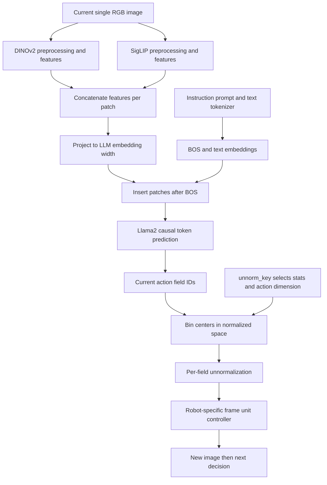

# S2.3 — OpenVLA Architecture Trace

## Why / Problem

原版OpenVLA如何把单张RGB和指令变成可执行动作？在哪个轴融合视觉？
机器人state是否进入模型？相同action ID为何能被不同统计解码成不同物理命令？
本任务约2小时，逐模块/shape/语义追踪，并做CPU上的序列与codec实验，不运行7B模型。

## Intuition

两位视觉观察员分别提取同一张图的patch features，在每个patch上拼接feature channels；
projector将它们转换到LLM embedding宽度，再插入语言序列BOS后。
LLM生成当前动作各维的token，codec把ID变回normalized值，dataset统计恢复数值尺度。
最后仍需机器人controller按frame/unit/频率执行。它并不是“LLM直接输出电机电流”。

## Sources / precise variant

查阅2026-10-18，限定原版 **OpenVLA-7B**，不混入OpenVLA-OFT、proprio增强、并行chunk或连续action head。

- [官方项目](https://openvla.github.io/)：模型组件、训练与外部真实机器人实验。
- [论文v1](https://arxiv.org/html/2406.09246v1)，§3：Prismatic初始化、robot action训练与数据契约。
- 官方repo commit `c8f03f48af692657d3060c19588038c7220e9af9`，git ls-remote HEAD核对。
- HF `openvla/openvla-7b` metadata revision `47a0ec7fc4ec123775a391911046cf33cf9ed83f`：只读取
  [config.json](https://huggingface.co/openvla/openvla-7b/blob/47a0ec7fc4ec123775a391911046cf33cf9ed83f/config.json)（60,712bytes）与
  [preprocessor_config.json](https://huggingface.co/openvla/openvla-7b/blob/47a0ec7fc4ec123775a391911046cf33cf9ed83f/preprocessor_config.json)（1,650bytes）。
  没有下载权重、tokenizer模型或dataset；web工具未取到HF config，改用只读HTTP获取metadata。
- [source manifest](s2_3_openvla_sources.json)：revision、配置摘要、读取文件SHA256。HEAD/config不等于论文实验源码版本。

关键源码（以下均为固定repo revision）：

| 文件 | 追踪入口 / 检查点 |
|---|---|
| [modeling_prismatic.py](https://github.com/openvla/openvla/blob/c8f03f48af692657d3060c19588038c7220e9af9/prismatic/extern/hf/modeling_prismatic.py) | PrismaticVisionBackbone、PrismaticProjector、multimodal forward、predict_action |
| [processing_prismatic.py](https://github.com/openvla/openvla/blob/c8f03f48af692657d3060c19588038c7220e9af9/prismatic/extern/hf/processing_prismatic.py) | image分支预处理、channel stack、processor输出 |
| [action_tokenizer.py](https://github.com/openvla/openvla/blob/c8f03f48af692657d3060c19588038c7220e9af9/prismatic/vla/action_tokenizer.py) | np.linspace/digitize、末端token映射及中心解码 |
| [datasets.py](https://github.com/openvla/openvla/blob/c8f03f48af692657d3060c19588038c7220e9af9/prismatic/vla/datasets/datasets.py) | RLDSBatchTransform、load_proprio=False、W1/H1、action监督mask |
| [data_utils.py](https://github.com/openvla/openvla/blob/c8f03f48af692657d3060c19588038c7220e9af9/prismatic/vla/datasets/rlds/utils/data_utils.py) | q01/q99 normalization、mask与clipping |

## Core Concepts

| 轴/接口 | 原版含义 | 错误理解 |
|---|---|---|
| visual fusion | 同一patch两个encoder的feature维相拼 | 拼成两倍patch数 |
| language fusion | projected patches插入BOS之后 | image先变成自然语言描述再进LLM |
| robot context | 原版无直接proprio输入；统计key在解码外部 | 所有VLA默认把state拼入prompt |
| action tokens | 当前控制命令的各维ID | 7维就是未来7步chunk |
| unnorm_key | 选择dataset统计和get_action_dim | 传给Transformer的embodiment embedding |
| autoregression | 同一动作字段按token序列依次生成 | 每生成一字段就执行一次物理动作 |

[官方项目](https://openvla.github.io/)说明DINOv2+SigLIP视觉、projector与Llama2构成策略；
7B模型在约970k robot episodes上训练。VLM预训练与机器人训练分开：原版robot训练不是RT-2式web/robot co-fine-tuning。
原版能力、论文成功率与本地实验必须区分，不能用组件名称推断已复现这些能力。

## Architecture / Data Flow



`unnorm_key`也决定generate的max_new_tokens=get_action_dim，因此不同动作维数时会改变生成长度；
它本身没有被嵌入LLM。默认训练W=1、future_action_window_size=0，目标是当前动作。
`load_proprio=False`和RLDSBatchTransform只返回image/input_ids/labels等字段是直接代码证据，
不是根据论文没有写state就猜“没有state”。Goal relabeling可能发生，但默认训练注释明确goal未使用。
真实测量state仍可能服务于机器人低层控制器，这与输入VLA Transformer是两回事。

## Input / Output Contract — full model static trace

B=batch；P=patch数；L=包含BOS的prompt token数；A=动作维数；H=未来horizon。
以下shape来自固定config和源码静态推导，**没有在本机运行真实forward**。

| module / tensor | shape / dtype | meaning / time / units |
|---|---|---|
| raw RGB | (H_img,W_img,3) uint8 | 当次决策之前获取的单张图；RGB camera frame |
| HF pixel_values | (B,6,224,224) floating | 同一图两个分支各3channels，不是双camera或两个时刻 |
| DINOv2 patches | (B,256,1024) floating | 224/14=16边长，16² patches；取倒数第二层patch输出 |
| SigLIP patches | (B,256,1152) floating | 同patch网格，另一个预训练特征空间 |
| fused features | (B,256,2176) floating | 拼feature维1024+1152，P仍256 |
| fused projector | 2176→8704→4096→4096 | 选定HF fused分支三层Linear，中间GELU；无物理单位 |
| input_ids / text embeddings | (B,L) int64 / (B,L,4096) floating | prompt含instruction，L由真实tokenizer决定 |
| multimodal inputs_embeds | (B,L+256,4096) floating | BOS + patches + 剩余text |
| token logits | (B,sequence_length,32064) floating | 下一token分布；含padding-expanded词表 |
| action IDs / decoded | (A,) int64 / (A,) NumPy floating | 当前动作维；通常A7，H1，不含RT-2 terminate字段 |

DINOv2/SigLIP宽度查所选timm模型定义：
[timm v0.9.10 vision_transformer](https://github.com/huggingface/pytorch-image-models/blob/v0.9.10/timm/models/vision_transformer.py)；
LLM默认4096来自[LlamaConfig v4.40.1](https://github.com/huggingface/transformers/blob/v4.40.1/src/transformers/models/llama/configuration_llama.py)。
config声明bfloat16，但实际dtype受加载选项/量化/AMP控制，不能声称所有tensor固定bf16。
DINO register/CLS不计入这里的patch序列，所选get_intermediate_layers输出patches。

注意原版论文§3.1概述projector为2层，选定HF fused分支源码实际3层；本表按所读配置/代码，
不将两种说法混为同一个精确实现。本机不安装timm/Torch来构造这些大型模块。
裸7B权重按2bytes/parameter约14GB，尚不含视觉/激活/KV等成本；不能据此宣称CPU可实时运行。

### Image / language / supervision details

两个视觉分支各自resize/normalize，不能将同一normalized RGB直接共用给两个encoder。
固定preprocessor保存的tvf_normalize_params有数值舍入，应按实际processor配置解释，不能用图像原始像素值代替。
HF processor返回input_ids、attention_mask、pixel_values；默认prompt形式包含“机器人为指令采取什么动作”的提问。
推理包装还检查末尾29871空白token，以对齐训练prompt；本地不模拟真实tokenizer行为。

训练label mask：视觉位置填−100，prompt位置忽略，仅action目标（配置允许时还含stop/EOS）参与监督。
causal LM内部shift，不能把当前位置输入action标签直接当当前位置预测正确。
EOS是序列结束标记，不是额外robot terminate动作字段。

## Mathematics — exact selected codec

模型词表32064，pad_to_multiple_of=64，所以动作映射用有效V=32000，不能直接用32064。
选定代码：edges=linspace(−1,1,256)，d=digitize(clip(a_norm,−1,1),edges)，token=V−d。
允许的action token范围31744…31999；各action字段共享这个范围，由字段位置决定语义。
中心c_i=(edges_i+edges_(i+1))/2，共255个，decode_i=clip(V−token−1,0,254)。
因此末端31745和31744都映射到最后中心；论文“256 bins”概述与代码的255个不同中心要分别说清。

中心间距2/255，in-range/clip后理想最大误差1/255；不能套用S0.6的1/256。
原始out-of-range物理误差不受这个量化界约束，clipping必须显式记录。
对需要反归一化的字段：a_phys=.5(a_norm+1)(q99−q01)+q01；mask=False的字段保持normalized值。
训练归一化还有小epsilon和clipping，并非精确可逆；这里不声称recover原始离群值。

官方decoder对非法ID也会clip到边缘，没有在该函数里严格拒绝非action词。
**合法数值不证明生成ID合法。** 本地增加strict检查作审计，并保留permissive反例，不冒充官方已有防护。
q统计对应dataset数值分布，不编码joint顺序、单位或controller；反归一化不能修复错frame/embodiment。

## Math / Architecture → Code — CPU version

[script](../../scripts/s2_3_openvla_trace.py)无训练，无真实DINO/SigLIP/Llama。

1. synthetic16×16 RGB→4×4平均patches→随机3/5维分支features→feature concat8维→随机线性8维projector。
2. 手写prompt IDs和固定2字段action IDs，组装BOS/patch/text/teacher-forced action序列。
3. 单层identity-QKV causal attention验证未来action字段不能影响之前输出，并核对shift预测位置。
4. 独立使用官方NumPy规则进行ID/中心解码，分别使用两套**synthetic train-only**统计反归一化。

随机attention输出不生成上述固定action IDs；没有LM head、优化器、自然语言tokenization或robot动作学习。
这不是完整tiny VLA，序列和codec两个实验只验证接口与因果边界。
本轮还隔离执行已阅读官方ActionTokenizer类，dummy tokenizer只返回ID数组，
与本地encode在1256个输入、decode在全部256个ID上逐值相同；未验证真实tokenizer文本往返。

## Local Input / Output Contract

| item | shape / dtype | semantic / units / time |
|---|---|---|
| rgb | (16,16,3) uint8 | synthetic gradient，无真实机器人或标定 |
| branch_a / branch_b | (1,16,3)/(1,16,5) float32 | 固定seed17代理特征，不是预训练encoder |
| fused / projected | (1,16,8) float32 | features concat；单层projector，无单位 |
| prefix / teacher_forced | (1,20,8)/(1,23,8) float32 | prompt4+patch16，再加action2+EOS1 |
| labels | (1,23) int64 | action位置20/21，其他−100；本地不监督EOS |
| prediction_positions | (2,) int64 | shift后19/20位置输出预测下一action字段 |
| fixed_action_ids | (2,) int64 | encode normalized [−.3,.4]，不是生成结果 |
| decoded normalized | (2,) float64 | 无单位；中心量化有损 |
| compact/wide action | (2,) float64 | synthetic world XY displacement[m]，dt=.1s，H1/A2 |

compact/wide各由101条synthetic train-domain动作数值的q01/q99得到，wide训练样本幅度恰为compact两倍。
它们共享world XY/dt语义；不是真实dataset或两个embodiment适配实验，也没有rollout/episode。
raw训练数值另存trace.npz的compact_train_actions_m/wide_train_actions_m，只用于拟合，不修改原值；未使用held-out或重叠windows拟合。
CLI的key只是本地两统计选择，用于学习官方unnorm_key所在接口，不使用真实norm_stats控制机器人。

## Minimal Experiment

已有NumPy，CPU，无新增依赖/模型或dataset下载。输出目录必须不存在。

```bash
.venv/bin/python scripts/s2_3_openvla_trace.py --output tmp/my_s2_3
.venv/bin/python scripts/s2_3_openvla_trace.py --unnorm-key wide --output tmp/my_s2_3_wide
```

Run：查看report的tensor_shapes与trace.npz，画BOS后插入16patch的序列，定位action label与shift预测位置。
Modify：先预测compact→wide对features、sequence、固定IDs、normalized和physical action的影响。
脚本始终计算两profile，flag只改report.selected_unnorm_key/selected_action_m；不重训或重生成ID。
本地同A2不改变生成长度；真实key若对应不同A，还会改变get_action_dim/max_new_tokens。

## Expected Result

features沿channel融合，patch数16不变；prefix20、teacher-forced23，预测位置[19,20]。
同输入+两统计：IDs/normalized/所有trace数组不变，selected physical action恰为原来的2倍。
codec输入[−2,−1,0,1,2]对应IDs[31999,31999,31872,31744,31744]；255个不同中心，末端两ID碰撞。
strict拒绝3类坏ID；permissive的text ID1仍能变成边缘数值，展示错误接口风险；mask=False字段不反归一化。

## Actual Result

2026-10-18 repo .venv Python3.14.7 / NumPy2.5.4，实际模块位于
.venv/lib/python3.14/site-packages/numpy/__init__.py；执行前核对，无环境更改。
最终两命令写tmp/s2_3_final、tmp/s2_3_wide_final（另有初次verified目录）；序列/因果/shift/codec端点/3拒绝/统计比例/NPZ重载通过。
官方隔离codec等价检查1256inputs与256IDs通过；真实encoder/LLM/tokenizer未运行。
不报告模型loss、闭环成功或latency，也不将这些检查叫作OpenVLA复现。

## Explanation / Result

关键学习结果是把三类东西分开：模型条件（image/text）、动作符号（ID/字段位置）、物理尺度（统计+契约）。
修改统计可在不改变模型输入或ID时改变执行数值；选错key无法由正确shape自动发现。
projector和codec边界验证也无法说明视觉语义或动作预测正确，Stage1 learned控制仍失败。

## Failure Analysis / Limitations

| failure | consequence / evidence boundary |
|---|---|
| 把两分支当两个时刻 | 误解6channels和fusion轴；本地检查patch数不变 |
| 把proprio默认拼入模型 | 换了原版被研究架构；源码load_proprio=False |
| V=32064用于decode | ID偏移错误；应扣掉64padding词表项 |
| 非action token被clip | 得到貌似合法的边缘动作；本地strict检查，官方decoder本身宽松 |
| q统计key错误 | 相同ID变成不同数值；不能据词表/hash正确断言控制正确 |
| 未来标签泄漏 | teacher-forced input不等于预测，必须核对causal mask和shift |
| 量化误差当成功指标 | offline codec误差不等于闭环成功，未做控制实验 |
| 泛化/实时性外推 | 外部论文评估不代表任意embodiment、本机CPU或安全实时性 |

## Relation to Robotics

网络没有直接读state不代表系统没有反馈：新图像仍提供视觉反馈，低层controller仍可能使用实际state。
正式部署要核对camera、采样时序、单位/frame、动作语义、反归一化、controller以及完整闭环失败记录。
这里未连接旧仓库、仿真器或真实机器人，不更改既有S1.5失败模型。

## Interview Capsule

30秒：原版OpenVLA以DINOv2/SigLIP融合视觉features，经projector插到Llama2语言序列，
自回归预测当前动作各维token。默认不读proprio；unnorm_key选统计和动作维数，不是输入embedding。

2分钟：补充256patch的feature轴、BOS插入、label/shift、V32000与q01/q99解码；
说明论文与固定实现的projector/codec差异，再限定本地CPU证据为序列和数值接口，不是学习能力。

## Likely Follow-up Questions

1. 画出原版image/text到动作的路径。proprio、unnorm_key、低层state分别在哪儿？为什么不能假设都有state token？
2. 解释(B,6,224,224)→两分支→(B,256,2176)→(B,256,4096)。为何不是512patch？本地哪些模块只是代理？
3. prompt4/patch16/action2/EOS1如何形成23槽？labels20/21为何由输出19/20预测？EOS与robot terminate有何区别？
4. V32064/有效V32000/256网格点/255中心分别是什么？两个末端ID为何碰撞？非法text ID解出数值意味着什么？
5. compact→wide哪些不变、哪些变化？真实unnorm_key若改变A又怎样？为何统计选对仍不证明robot success？

## Must Remember

原版不默认输入proprio；双视觉沿feature融合；action字段≠未来chunk；统计key≠模型条件；可解码≠预测正确。

## My Verification

- [x] Run：读trace/report，画真实静态shape与本地23槽序列。
- [x] Modify：先预测wide模式，再运行核对normalized/physical不变量和变化。
- [x] Explain：回答以上五问，明确原版、固定代码、教学代理与真实控制证据的边界。

2026-10-18 用户明确确认实验和预测完成，并准确回答五项Explain；Learning Mastered。
解释覆盖原版image/text与外部统计/低层state边界、双视觉feature轴、BOS插入与causal shift、
有效词表和255中心/末端碰撞，以及统计选择影响物理动作但不证明控制成功。

Engineering Complete + Learning Mastered。Current Task=S2.3；Next Task=S2.4，仅计划。STOP。
