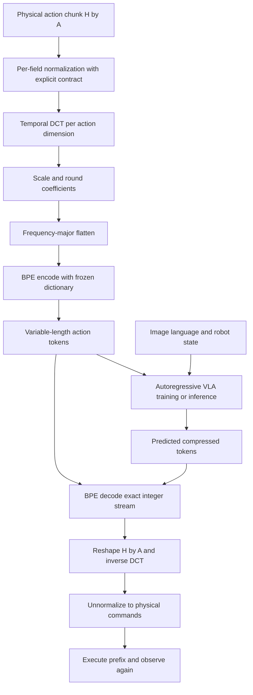

# S2.4 — FAST / π0-FAST Action Representation

## Why / Problem

原版OpenVLA每个动作维一个token；H步、A维chunk若逐标量离散，需要H×A个action IDs。
高频采样时相邻命令高度相关，重复表示可能浪费自回归序列。
本任务学习FAST如何把整个动作chunk压成变长token串，再解码回同一H×A连续动作；约1.5小时。
仅做tokenizer对照，不训练π0-FAST，不进入S2.5的flow架构研究。

## Intuition

平滑时间序列在频域可能只有少量显著系数。先DCT，再量化，小系数变成0；
BPE把常见整数模式合并成少量tokens。DCT本身不减少元素数，BPE无损还原量化整数，
但量化已经丢失精度。因此“压缩token少”与“动作重建好”必须分别评价。

## Sources / precise variant

查阅2026-10-18，仅FAST原论文与π0-FAST，不混入π0.5、其他tokenizer或flow action expert。

- [FAST论文v1](https://arxiv.org/html/2501.09747v1)，§V、Appendix C：DCT/量化/BPE与策略条件。
- [官方研究介绍](https://www.pi.website/research/fast)：FAST tokenizer、π0-FAST策略及训练/推理区别。
- HF `physical-intelligence/fast` revision `ec4d7aa71691cac0b8bed6942be45684db2110f4`：
  [processor源码](https://huggingface.co/physical-intelligence/fast/blob/ec4d7aa71691cac0b8bed6942be45684db2110f4/processing_action_tokenizer.py)、
  [processor_config](https://huggingface.co/physical-intelligence/fast/blob/ec4d7aa71691cac0b8bed6942be45684db2110f4/processor_config.json)。
  只读取源码6145bytes与config253bytes/API metadata；没有下载tokenizer.json字典或任何策略权重。
- openpi固定commit `215abfb217dbac7d5f1273282331b9b1866c0479`，git ls-remote HEAD核对：
  [tokenizer.py](https://github.com/Physical-Intelligence/openpi/blob/215abfb217dbac7d5f1273282331b9b1866c0479/src/openpi/models/tokenizer.py)与
  [pi0_fast.py](https://github.com/Physical-Intelligence/openpi/blob/215abfb217dbac7d5f1273282331b9b1866c0479/src/openpi/models/pi0_fast.py)。
- [版本/源码hash manifest](s2_4_fast_sources.json)。这是所读HEAD实现，不声称等于论文实验精确配置。

HF API确认实际配置名为processor_config.json；最初尝试preprocessor_config.json为404。
未调用AutoProcessor/trust_remote_code或安装SciPy/tokenizers/transformers。

## Core Concepts

| 名称 | 含义 | 不应推导的结论 |
|---|---|---|
| FAST | DCT+量化+BPE的动作tokenization方法 | tokenizer本身能理解指令或控制机器人 |
| FAST+ | 论文通用预训练tokenizer变体 | 适用于多种shape就自动统一frame/controller |
| π0-FAST | 用FAST离散chunk作为自回归目标的VLA策略 | FAST是π0连续flow head的一次量化后处理 |
| DCT轴 | 沿时间，每个动作维独立变换 | 混合不同joint单位后直接频域拟合 |
| BPE token | 量化系数序列中某段可展开模式 | token对应固定一个关节/固定一步动作 |
| variable length N | 压缩后token数随chunk/字典变化 | N变短意味着物理H或dt变短 |

[官方介绍](https://www.pi.website/research/fast)强调训练效率与推理速度应区分：π0-FAST的自回归解码仍可能慢于π0的flow解码。
本地只统计codec符号数量，不测VLA训练/推理，不复现官方训练提速或机器人成功率。

## Architecture / Data Flow



训练中tokens是监督目标，推理中由policy生成；codec直接编码真值不能当成策略预测。
FAST论文Appendix C的策略使用图像、指令及离散化state作为条件，这与S2.3原版OpenVLA无proprio的路径不同。
这里没有重新定义原版OpenVLA：论文中的FAST-policy配置是另一种实验设置。

### Fixed source → code reading

UniversalActionProcessor.__call__：输入(B,H,A)，DCT axis=1且norm=ortho，乘scale并around；
(H,A)按C-order展平，先频率、再action维；整数平移到字符后送BPE。
负整数不能直接chr：使用训练所得min_token偏移。所读实现还对低于min_token的值取maximum(...,0)，
因此超出训练字母域时另有clipping风险，不能把所有codec损失都归因于量化。

decode需明确H/A，否则token数N不足以恢复shape；所读实现可以缓存shape，生产审计宜显式传入。
其解码异常分支会回退零系数，不等于模型正确预测零动作。本地严格拒绝坏流，避免隐藏失败。
配置scale10/vocab2048/min_token−354；类默认vocab1024与发布配置不同，论文单dataset实验也不等于该配置。

openpi FASTTokenizer：state先离散成256档，再作为数字字符串进入文本prefix；action FAST IDs另映射到PaliGemma词表尾部，跳过128个special tokens。
具体映射为V−1−128−fast_id；它不是OpenVLA的32000−bin_id公式，也不是物理action维ID。
输入prefix可双向注意，输出postfix因果注意，loss只取postfix。pi0_fast.py将图像与文本embedding合并并执行next-token CE/AR采样。
本任务只读这些路径，不加载PaliGemma/SentencePiece/FAST+字典或运行真实VLA。

## Input / Output Contract — local experiment

[script](../../scripts/s2_4_fast_tokenization.py)：CPU NumPy，显式正交DCT矩阵和整数pair-BPE。

| Item | shape / dtype | modality / units / frame / time |
|---|---|---|
| raw train chunks | (8,16,2) float64 | synthetic world XY displacement[m]，每条命令dt=.1s |
| raw held-out chunks | 各(16,2) float64 | smooth与rough两个独立chunk，未用于fit字典 |
| normalized actions | (16,2) float64 | raw/.06m；固定教学尺度，无train/validation统计拟合 |
| DCT coefficients | (16,2) float64 | frequency × XY，无单位；不是控制时间索引 |
| quantized coefficients | (16,2) int64 | round(scale·C)，frequency-major整数流32元素 |
| BPE IDs | (N,) int64 | 本地字典namespace，无物理单位，与PaliGemma IDs无关 |
| reconstructed actions | (16,2) float64 | 原world XY delta[m]，H/dt/字段顺序保持 |
| scalar-bin baseline | (16,2) int64 | normalized[-1,1]上256个等宽bins，中心解码 |

H16/A2表示未来16条二维命令，覆盖1.6s命令区间；没有历史观测W或language输入。
原始chunks保存在trace.npz，不覆盖；它们是独立动作数值fixture，没有状态、episode/reset或机器人成功标签。
每chunk内部有序；不跨chunk拼接或学习跨boundary BPE pair。train8/heldout2按完整chunk隔离，不是从一个episode随机切windows。

### 本地简化边界

与官方相同的概念：沿时间正交DCT、scale-round、频率优先、BPE模式压缩、明确H/A逆变换。
不同：本地直接把整数当基础符号，没有Unicode/UTF-8/byte-level tokenizer；固定字母域−128…128，
不是官方learned min_token或FAST+词表。最多24次greedy pair merge，只用train数据，计数相同以pair词典序打破平局。
字典拟合是数据驱动tokenizer学习，评价为heldout重建/压缩；没有learned policy。
固定基础字母域避免heldout值影响字母表，越界明确拒绝，不silent clip或自动扩展。

## Mathematics

设normalized动作X∈R^(H×A)，正交DCT-II矩阵M：
M_(k,t)=sqrt(2/H) cos[π(t+.5)k/H]，k=0行再除sqrt2；MᵀM=I。
C=MX，Q=round(γC)，X_hat=Mᵀ(Q/γ)。γ为scale。
BPE编码Q的整数序列，展开后必须逐值等于Q，不额外引入重建误差。

不溢出/不clip时，每个系数误差≤1/(2γ)，正交变换保持Frobenius norm，
所以normalized RMSE≤1/(2γ)，physical RMSE≤.06/(2γ)m。
这不是每个时刻component的最大误差界；单个动作误差可以超过RMSE bound。
γ10→20使RMSE上界.003→.0015m；实际误差可不变，不能说必减半。

逐标量bins baseline固定32tokens，不压缩，精度也不同；未做同误差预算对齐，不能据此比较策略优劣。
重建误差之外，记录||Σ_t(a_hat_t−a_t)||₂[m]，它是在ideal additive point假设下的末端偏差，
这里只是位移积分诊断，不是执行过真实闭环或报告robot success。

## Math / Architecture → Code

fixtures生成8个低频训练chunk与heldout smooth/随机rough；不生成图像或语言。
quantize → fit_bpe(train only) → bpe_encode/decode → inverse DCT → metrics。
每个BPE token保存其整数展开，tokenizer.json可审计；train拟合、合并顺序、基础字母域明确记录。
scalar baseline保存独立IDs与decoded，便于对照；不复用S2.3的255中心实现。
拒绝未知/空/错系数数目的token流，以及错shape/NaN/字母域溢出chunk，共6类。

## Minimal Experiment

已有NumPy即可，无依赖修复/安装、真实dataset或模型权重下载；输出目录必须不存在。

```bash
.venv/bin/python scripts/s2_4_fast_tokenization.py --output tmp/my_s2_4
.venv/bin/python scripts/s2_4_fast_tokenization.py --scale 20 --output tmp/my_s2_4_s20
```

Run：看report、tokenizer.json和trace.npz，跟踪smooth一个token展开成哪些频率系数。
Modify：第二条前预测γ10→20对raw/H/A/dt/DCT、Q/字典、N和误差界的影响，再运行比较。
每个scale分别在相同train chunks上重新fit字典；token编号不具有跨scale可比的语义。

## Expected Result

raw/归一化尺度/DCT矩阵/连续系数/H16/A2/dt和scalar baseline保持不变。
Q与字典可能改变，N不保证单调，BPE展开必须无损恢复Q；动作恢复有量化误差。
所有系数仍保留32槽，小系数量化成0；没有手工丢弃高频或缩短H。
预计平滑输入更易压缩；rough可能不压缩。仅两个人工case，不能当通用统计结论。

## Actual Result

2026-10-18 repo .venv Python3.14.7 / NumPy2.5.4；实际module路径
.venv/lib/python3.14/site-packages/numpy/__init__.py，执行前核对；无安装。
两命令输出tmp/s2_4_verified、tmp/s2_4_s20_verified，正交/逆变换/BPE精确整数往返/6拒绝/NPZ与字典重载均PASS。

| scale / case | scalar tokens | BPE tokens | nonzero Q /32 | DCT physical RMSE[m] | integral error[m] |
|---|---:|---:|---:|---:|---:|
| 10 / smooth | 32 | 2 | 4 | .000243687 | .00480000 |
| 10 / rough | 32 | 32 | 27 | .00169016 | .00770210 |
| 20 / smooth | 32 | 6 | 4 | .000243687 | .00480000 |
| 20 / rough | 32 | 32 | 29 | .000944171 | .00490566 |

scale10拟合10merges/vocab267，scale20为9merges/vocab266；基础257符号计入vocab。
scalar baseline的smooth/rough RMSE约.000144044/.000138514m，随scale不变。
这些token数不含字典存储、state/image/prompt/分隔或EOS；压缩率不是文件byte压缩率，也不是VLA速度倍数。

## Explanation / Result

smooth从32到2个token来自特意构造的低频信号和train中常见零后缀，不是复现FAST+压缩率。
rough不压缩保留为失败case；提高scale时smooth重建不变但token2→6，说明精度界变严不保证实际误差改善或更省token。
平均重建误差较小仍可能积累成可观位移偏差；实际servo、碰撞和接触行为不满足这里的简单加法假设。
没有策略训练/控制，因此没有policy loss、闭环success/failure stages或推理latency可报告。

## Failure Analysis / Limitations

| failure | consequence / local handling |
|---|---|
| train/heldout泄漏 | 字典适应测试模式；只fit完整train chunks，保存train来源 |
| 量化损失忽略 | BPE整数无损不代表raw无损；分开报告RMSE与积分偏差 |
| 错flatten或H/A | BPE成功展开仍可能错配action维/时间；shape/schema必须携带 |
| 未见整数/字母域越界 | 本地固定域覆盖并显式拒绝溢出；不是自动宣称OOD鲁棒 |
| rough/high frequency | 小系数少、N不降；不声称DCT压缩对所有序列有效 |
| token截断/坏decode | 本地严格拒绝，不把官方fallback零当正确预测 |
| 时间/单位重解释 | 不能把position/delta/velocity混用；.1s与world XY只属于本地fixture |
| 重建好当控制好 | 无policy或环境反馈；离线误差不证明技能、泛化或安全实时性 |

## Relation to Robotics

codec不改变动作控制语义。即使token流长度变短，仍需按原H×A与dt解码、执行短prefix后重新观测。
模型生成的系数token影响的是整个chunk，不宜一边生成一个BPE token就直接当一次robot命令执行。
选择γ和字典应结合目标控制精度与完整闭环评价，而非只优化N。

## Interview Capsule

30秒：FAST用时间DCT与量化制造可压缩频率整数模式，再BPE压成变长tokens，供VLA自回归预测整个chunk。
DCT可逆、BPE对量化整数无损，损失来自量化和实现边界；更少tokens不自动意味着更好的控制或更快于flow推理。

2分钟：补充H/A/N不同轴、frequency-major顺序、train-only字典、FAST/FAST+/π0-FAST区别，
并用smooth与rough及scale变化解释压缩/误差/积分偏差的取舍。本地不复现策略或FAST+词表。

## Likely Follow-up Questions

1. FAST、FAST+、π0-FAST分别是什么？画出训练目标编码和推理解码路径，robot state在哪一侧？
2. H16/A2经过DCT、量化、flatten、BPE后各shape/轴是什么？为何N=2不表示只执行2步？
3. 哪些步骤可逆或无损，哪些丢信息？为什么BPE往返完全一致仍有物理误差，RMSE小仍有积分偏差？
4. γ10→20哪些不变、哪些重fit？误差界如何变化？本次smooth误差不变而token数增加说明什么？
5. 字典如何避免heldout泄漏？rough不压缩/坏流拒绝各说明什么？为何token数、文件byte、策略latency和robot success不能互相替代？

## Must Remember

DCT不减少shape；BPE无损的是量化整数；H/A/N不同轴；train-only字典；codec重建≠learned robot success。

## My Verification

- [ ] Run：自己运行并查看raw/coeff/Q/BPE/decoded与两case结果。
- [ ] Modify：先预测scale变化，再运行，核对不变量、字典与误差界。
- [ ] Explain：回答五问，区分官方FAST+、本地整数BPE与策略控制证据。

Engineering Complete；Learning未确认。Current Task=S2.4；Next Task=S2.5，仅计划。STOP。
