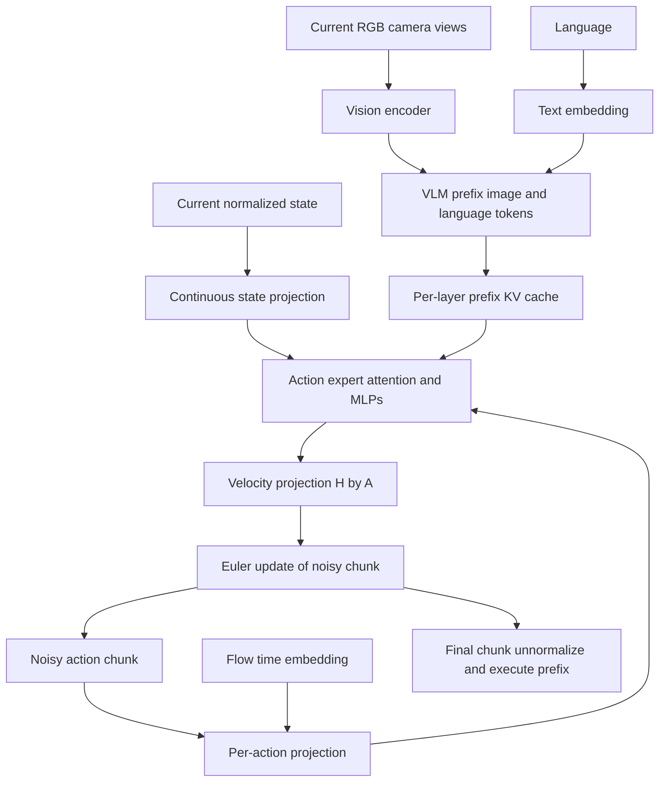

# S2.5 — π0 Architecture Trace

## Why / Problem

π0怎样把预训练VLM与连续动作生成连接起来？state、带噪chunk和flow时间进入哪里？
为什么动作之间能双向注意，而图像语言前缀还能缓存？本任务约2小时，只研究原版π0路径。
不训练完整模型，不推进S2.6，也不把FAST动作tokens或π0.5条件机制混进来。

## Intuition

图像和语言先提供固定上下文；action expert同时查看整个带噪动作chunk，预测每个动作向量
在“生成过程”中的变化方向。小步沿这个向量场积分，逐渐形成连续chunk，再按机器人时间执行。
生成时间不是物理时间，动作token是连续序列槽，不是离散词表ID。

## Sources / Version Boundary

查阅2026-10-18：

- [π0论文v1](https://arxiv.org/html/2410.24164v1)，§IV、Appendix B/D：模型、flow及推理。
- [官方介绍](https://www.pi.website/blog/pi0)；research/pi0路径不可访问，使用论文给出的blog地址跳转。
- openpi commit `215abfb217dbac7d5f1273282331b9b1866c0479`，git ls-remote HEAD核对：
  [pi0.py](https://github.com/Physical-Intelligence/openpi/blob/215abfb217dbac7d5f1273282331b9b1866c0479/src/openpi/models/pi0.py)、
  [pi0_config.py](https://github.com/Physical-Intelligence/openpi/blob/215abfb217dbac7d5f1273282331b9b1866c0479/src/openpi/models/pi0_config.py)、
  [gemma.py](https://github.com/Physical-Intelligence/openpi/blob/215abfb217dbac7d5f1273282331b9b1866c0479/src/openpi/models/gemma.py)。
- [source manifest](s2_5_pi0_sources.json)：源码hash与精确分支。只读取小源码，保存ignored tmp/s2_5_source。

选择 **JAX Pi0 + Pi0Config(pi05=False)**。同一文件包含pi05分支，本任务不走该分支。
所读HEAD是实现证据，不等于论文实验checkpoint；未安装/执行JAX/Flax/Torch、未下载模型或dataset。

## Core Concepts

| 概念 | 本任务含义 | 不能混淆 |
|---|---|---|
| VLM prefix | image与language的embedding上下文 | 不是将图像先描述为文字 |
| action expert | 单独参数处理state/action，通过attention读prefix | 不只是接在VLM末端的小MLP |
| state token | 原版连续state线性投影到expert宽度 | 不同于π0-FAST的数字字符串prefix |
| action token | chunk每个动作时刻一个连续embedding槽 | 不等于每action维一个离散token |
| flow time t | 人工生成路径上的无单位时间 | robot tick、H、E、dt或频率 |
| num_steps K | 数值积分调用次数 | 执行K个robot动作 |
| prefix cache | 当前decision上下文的每层K/V | 跨新观测永久复用，或缓存全部action后缀 |

[论文](https://arxiv.org/html/2410.24164v1)将预训练PaliGemma与随机初始化action expert结合；
其贡献包含架构、机器人数据和训练配方。本地只有信息路径与数学实验，不推导已获得其语义或操控能力。

## Architecture / Data Flow



原版image/language走较宽VLM参数，state/action走较窄expert参数。
gemma.py为不同token组分别做Q/K/V和output/MLP投影，再在共同attention维度拼接K/V计算；
不是将2048维prefix和1024维suffix直接concat为同一矩阵，也不是随机路由选expert。
π0.5的state文本输入/时间adaRMS不属于这里的pi05=False路径。

### Code → tensor trace（静态推导）

B=batch，C=camera数，L=文本槽数，P=全部图像+文本槽数，H=chunk长度，A_pad=配置动作维。

| 模块 / tensor | 所选默认config shape / dtype | semantic |
|---|---|---|
| image inputs | 每相机(B,224,224,3) float32接口 | 当前图像，多camera不是时间历史 |
| image/text prefix | (B,P,2048)，P≈C·256+L | SigLIP/14投影至PaliGemma宽度；mask处理缺失camera/text padding |
| state | (B,32) float32接口 | padding后的状态，由具体机器人adapter确定字段/单位 |
| state projection | (B,1,1024) floating | expert侧单state槽 |
| noisy actions | (B,50,32) floating | H50条连续动作，每条32个padding后字段 |
| action projection | (B,50,1024) floating | 一步动作向量对应一个槽 |
| flow t embedding | (B,1024)→重复50次 | sin/cos无单位，和action投影拼成2048维再经MLP回1024 |
| full suffix | (B,51,1024) floating | 1state+50action；不是51维动作 |
| action output | (B,50,32) floating | suffix最后H槽线性投影成速度场 |

默认gemma_2b宽2048、gemma_300m宽1024，均18层，共享attention配置8query heads、1KV head、head_dim256。
这是固定源码的形状定义，未在本机构造大模型。config声明bf16但输入/加载/实际运算dtype仍需具体执行核对。
论文数据最大动作/state维为18，所选开源config padding到32；不能把32叫做每台机器人实际32DoF。
论文和所选config均H50；论文层面的规模描述也不等于本地tiny模型。

### Attention与cache

make_attn_mask用ar_mask的累计组号比较，key组号≤query组号且二者有效才允许访问。
pi05=False的组号：image+language=0，state=1，所有action=2。
因此prefix内部双向；state读prefix和自身；action读prefix/state/全部action。
**state不读action，prefix不读state/action。** 后面的动作槽读前/后动作槽不构成label泄漏：输入是同一生成时间的带噪变量，监督目标是velocity。

sample_actions先运行prefix填KV；每个Euler步重建suffix，复用prefix KV。
缓存只对同一decision的固定prefix有效；新图像/语言/掩码变化要重算。
state虽然在采样期间固定，但所选实现把它放suffix每步重新计算，不能声称它已在prefix cache里。

## Mathematics — 明确时间约定

本实验严格采用所选代码的 **t=1为noise、t=0为action**：

x_t=t·epsilon+(1−t)·a，u_t=epsilon−a，训练比较||v_theta(x_t,o,t)−u_t||²。
代码采样t~Beta(1.5,1)·.999+.001；一次训练样本随机取t，不是先运行K步再计算监督。
推理x_1~N(0,I)，Δt_flow=−1/K，x_next=x+Δt_flow·v_theta。
若已知a与epsilon，则常量oracle u=epsilon−a积分到0可恢复a，但部署时没有a。

论文将τ定义为noise0→data1，必须同时转换τ=1−t以及velocity符号。
特别是所读v1 §IV印出的插值、velocity符号和正向Euler之间存在表面不一致；本包不拼接它们，
采用可直接核对的代码compute_loss/sample_actions配套约定。
同一物理路径在τ表示下应写x_τ=(1−τ)epsilon+τa、dx/dτ=a−epsilon，正步长积分。
不要仅记“velocity=noise−action”而忘记时间方向。

### 与既有Diffusion知识的关系

| 接口 | DDPM常见表述（如S2.2所读head） | 所选π0 flow实现 |
|---|---|---|
| training variable | 按noise schedule混合action与epsilon | 线性路径t·epsilon+(1−t)action |
| target | 该参数化下常为epsilon | 速度epsilon−action |
| inference | schedule对应的反向更新，可含随机项 | 从noise出发，Euler ODE速度积分 |
| shared idea | 条件连续chunk分布学习 | 条件连续chunk分布学习 |

不同参数化可有关联，不能说flow只是DDPM把loss名字改一下。两者都需真实训练、heldout评价与闭环控制。
P3既有Diffusion经验在此作为概念联系；本任务没有运行、复制或import旧仓库实现。

## Input / Output Contract — local CPU probes

[script](../../scripts/s2_5_pi0_flow_trace.py)分为独立attention/cache与flow数学两组。
它们不连成learned策略，无自然语言/视觉encoder、无训练或模型权重。

| local tensor | shape / dtype | modality / unit / frame / time |
|---|---|---|
| synthetic prefix | (3,6) float64 | 无单位；mock image2+text1，seed19，不是真实模态表示 |
| synthetic suffix | (4,4) float64 | state1+action3，随机代理；不是实际state/action编码 |
| common Q/K/V | 每组token数×3 float64 | 两expert独立随机投影，seed23；两层attention残差 |
| mask | (7,7) bool | row=query、col=key，34条允许边 |
| raw clean action fixture | (3,2) float64 | world XY displacement[m]，H3/A2，robot dt=.1s |
| normalized clean/noise/velocity | (3,2) float64 | 固定raw/.06m，noise seed29；均无单位 |
| flow traces | (K+1,3,2) float64 | 同一chunk在生成时间的迭代，不是机器人rollout |
| flow times | (K+1,) float64 | 1→0，非秒 |

raw保存不覆盖；.06m为声明的教学尺度，没有fit统计或公开data。
raw fixture没有状态轨迹/episode/成功标签；不导出embodied_episode。

## Math / Architecture → Code

full将不同宽度的prefix/suffix投影到共同attention空间；cache_prefix保存每层K/V，
cached_suffix重用它们；两层验证prefix不受suffix扰动，state不受action扰动，state可影响action。
没有完整LayerNorm/位置编码/MLP或预训练，attention输出也不拿去生成下面的速度。

三种手写速度场隔离不同误差来源：

- straight oracle：u=noise−clean，依赖特权目标，K10/K20均恢复clean，仅检验符号/积分。
- biased oracle：u+.1，最终为clean−.1，增加K不消除此固定场偏差；不是训练得到的模型误差。
- analytic curved test：v(x,t)=x−mu，mu=clean，精确终点mu+(noise−mu)e^(−1)。
  终点**不等于clean**，评价的是Euler数值解与该ODE解析解的差，不能解释为action预测误差。

## Minimal Experiment

已有NumPy，CPU，无安装、数据集或模型下载；输出目录必须不存在。

```bash
.venv/bin/python scripts/s2_5_pi0_flow_trace.py --output tmp/my_s2_5
.venv/bin/python scripts/s2_5_pi0_flow_trace.py --steps 20 --output tmp/my_s2_5_k20
```

Run：检查report/trace.npz，按prefix3/state1/action3画mask；核对noise→action的符号。
Modify：先预测K10→20对raw、prefix/suffix、H/A、robot dt、mask/cache、flow步长/trace长度及三种场误差的影响。

## Expected Result

mask34边、full/cache相同；prefix/state隔离检查通过。
K变化不改随机输入/raw/clean/noise/H3/A2/robot dt.1s；flow step−.1→−.05、trace11→21帧。
straight oracle误差仅浮点量级；biased误差约.1不消失；curved Euler误差减小，但不承诺任意learned模型随K改善。
三个坏输入（非正steps、错shape velocity、NaN velocity）拒绝；NPZ逐数组重载一致。

## Actual Result

2026-10-18 repo .venv Python3.14.7 / NumPy2.5.4，实际模块
.venv/lib/python3.14/site-packages/numpy/__init__.py；执行前已核对，无安装。
输出tmp/s2_5_verified、tmp/s2_5_k20_verified，以上checks和3拒绝/重载通过。

| metric（无单位） | K10 | K20 |
|---|---:|---:|
| cache max difference | 0 | 0 |
| straight oracle normalized RMSE | 5.78e−17 | 8.92e−17 |
| biased oracle normalized RMSE | .1 | .1 |
| curved Euler vs analytic endpoint RMSE | .00927026 | .00453520 |

无learned velocity、heldout训练评价或robot控制，本包没有policy success/loss/latency可报告。
本地数值恢复也不能当作π0模型复现。

## Explanation / Result

不同宽度专家能共享attention而不直接拼embedding；prefix单向信息边界允许cache，state仍在suffix。
oracle说明方向配套正确，analytic test说明更细积分可减少数值误差；偏置场说明更多步不等于模型更准确。
这些都不能证明pretraining迁移、语言grounding、接触控制或真实机器人泛化。

## Failure Analysis / Limitations

| failure | consequence / boundary |
|---|---|
| 混用论文/代码时间方向 | 加noise而不是去noise；需要插值/target/步长一起核对 |
| action当离散ID | 丢失连续chunk模型语义；本地不使用codec词表 |
| 混入π0.5分支 | 改了state/time条件架构；只读pi05=False |
| prefix读suffix | cache失效，可能污染条件；两层反事实检查信息隔离 |
| 直接concat不同宽度 | shape不成立；分别投影到共同Q/K/V维度 |
| 缓存跨观测复用 | 使用stale image/language；本任务cache等价只限固定prefix |
| K越大必成功 | 数值误差/场误差/执行误差不同；偏置反例保留 |
| padded actions当真实命令 | A_pad不等于实际robot维；需adapter/controller契约 |
| 流时间当秒 | K与robot dt/H/E不同；无真实执行或实时性证据 |

## Relation to Robotics

一次decision生成H步chunk；执行E≤H条命令后用新观测再生成，H/E与ODE的K是独立选择。
外部论文的控制频率/硬件不代表本机CPU；完整闭环还应测success、失败stage与端到端latency。
不修改S1.5模型或旧仓库，既有VLA控制失败结论不变。

## Interview Capsule

30秒：π0在预训练VLM旁加入连续state/action expert，用条件flow生成整个chunk。
image/text prefix双向，action tokens互相注意并读state；固定prefix可缓存，带噪suffix多步积分。

2分钟：补充2048/1024的独立投影与共同attention、paper/code时间方向转换，
以及K/H/E/robot dt不同轴。用oracle/偏置/解析ODE区分数学正确、数值精度和真实策略能力。

## Likely Follow-up Questions

1. 画出原版π0 image/text/state/noisy action/time路径；与π0-FAST及pi05分支哪里不同？
2. VLM2048/expert1024怎样共享attention？H50/A_pad32/state1分别代表什么？本地7槽可读关系是什么？
3. 按代码定义写x_t、target velocity、Euler步长与起终点；若换论文τ=1−t应怎样改符号？
4. 为什么prefix可以cache、state却未放入该cache？更换图像或语言后能否继续用旧cache？full/cache相等证明什么？
5. K10→20哪些不变、哪些改变？三种手写场的结果如何解释，为什么不能推出learned robot success或实时性？

## Must Remember

state在原版suffix；连续槽不是离散token；共同attention不要求相同embedding宽度；时间方向要配套；K≠H≠E。

## My Verification

- [ ] Run：读report/trace，画mask和noise→action路径。
- [ ] Modify：先预测K变化，再运行比较不变量及三个场的误差。
- [ ] Explain：回答五问，区分原版/固定代码/本地代理与控制证据。

Engineering Complete；Learning未确认。Current Task=S2.5；Next Task=S2.6，仅计划。STOP。
