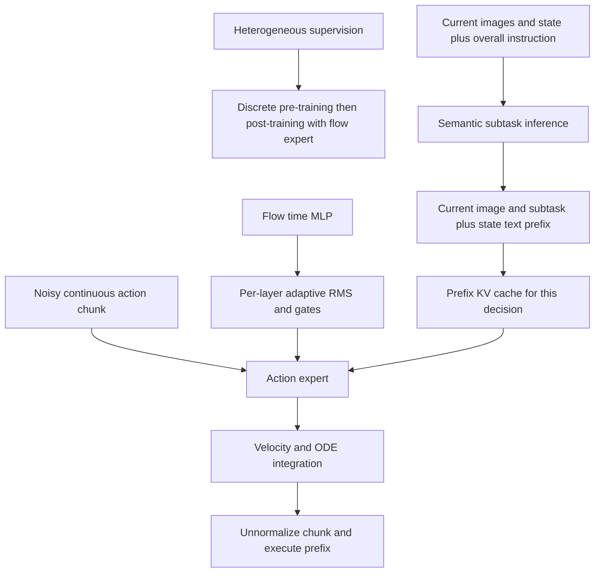

# S2.6 — π0.5 Study

## Why / Problem

为什么π0已有连续动作生成，还需要π0.5？这一步约1小时，连接S2.4的FAST与S2.5的flow：
学习训练数据、语义子任务与动作生成怎样配合，区分论文完整系统、开源条件分支与本地数学证据。

## Intuition

“整理厨房”需要先决定当前该做什么，再输出能执行的动作。语义知识和机器人运动经验来自不同监督源；
训练配方将它们连接起来。离散动作方便沿用next-token训练，连续expert用于最终chunk生成。
仅把config的pi05开关打开，不会自动获得数据、层级决策能力或新家庭泛化。

## Sources / Version Boundary

查阅2026-10-19，精确限定：

- [π0.5论文v1](https://arxiv.org/html/2504.16054v1)，§IV、V、Appendix A-B/A-C/A-E。
- [官方介绍](https://www.pi.website/blog/pi05)。论文的完整训练/部署系统是研究对象，演示不是本地实验。
- openpi固定沿用S2.5 commit `215abfb217dbac7d5f1273282331b9b1866c0479`，不声称当前HEAD：
  [pi0.py](https://github.com/Physical-Intelligence/openpi/blob/215abfb217dbac7d5f1273282331b9b1866c0479/src/openpi/models/pi0.py)、
  [config](https://github.com/Physical-Intelligence/openpi/blob/215abfb217dbac7d5f1273282331b9b1866c0479/src/openpi/models/pi0_config.py)、
  [tokenizer](https://github.com/Physical-Intelligence/openpi/blob/215abfb217dbac7d5f1273282331b9b1866c0479/src/openpi/models/tokenizer.py)、
  [gemma](https://github.com/Physical-Intelligence/openpi/blob/215abfb217dbac7d5f1273282331b9b1866c0479/src/openpi/models/gemma.py)。
- [源码hash manifest](s2_6_pi05_sources.json)。小源码保存在ignored tmp/s2_6_source；无模型/dataset下载。

选择JAX Pi0Config(pi05=True)静态读码，不初始化模型。
该pi0.py的compute_loss是flow loss；没有在这里实现论文的联合FAST CE、数据混合训练与自动子任务推理。
不能从这个分支推导论文完整系统已发布或已复现。

## Core Concepts

| 概念 | 需要掌握的区别 |
|---|---|
| co-training | 多监督源共同训练；web图文样本不因此拥有机器人动作标签 |
| pre-training / post-training | 广覆盖学习与任务侧适配；不是只改推理prompt |
| semantic subtask | 当前可执行的语言子目标；不是一串电机命令，也非世界模型预测 |
| discrete state | 归一化state→整数→文本→text tokenizer；整数bin不等于最终词表ID |
| hybrid action supervision | FAST离散表示与连续flow是同一动作的两种监督；需隔离真值路径 |
| adaRMS | 时间条件调节expert每层归一化与残差gate；不是将时间当机器人秒数 |

## Mathematics

论文层级分解为 p(a,s|o,l)=p(a|o,s)·p(s|o,l)，s是子任务文本。
这里低层条件是o与s；不能随意把总体指令l再次写回该论文分解的低层条件。
同一模型承担两级推理，不必是两个独立网络；高层刷新与低层生成不必同频。

训练可概括为 L=CE(text/FAST targets)+α·L_flow；pre-training α=0，post-training加入expert。
该式是论文配方摘要；本地不计算模型CE或训练，开源所选compute_loss也不能当完整联合目标。
flow数值沿用S2.5代码约定 x_t=tε+(1−t)a、u=ε−a、t:1→0、负Euler步长。
论文使用另一时间方向的记号，不能将其印刷公式与代码符号拼接。

所选state表达式：b(q)=digitize(q,linspace(−1,1,257)[:-1])−1。
输入是已归一化的值。bin宽2/256，无单位；本地固定1m尺度使宽度对应7.8125mm。
这是教学尺度，不是官方机器人的分辨率或train-fit normalizer。

RMS(x)=x/sqrt(mean(x²)+10⁻⁶)，adaptive输出=(1+scale(c))·RMS(x)+shift(c)，另返回gate(c)。
c来自sin/cos时间编码与两层swish MLP；每层将c线性映射成scale/shift/gate。
上游modulation kernel零初始化：初始输出不依赖c且gate为0。训练可改变参数。
本地非零seeded参数只展示可能的依赖，不是假装已经训练。

## Architecture / Data Flow



图的高层节点描述论文；下方state/time路径有固定源码支持，不能把整图都叫已运行openpi路径。

| 比较项 | S2.5原版π0分支 | S2.4 π0-FAST | 本次pi05开源分支 |
|---|---|---|---|
| state | 连续单槽，expert suffix | 离散state文本prefix | 离散state文本prefix |
| action输出 | 连续velocity | AR预测FAST IDs再decode | 连续velocity |
| flow time | 与action embedding拼接后MLP | FAST AR不使用该flow输入 | time MLP→每层adaRMS |
| suffix槽数 | 1+H | 压缩后可变token长度 | H，没有单独state槽 |
| 学习边界 | 原版实现追踪 | codec实验≠策略训练 | 条件变化≠完整论文训练配方 |

静态shape：默认H50/A_pad32，noisy actions(B,50,32)，expert槽(B,50,1024)，
time condition(B,1024)，输出(B,50,32)；prefix宽2048，文本上限默认由48变200。
state数字字符串经SentencePiece后的长度不是32的固定倍数；本地没有下载词表，未计算真实text IDs。
config接口state(B,32) float32仍存在，pi05的embed_suffix不再投影它；必须由transform先将state送入文本。
不同机器人原始字段、单位与frame仍由adapter声明，padding32不是实际DoF。
浮点运算dtype取决于加载和执行；未运行大模型，不能把配置bf16当成本地实测。

## Data / Generalization Evidence

论文§IV的监督类别：MM（移动操作）、ME（多环境固定机器人）、CE（实验室跨形态）、
HL（语义子任务）、WD（web多模态），post-training另使用VI（人类口述指引），并移除CE。
类别不是可直接拼接的同构动作数组；跨形态必须保留各自controller/frame/time契约。

论文§V以未见家庭/场景、物体类别和训练配方消融研究泛化，§A-B使用任务进度rubric；
§A-C区分选对目标的language-following与实际完成放置的success。
因此不能将进度分数统一称为二元成功率，也不能从展示视频推出任意家庭安全可靠。
本地无这些数据、训练和部署证据；toy bin/mask检查不验证论文泛化因果机制。

## Input / Output Contract — Local CPU Probe

[脚本](../../scripts/s2_6_pi05_conditions.py)，只用已有NumPy，无训练、视觉encoder、语言理解或闭环。

| tensor | shape / dtype | 单位、frame、时间 |
|---|---|---|
| raw / changed state | (2,) float64 | 当前world XY位置[m]；x方向扰动；raw单独保存 |
| normalized state / bins | (2,) float64 / int64 | raw/固定1m；bins无单位，不是text IDs |
| synthetic inputs | (8,4) float64 | prefix3、shifted discrete2、continuous3；无模态语义/单位 |
| mask | (8,8) bool | row=query，col=key；prefix双向、discrete因果、continuous双向 |
| condition / weights | (4,) / (4,12) float64 | 人工0/1条件与seed41随机线性参数；不是完整time MLP |
| norm outputs | (3,4) float64 | 仅展示adaptive norm；没有attention/MLP residual训练 |

## Implementation

mask是论文hybrid分支的教学实例：prefix不能读两种action，discrete不能读continuous，
continuous不能读discrete真值。两层mean-attention残差传播检查信息是否绕行泄漏。
离散槽表示shift后的AR输入，因果对角线不意味着同位置标签可喂入自身；本地不训练next-token。
开放continuous→discrete读边是显式错误对照，含特权标签，不能用于部署。

state probe直接复写上游digitize表达式；小于−1得到−1，大于1得到255，没有双边显式clip。
这是源码边界观测，不是推荐数据预处理。拒绝NaN/Inf/非向量是本地新增防护，不冒称上游validator。

## Experiment / Expected Result

先阅读到这里，再运行默认实验。Modify前先预测delta从.001→.02m：
raw基准、mask、adaRMS两组结果是否变化？改变的state bin应是多少？

```bash
.venv/bin/python scripts/s2_6_pi05_conditions.py --output tmp/my_s2_6
.venv/bin/python scripts/s2_6_pi05_conditions.py --delta .02 --output tmp/my_s2_6_delta20
```

output必须不存在。查看report.json和trace.npz；预期bin128→128/130，y分量仍128。
正确mask36边，两层隔离差0，错误mask产生非零泄漏；零初始化无条件差，非零modulation有差。

## Actual Result

2026-10-19 repo .venv Python3.12.3 / NumPy2.5.4，actual NumPy
`.venv/lib/python3.12/site-packages/numpy/__init__.py`；执行前确认解释器/prefix/module，无安装。

| metric | delta .001m | delta .02m |
|---|---:|---:|
| changed bins | [128,128] | [130,128] |
| mask edges | 36 | 36 |
| isolated max difference | 0 | 0 |
| wrong-mask leak difference | 67.5 | 67.5 |
| nonzero modulation max difference | .26353505 | .26353505 |
| zero-init condition difference | 0 | 0 |

两run各3类坏state拒绝，NPZ逐数组重载相同。
边界[-1.01,−1,0,1,1.01]→[−1,0,128,255,255]。
本地没有learned model，无policy loss、heldout机器人success、failure stage或latency可报告。

## Explanation / Result

离散state会隐藏bin内小变化，信息路径改变也会改变prefix缓存依赖：现在state变了也应重算prefix。
训练用的FAST标签不可成为continuous expert的捷径。adaRMS有时间依赖的能力，但初始化可暂不显现。
这些结果验证教学路径，无法比较真实π0与π0.5性能优劣。

## Failure Analysis / Limitations

| 错误 | 后果 / 检查边界 |
|---|---|
| pi05=True等于获得论文系统 | 缺数据配方、联合目标和高层推理证据 |
| discrete state等于discrete actions | 条件表示与输出分布是两条轴 |
| FAST真值可被flow读到 | teacher-forcing捷径，训练部署不一致 |
| state变化仍用旧prefix cache | state已在文本prefix，缓存条件过时 |
| zero-init无差就断言时间无效 | 忽略modulation训练和gate机制 |
| bin内不变等于机器人精度足够 | 只测表达式，没有动力学/噪声/接触实验 |
| rubric分数等于整任务success | 混淆阶段进度、选物与最终完成 |

## Relation to Robotics

高层选错子任务、低层动作失败、控制器跟踪失败应分阶段报告；低层offline loss不足以衡量整体系统。
K是flow积分次数，H是chunk长度，E是执行前缀，高层刷新频率又是一条时间轴。
本任务不修复S1.5控制失败，不修改旧仓库，不进入S2.7。

## Interview Capsule / Notes

30秒：π0.5将异构监督、语义子任务与连续动作生成结合。先用离散next-token配方，
再加入flow expert；state走文本prefix，flow时间通过adaRMS进入expert每层。

2分钟：画两级条件分解与hybrid隔离mask，区分论文完整系统和开源pi05分支。
补充train/inference差异、state变化对cache的影响，以及未见场景评价与本地probe的证据边界。

## Likely Follow-up Questions

1. π0、π0-FAST、π0.5在state/action/time路径上有什么区别？为什么pi05开关不等于完整复现？
2. 写出层级条件分解、解释两级共享模型与刷新频率；FAST在哪个训练阶段，最终动作如何生成？
3. 为什么continuous expert不能读取FAST真值？只禁止直接边但允许prefix读标签会怎样？
4. 预测并解释1mm→20mm的bin变化；为什么bin不是text ID，state变化为何影响prefix cache？
5. adaRMS零初始化与非零参数的结果如何解释？论文进度分、选物率、success与本地probe证明什么？

## Must Remember

训练配方≠config；state tokens≠action tokens；FAST标签隔离；state也是cache条件；外部泛化≠本地证据。

## My Verification

- [x] Run：运行默认实验，查看mask、bin与modulation结果。
- [x] Modify：先预测delta变化，再运行第二条验证不变量与bin。
- [x] Explain：用自己的话回答上面五问。

2026-10-19 用户明确确认实验与预测完成，并准确回答五项Explain；Learning Mastered。
解释覆盖三种模型state/action/time路径、层级分解与训练阶段、直接和间接标签泄漏、
bin与text ID区别及state缓存依赖、adaRMS初始化和外部/本地证据边界。

Engineering Complete + Learning Mastered。Current Task=S2.6；Next Task=S2.7，仅计划。STOP。
