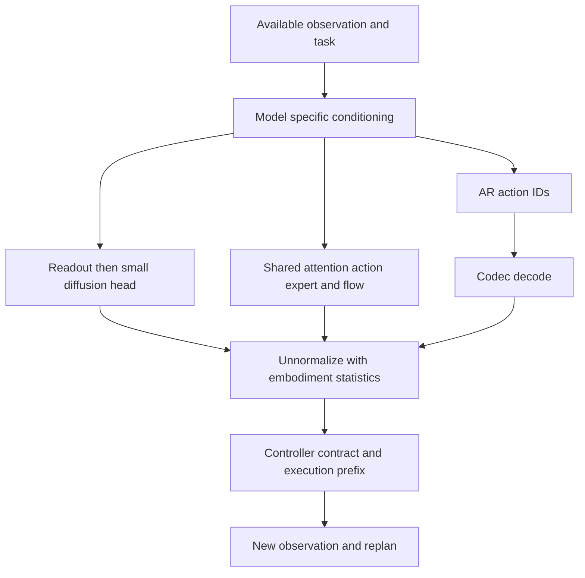

# S2.7 — VLA Architecture Comparison

## Why / Problem

给定机器人、传感器、数据与算力预算，怎样解释不同VLA的设计取舍？
本任务约1.5小时，汇总Stage2，不再新增大型模型实现。比较输入、融合、动作分布、
训练与部署路径；不凭名称或论文不同benchmark的成功率做总排名。

## Intuition

先确定“模型看到了什么”，再确定“输出怎样成为命令”，最后确定“用了什么监督、算几次、怎么评价”。
动作最终都是可执行数值，但数值由离散ID解码、diffusion去噪还是flow积分产生，决定了不同的信息与计算路径。
适配shape、学会动作语义、满足实时预算、闭环成功是四项不同要求。

## Sources / Precise Version Boundary

查阅2026-10-19。模型与commit沿用已学习版本，不更新到新变体：

| key | 版本 / 来源 | 精确读码记录 |
|---|---|---|
| O | 原版Octo；[paper v1](https://arxiv.org/html/2405.12213v1)、[官方项目](https://octo-models.github.io/) | [S2.2](s2_2_octo_study.md)，commit `241fb3514b7c40957a86d869fecb7c7fc353f540`；选MLP DiffusionActionHead |
| V | 原版OpenVLA-7B；[paper v1](https://arxiv.org/html/2406.09246v1)、[官方项目](https://openvla.github.io/) | [S2.3](s2_3_openvla_architecture_trace.md)，commit `c8f03f48af692657d3060c19588038c7220e9af9`；HF revision见该包manifest |
| F | FAST / π0-FAST；[paper v1](https://arxiv.org/html/2501.09747v1)、[官方介绍](https://www.pi.website/research/fast) | [S2.4](s2_4_fast_action_representation.md)，FAST processor与openpi固定revision见manifest |
| P | 原版π0；[paper v1](https://arxiv.org/html/2410.24164v1) | [S2.5](s2_5_pi0_architecture_trace.md)，openpi `215abfb217dbac7d5f1273282331b9b1866c0479`，pi05=False |
| Q | π0.5；[paper v1](https://arxiv.org/html/2504.16054v1)、[官方介绍](https://www.pi.website/blog/pi05) | [S2.6](s2_6_pi05_study.md)，同openpi revision，pi05=True条件分支与完整论文系统分开 |

本轮重新浏览官方项目/论文；精确源码细节沿用上述固定版本审计，不宣称重新下载或执行全部源码。
GitHub tree页面本轮浏览失败；以已有包内精确文件链接/manifest为固定代码证据，不猜测新HEAD。
不混入OpenVLA-OFT、Octo UNet head、更新的π系列；RT-1/RT-2仅在[S2.1](s2_1_rt_overview.md)作为历史参照。

## Core Concepts

| 比较轴 | 提问方式 | 需要避免的混淆 |
|---|---|---|
| modality | 哪些观测真正进入所选checkpoint？ | controller读取state≠VLA输入state |
| fusion | token、feature还是expert层面连接？ | 多encoder≠多camera；多个camera≠时间历史 |
| representation | 离散ID / 连续带噪chunk？ | 连续动作解码结果≠连续生成模型 |
| distribution | AR条件分解 / diffusion / flow？ | AR也是generative；generative不是AR的反义词 |
| temporal axes | W、H、E、K、N分别是什么？ | 字段数A、token数N与物理步数H不同 |
| evidence | 来源实验、代码静态路径、本地运行？ | 各自能证明的事情不同 |

## Architecture / Modality and Fusion Matrix

以下各列分别由来源O/V/F/P/Q及对应学习包支持。

| 轴 | Octo（O） | OpenVLA原版（V） | π0-FAST（F） | π0（P） | π0.5（Q） |
|---|---|---|---|---|---|
| vision | primary/wrist等配置模态，支持history | 当前单图，DINOv2+SigLIP | 图像经VLM视觉路径 | 多视角当前图像VLM prefix | 图像VLM prefix |
| task | language或goal image | language instruction | language instruction | language instruction | 论文总体任务→语义子任务→低层条件 |
| state | 所选pretrain config无proprio；可适配加入 | 原版无直接proprio输入 | 离散state文本 | 连续state单槽suffix | 离散state文本prefix |
| fusion | 模态tokenizers→分组Transformer→readout | 同patch拼feature→projector→BOS后插patches | image/text/state prefix→AR VLM | VLM/expert独立参数、共同attention | 同类共同attention；time逐层adaRMS |
| action | 小MLP diffusion head输出连续chunk | 各字段离散bins ID→数值 | DCT/量化/BPE IDs→chunk | expert velocity→ODE chunk | 最终expert velocity→ODE chunk |
| serial dependency | head迭代去噪 | 同一动作各字段AR | 压缩chunk tokens AR | 对整个chunk做K次flow迭代 | 子任务文本AR + flow；刷新频率可不同 |
| selected shape | W2/H4/A7 | W1/H1/通常A7 | (H,A)→可变N tokens；不固定压缩率 | H50/A_pad32 | 开源H50/A_pad32 |
| cache / reuse | backbone摘要在head去噪内复用 | 同decision AR KV复用 | 同decision AR KV复用 | fixed image/text prefix KV；state仍在suffix | prefix包含state，state更新也影响cache |

FAST本身只是codec，没有图像/语言感知或策略；表中策略列是π0-FAST。
Q列层级描述属于论文完整系统；所读pi0.py分支只有flow路径，不自动实现完整子任务系统。
论文与源码精确配置可能不同；如π0.5论文inclusive区间写H=49对应50条动作，本包H统一指条数50。



此图概括数据流；不表示三条路径已在本地实现为可切换策略。

## Training / Data / Adaptation Matrix

| 轴 | Octo（O） | OpenVLA（V） | π0-FAST（F） | π0（P） | π0.5（Q） |
|---|---|---|---|---|---|
| 初始化 / data | robot多形态预训练，借用预训练语言组件 | Prismatic VLM初始化→OXE机器人训练 | 预训练VLM→FAST动作监督 | PaliGemma初始化→跨形态robot数据 | VLM初始化→异构预训练→post-training |
| objective | selected head noise prediction | action-token CE | FAST-token CE | flow velocity regression | 论文CE+flow；离散pretrain后加入expert |
| data boundary | OXE mixture；不是完整web VLM co-training策略 | VLM初始化≠RT-2式robot/web共同微调 | tokenizer语料与policy监督是两份职责 | robot pre/post-training，不等于π0.5完整配方 | MM/ME/CE/HL/WD，post加VI/移CE；见S2.6 |
| adaptation入口 | 更换/加入tokenizer和action head | 对齐image/prompt、codec/statistics/controller | chunk shape、normalizer、codec与训练目标 | state/action adapter、mask、normalization | 同左，另需离散state文本及任务prompt约定 |
| fine-tuning | 可保留backbone初始化；论文更新全模型 | 官方支持full与LoRA；只训末层不等于充分适配 | codec固定后还需policy监督训练 | 目标域post-training；不默认为只训expert | 发布分支finetune不能替代完整论文数据recipe |
| 部署主要约束 | backbone一次+小head多次；仍需实测 | 大VLM+字段AR；原版不是chunk并行head | N次AR，N依chunk/字典变化 | prefix一次+expert K次，K不是H | prefix依赖state；高层与低层开销分别计入 |

本任务不提供未经版本验证的fine-tune CLI，也不下载权重。
大模型初始化、全量/LoRA训练的optimizer/activation成本与部署量化成本不同；
参数少或token少只说明一部分成本，不能据此声称本机CPU实时可用。

## Mathematics — Compare Paths, not Names

AR：p(z|o,l)=∏ᵢp(zᵢ|o,l,z<ᵢ)，z可能是当前动作字段，也可能是FAST压缩chunk符号。
训练teacher forcing可并行计算token损失，部署自回归仍需串行生成。
连续chunk模型：学习p(a₀:H₋₁|o,l)，内部每次迭代同时更新整个chunk。
Diffusion噪声预测与flow velocity目标不可混用；各自的公式/时间约定见S2.2、S2.5。

粗略串行成本分解：

- T_AR ≈ T_prefix + N·T_token + T_io_decode。
- T_flow ≈ T_prefix + K·T_expert_step + T_io_decode。
- T_small_diffusion ≈ T_backbone + K_d·T_small_head_step + T_io_decode。

每项受shape、dtype、KV长度、硬件、实现影响，不是固定常数定律；相同K不能当相同成本。
π0.5完整系统还需按刷新计划计算高层文本推理、输入预处理、通信等开销。

H=生成动作条数；A=每条动作维数；E≤H=执行前缀；dt=命令间隔[s]；K=生成迭代数；N=输出ID数。
Δ_replan=E·dt是在稳态“执行旧prefix同时准备新chunk”假设下的预算窗口。
同步observe→infer→execute仍会等待推理；E增大不让推理本身变快，并延长开环执行/反馈间隔。
预算通过也不保证观测新鲜、控制准确、启动无等待或任务成功。

## Input / Output Contract — Local Budget Calculator

[script](../../scripts/s2_7_architecture_budget.py)使用Python标准库，不训练/运行模型，不读取robot data。

| 输入 / 输出 | type / shape | 单位与语义 |
|---|---|---|
| H4/A7/E1或4/K10或20/N8 | Python int scalars | 数量；H4标量AR是明确的假设chunk模型，不是原版OpenVLA |
| dt=.1 | Python float scalar | s/robot command，假设10Hz；无物理轨迹 |
| prefix40/token5/expert4/head.5/io5 | Python float scalars | ms；全部人为设定，非论文或本机测量 |
| per-path rows | 四条JSON records | 调用次数、假设ms、预算ms、margin及bool |
| report.json / budget.md | JSON / Markdown | 直接算术结果；无tensor、frame、state或动作单位变换 |

没有物理数据、normalizer、传感器时间戳、模型tensor、encoder或learned policy。
共同prefix40ms只是隔离串行路径的教学控制；真实模型prefix成本不会自然相同。
FAST N8是输入假设，没有调用S2.4 codec；小head固定20步，flow用可改K。

## Implementation

calculate显式列出四条路径，不是模型registry或后端框架。输入检查正整数、E≤H与正有限dt。
输出目录必须不存在；JSON重载核对相同。报告的pass只叫steady_state_budget_pass。
序列化结果包含所有cost假设与限制，避免把输出表脱离背景当benchmark传播。

## Experiment

先运行默认实验，再预测E1→4时H/A/N/K、串行次数、latency、预算与margin如何变化。

```bash
.venv/bin/python scripts/s2_7_architecture_budget.py --output tmp/my_s2_7
.venv/bin/python scripts/s2_7_architecture_budget.py --execute 4 --output tmp/my_s2_7_e4
```

可选诊断（仍属本任务）：先预测K10→20只影响哪个路径，再运行：

```bash
.venv/bin/python scripts/s2_7_architecture_budget.py --steps 20 --output tmp/my_s2_7_k20
```

## Expected Result

默认serial calls为28/8/10/20；假设latency为185/85/85/55ms。
E1预算100ms，E4预算400ms；E变化不改变推理调用数和假设latency，所有margin增加300ms。
K20时只有flow变125ms，E1预算下该路径从pass变fail；不推导生成质量变好或变差。

## Actual Result

2026-10-19，repo .venv Python3.12.3，执行前核对sys.executable、sys.prefix；
现有NumPy2.5.4与module路径也核对，本脚本不使用NumPy，无新增依赖。

| hypothetical path | calls K10 | assumed latency ms | E1 margin ms / pass | E4 margin ms / pass |
|---|---:|---:|---|---|
| scalar chunk AR | 28 | 185 | −85 / False | 215 / True |
| FAST chunk AR | 8 | 85 | 15 / True | 315 / True |
| flow expert | 10 | 85 | 15 / True | 315 / True |
| small diffusion head | 20 | 55 | 45 / True | 345 / True |

K20额外run仅flow变20次/125ms，E1 margin−25ms/False。
结果是确定性算术，没有测量噪声、模型输出质量或机器人成功率，不能按此给真实模型排名。

## Explanation / Result

减少N、减少K、缩小重复运行的模块、改变E分别影响不同的预算项。
更多去噪步骤也可能比少数大网络AR步骤便宜，取决于单步成本；不能只数forward次数。
增大E只扩大等待下一次决策的窗口；这是反馈/预算取舍，需要闭环验证。

## Failure Analysis / Limitations

| failure | consequence / boundary |
|---|---|
| 把原版OpenVLA写成H4 chunk | 混入未授权版本；本地scalar chunk AR明确是假设模型 |
| FAST+字典能decode就等于π0-FAST会控制 | codec重建不是policy生成 |
| Octo总读state或只训head | 忽略具体config与全模型fine-tune |
| 相同shape就跨机器人混数据 | frame、unit、controller、dt及reset-group仍必须审计 |
| N<K就必定更快 | 单步模块、KV和prefix成本不同 |
| E增加解决实时性 | 推理耗时未变，可能增加stale/open-loop风险 |
| 按各论文成功率排序 | 任务、分母、机器人、评估协议不匹配 |
| 本地算术当CPU benchmark | 所有ms是假设，未执行任何完整模型 |

## Relation to Robotics / Fair Evaluation

新机器人先写observation/action contract：相机布局、state字段、单位、frame、action anchor、controller、dt。
确认codec/normalizer只fit训练episode，目标域数据按episode/reset group隔离，再决定适配模块与训练参数。

真正比较至少匹配任务/初态/扰动/训练预算/执行频率，逐模型声明允许的输入与checkpoint。
区分expert-state离线误差、visited-state误差、闭环success全分母、failure stage；
测sensor→preprocess→prefix→decode/head→unnormalize→通信的端到端latency，报告硬件、dtype、
batch、H/E/K/N、warmup及p50/p95。缺少这些时只报告已有证据，不填猜测的真实测速数字。

在本仓库，S1.5/S1.7模型控制失败仍成立。Stage2产物是架构/codec/数学证据，
并未取得上述大型模型的泛化能力。本任务不实现S3.1，也不修改旧仓库。

## Interview Capsule / Notes

30秒：先按模态和融合比较，再按动作分布与部署循环比较。OpenVLA生成当前动作字段，
π0-FAST生成压缩chunk IDs，Octo在readout后跑小diffusion head，π0 family用共享attention的flow expert。
π0.5还涉及异构监督与语义层级；不能只用pi05开关概括。

2分钟：补充state条件位置、H/A/E/K/N区别、训练与解码成本、数据/接口适配和匹配协议的闭环评价。
用本地E1→4反例解释“预算变宽”并不等于“模型变快”。

## Likely Follow-up Questions

1. 按modality/fusion/action路径比较五种策略；原版OpenVLA为何不是H7或H4 chunk？FAST与π0-FAST区别是什么？
2. 为什么AR和generative不是互斥分类？FAST训练可并行而部署仍串行，Octo与flow的重复计算模块哪里不同？
3. 换机器人时，改tokenizer/head或unnorm_key为什么还不够？数据契约、fine-tune与评价各需检查什么？
4. E1→4改变哪些预算量、保持哪些不变？K10→20又怎样？为什么不能据表声称哪个真实模型更快或更成功？
5. 怎样设计公平闭环比较？列出输入/任务/分母/latency条件，并区分来源论文、静态源码与本地probe三种证据。

## Must Remember

AR也是生成；codec不是policy；config不等于论文系统；H/A/E/K/N五轴分清；预算pass不等于robot success。

## My Verification

- [ ] Run：运行默认命令，逐项核对四条计算路径及成本假设。
- [ ] Modify：先预测E1→4，再运行并检查latency不变、预算与margin增加；K可选。
- [ ] Explain：用自己的话回答五问，给出匹配协议下的比较方式。

Engineering Complete；Learning待用户确认。Current Task=S2.7；Next Task=S3.1，仅计划。STOP。
